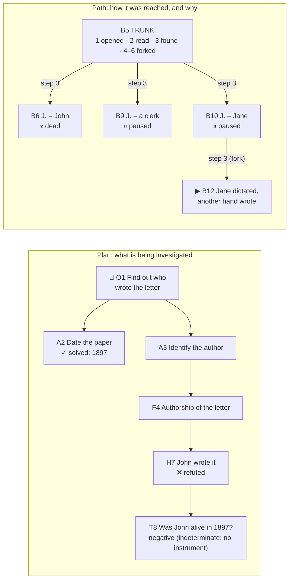
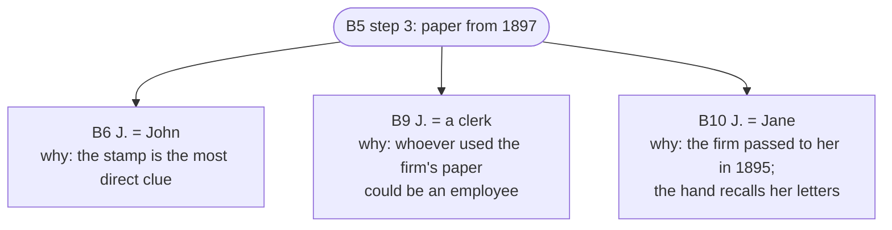
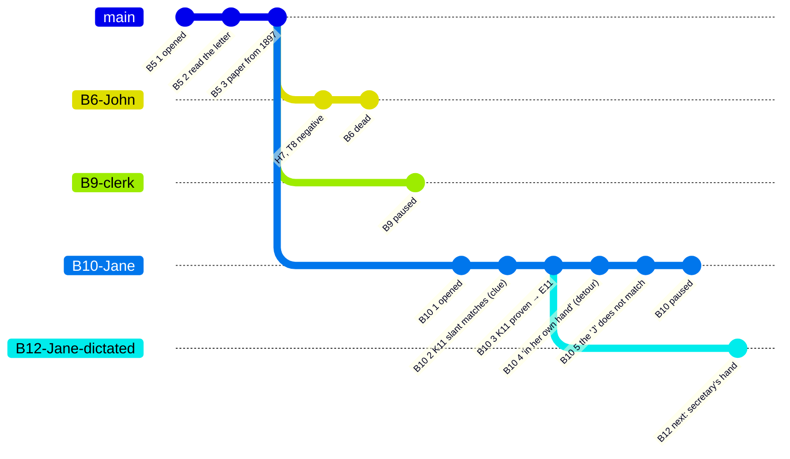

# A fictional case, from start to finish

[README](README.md) · [Data model](MODEL.md)

This document shows how holmes records a short investigation: the **plan** (what is wanted, what is tested) and
the **path** (how each thing was reached, and why). Every output below was produced by running the commands for
real; the script to reproduce it is at the end.

**The case:** an anonymous letter, signed only "J.", with a firm's stamp on the back. Who wrote it?

## The two trees

holmes keeps two trees in the same database, and they answer different questions.



- The **plan** (objective, targets, fronts, hypotheses, tests) says what is open, what is solved and what each test
  covers. It is what the `map` summarizes.
- The **path** (branches and steps) says where each line of reasoning came from, what was done in it and why the
  direction changed. It is what `tree`, `trail` and `sheet` show.

The two touch: hypothesis H7 and test T8 were created **inside** branch B6, so they show up as steps of it, and the
refutation of H7 was recorded there with its reason.

## The story, step by step

### 1. The case and what is already solved

```bash
holmes.py init letter "Find out who wrote the anonymous letter signed J."
holmes.py new target "Date the paper" --parent O1                 # A2
holmes.py new target "Identify the author" --parent O1            # A3
holmes.py state A2 solved "watermark compared with the maker's catalogue" \
    --solution "paper from 1897 (Whatman 1897 watermark)"
holmes.py new front "Authorship of the letter" --parent A3        # F4
```

### 2. The trunk: what is established

Before any hypothesis, a trunk branch records only what is fact, with the source of each thing. Every line of
investigation will be born from one of its steps.

```bash
holmes.py branch new "TRUNK: what is established about the letter" --from O1 \
    --why "Every twig needs the path that leads to it"                                           # B5
holmes.py step read "The letter: one sheet, signed only 'J.', a 'John & Co' stamp on the back, handwriting slanting left." \
    --why "Primary source: the letter itself (photographed and catalogued)"
holmes.py step found "Paper from 1897 by its watermark (A2)." \
    --why "Authenticated by the maker's catalogue: the earliest possible date of the text" --nodes A2
```

`branch new` makes the branch **active**. Every step without `--branch` goes to the active branch.

### 3. Three rival readings, as sibling branches

"J." admits three readings. They do not become a queue in which the newest corrects the previous one: each is a
branch born from the same point (step 3 of the trunk), inheriting everything established up to there.



### 4. The "John" line: a test that brings it down

```bash
holmes.py branch new "J. = John, owner of the firm on the stamp" --from B5 --step 3 \
    --why "The 'John & Co' stamp on the back is the most direct clue"                            # B6
holmes.py new hypothesis "John wrote the letter" --parent F4 --prob 0.5 \
    --refuted-if "John dead or away before 1897"                                                  # H7
holmes.py test H7 "Was John alive in 1897?" --scope "the town's civil register, 1890-1900" \
    --why "if alive, still possible; if dead before 1897, it falls" --prediction "alive"         # T8
holmes.py result T8 negative "John died in 1895, two years before the paper" \
    --meaning "the stamp belongs to the FIRM, which outlived John; not to the person" --n 1
holmes.py state H7 refuted "T8: John died in 1895"
holmes.py step thought "The stamp proves where the sheet passed through (the firm), not who wrote it." \
    --why "T8: the owner died before the paper existed"
holmes.py state B6 dead "T8: John died in 1895, before the 1897 paper"
```

`new`, `test`, `result` and `state` become steps of the active branch **by themselves**. Only reasoning without a
command (the `thought`) has to be written, and it requires `--why`. The branch dies here because the hypothesis'
**refutation criterion** was met (`--refuted-if`), not because a test gave zero.

> [!NOTE]
> The test here has no `--instrument` and no real control, so `result` warns and stamps the negative
> `⚠ INDETERMINATE (no instrument)`; the `map` keeps an alert about it. In this story the civil register is read by
> hand, so the warning is expected. It is not what kills H7: the refutation criterion is.

The dead line's trail stays whole, with the reason:

```
$ holmes.py trail B6
O1 [open] Find out who wrote the anonymous letter signed J.
  B5 [active] TRUNK: what is established about the letter
    1. opened: grows from O1: Find out who wrote the anonymous letter signed J.
       why: Every twig needs the path that leads to it
    2. read: The letter: one sheet, signed only 'J.', a 'John & Co' stamp on the back, handwriting slanting left.
       why: Primary source: the letter itself (photographed and catalogued)
    3. found: Paper from 1897 by its watermark (A2).
       why: Authenticated by the maker's catalogue: the earliest possible date of the text
    B6 [dead] J. = John, owner of the firm on the stamp
      1. opened: grows from B5 (step 3): TRUNK: what is established about the letter
         why: The 'John & Co' stamp on the back is the most direct clue
      2. recorded: H7 John wrote the letter
      3. recorded: T8 Was John alive in 1897?
         why: if alive, still possible; if dead before 1897, it falls
      4. tested: T8 X1 → negative: Was John alive in 1897?
         why: the stamp belongs to the FIRM, which outlived John; not to the person
      5. changed: H7 alive → refuted
         why: T8: John died in 1895
      6. thought: The stamp proves where the sheet passed through (the firm), not who wrote it.
         why: T8: the owner died before the paper existed
      7. changed: B6 active → dead
         why: T8: John died in 1895, before the 1897 paper
```

### 5. The "clerk" line: paused, not dead

```bash
holmes.py branch new "J. = a clerk at the firm" --from B5 --step 3 --no-use \
    --why "Rival reading: whoever used the firm's paper could be an employee"                    # B9
holmes.py state B9 paused "no list of employees; reopen if the attendance book turns up"
```

There is no way to test it now, and that is not a refutation. The branch pauses with what is missing written down,
and comes back into view whenever someone looks at the tree. `--no-use` opens the branch without making it active.

### 6. The "Jane" line: a clue proven into a fact without a source, a detour, and the way back

```bash
holmes.py branch new "J. = Jane, John's daughter" --from B5 --step 3 \
    --why "The firm passed to Jane in 1895; and the left-slanting hand recalls her letters"       # B10
holmes.py new clue "Blind comparison by a third party: the slant matches 3 letters signed by Jane." \
    --nature observation --why "Discriminating test written beforehand: same slant and same 'J'"  # K11 (a clue)
holmes.py prove K11 "a second examiner repeated the comparison blind and got the same result" \
    --by reproduction --proof "second examiner's report, 2 Nov"                                 # K11 → E11 (a fact)
holmes.py step thought "So Jane wrote the letter in her own hand." \
    --why "The slant is rare and matches in all 3 letters"
holmes.py step found "But the letter's 'J' has a loop Jane never makes in the 3 letters." \
    --why "Second half of the prediction: the 'J' should match, and it does not"
```

**A fact is a finding already proven; until then it is a clue.** The comparison enters as the clue K11: one
examiner's word is not yet proof. It becomes the fact E11 (same node, same links) when a second examiner reproduces
it blind; the output says so: `E11 proven by reproduction (it was clue K11; now it is a fact)`. The proof raises the
node's grade to A and is recorded as step 3 of the branch (`changed: K11 proven by reproduction: clue → fact`). There
is no document to quote here: the proof is the reproduction. `prove --by` takes four kinds of proof:

| `--by` | Proof |
|---|---|
| `source` | read in the primary source, with `--source S..` or `--location "<where>"` |
| `measurement` | a measurement anyone can rerun, with `--proof "<command>"` |
| `test` | a test with a valid positive result (instrument registered, control seen, not exploratory), `--proof T..` |
| `reproduction` | reproduced independently, with `--proof "<record>"` |

A fact that is already proven when it is found goes straight in with `new fact ... --by ..` (grade A by default).
Step 4 ("so she wrote it in her own hand") is an inference: it is never a fact, `new fact` refuses it, and it can
only be a clue, or a hypothesis if it is testable.

Step 4 was a leap: the slant does not prove "in her own hand". Step 5 shows the problem. The correction **does not
erase** step 4: you go back to the last step that still holds (step 3, the proof) and open another direction from
there, like a fork.



```bash
holmes.py branch new "Jane dictated; another hand wrote" --from B10 --step 3 \
    --why "Back to step 3: the slant holds and is proven; the detour was step 4 (concluding 'in her own hand'). The slant may come from the handwriting school Jane and her secretary both attended"   # B12
holmes.py state B10 paused "the 'J' does not match (step 5): 'in her own hand' has no basis; Jane as author continues in B12"
holmes.py step next "Compare the letter's 'J' with the handwriting of Jane's secretary." \
    --why "Separates 'Jane dictated' from 'a clerk': if the loop is the secretary's, the letter came from Jane's office"
```

The new branch's trail inherits **only** steps 1 to 3 from B10. Steps 2 and 3 still say `K11`: they record what the
item was when each step was written (a clue, then the clue being proven), and `show K11` or `show E11` both open the
node, now a fact. The detour (step 4) and the evidence that brought it down (step 5) stay in B10, visible, but
outside the path going forward:

```
$ holmes.py trail B12
O1 [open] Find out who wrote the anonymous letter signed J.
  B5 [active] TRUNK: what is established about the letter
    1. opened: grows from O1: Find out who wrote the anonymous letter signed J.
       why: Every twig needs the path that leads to it
    2. read: The letter: one sheet, signed only 'J.', a 'John & Co' stamp on the back, handwriting slanting left.
       why: Primary source: the letter itself (photographed and catalogued)
    3. found: Paper from 1897 by its watermark (A2).
       why: Authenticated by the maker's catalogue: the earliest possible date of the text
    B10 [paused] J. = Jane, John's daughter
      1. opened: grows from B5 (step 3): TRUNK: what is established about the letter
         why: The firm passed to Jane in 1895; and the left-slanting hand recalls her letters
      2. recorded: K11 Blind comparison by a third party: the slant matches 3 letters signed by Jane.
         why: Discriminating test written beforehand: same slant and same 'J'
      3. changed: K11 proven by reproduction: clue → fact
         why: a second examiner repeated the comparison blind and got the same result · proof: second examiner's report, 2 Nov
      B12 [active] Jane dictated; another hand wrote
        1. opened: grows from B10 (step 3): J. = Jane, John's daughter
           why: Back to step 3: the slant holds and is proven; the detour was step 4 (concluding 'in her own hand'). The slant may come from the handwriting school Jane and her secretary both attended
        2. next: Compare the letter's 'J' with the handwriting of Jane's secretary.
           why: Separates 'Jane dictated' from 'a clerk': if the loop is the secretary's, the letter came from Jane's office
```

## Resuming later: what a new session sees

### The whole tree

```
$ holmes.py tree
O1 [open] Find out who wrote the anonymous letter signed J.
  A2 [solved] Date the paper ✓ paper from 1897 (Whatman 1897 watermark)
  A3 [open] Identify the author
  B5 [active] TRUNK: what is established about the letter
      6 steps; last: forked: → B10 J. = Jane, John's daughter
    B6 [dead] J. = John, owner of the firm on the stamp  (from step 3)
        7 steps; last: changed: B6 active → dead
    B9 [paused] J. = a clerk at the firm  (from step 3)
        2 steps; last: changed: B9 active → paused
    B10 [paused] J. = Jane, John's daughter  (from step 3)
        7 steps; last: changed: B10 active → paused
      ▶ B12 [active] Jane dictated; another hand wrote  (from step 3)
          2 steps; last: next: Compare the letter's 'J' with the handwriting of Jane's secretary.
```

`(from step N)` says which step each branch was born from; `▶` marks the active branch. The trunk's `forked` steps
are automatic: whoever opens a branch leaves a record in the branch of origin that it was opened and why.

### The sheet: one page

```
$ holmes.py sheet
# SHEET — letter  (2026-11-21 22:10 UTC)
OBJECTIVE O1: Find out who wrote the anonymous letter signed J.

IMMEDIATE B12: Jane dictated; another hand wrote
  path: O1 Find out who wrote the anonymous letter  › B5 TRUNK: what is established about the let › B10 J. = Jane, John's daughter

LATEST STEPS (2 in the branch; `trail` gives them all):
  1. opened: grows from B10 (step 3): J. = Jane, John's daughter
     why: Back to step 3: the slant holds and is proven; the detour was step 4 (concluding 'in her own hand'). The slant may come from the handwriting school Jane and her secretary both attended
  2. next: Compare the letter's 'J' with the handwriting of Jane's secretary.
     why: Separates 'Jane dictated' from 'a clerk': if the loop is the secretary's, the letter came from Jane's office

NEXT EXPERIMENT: Compare the letter's 'J' with the handwriting of Jane's secretary. — because Separates 'Jane dictated' from 'a clerk': if the loop is the secretary's, the letter came from Jane's office

ALREADY EXPLORED HERE (do not redo without a new reason):
  B6 [dead] J. = John, owner of the firm on the stamp — T8: John died in 1895, before the 1897 paper

SOLVED (trunk):
  A2 Date the paper — paper from 1897 (Whatman 1897 watermark)

OTHER OPEN LINES (3):
  B5 [active] TRUNK: what is established about the letter
  B9 [paused] J. = a clerk at the firm
  B10 [paused] J. = Jane, John's daughter
```

The sheet's sections: the immediate goal and the path to it, the latest steps, the **next experiment**, what was
**already explored here** (do not redo without a new reason), what is **solved**, and the **other open lines**.

### The map at session start

Every session start injects the `map`. Right after the current reading comes the active branch with its last two
steps, so the agent knows where to continue without reading anything:

```
ACTIVE BRANCH B12: Jane dictated; another hand wrote  (2 active, 2 paused; `sheet`, `trail`, `tree`)
  1. opened: grows from B10 (step 3): J. = Jane, John's daughter
  2. next: Compare the letter's 'J' with the handwriting of Jane's secretary.
NEXT (`next`): revise the overall reading — 1 hypothesis or premise refuted (H7); 1 clue or fact proven (E11)
```

### Asking the database

Steps are searchable, so a question in ordinary words finds the lines where the subject came up, and each fact
shows how it was proven:

```
$ holmes.py search slant --no-corpus
E11 [fact:current observation/agent/A proven:reproduction] Blind comparison by a third party: the slant matches 3 letters signed by Jane.
B10 [branch:paused] J. = Jane, John's daughter
B12 [branch:active] Jane dictated; another hand wrote
```

A dead branch or a refuted hypothesis shows with `✗` in front, so nobody walks it again by accident.

## What the example illustrates

| Situation | What holmes does | Rule |
|---|---|---|
| A clue admits several readings | one sibling branch each, born from the same step | constitution 24 |
| A test meets the refutation criterion | hypothesis refuted, branch dead with the reason, trail kept | 7 and 26 |
| No way to test now | branch paused with what is missing, not discarded | 26 |
| A conclusion was a leap | fork from the last valid step; the detour stays visible in the branch of origin | 25 |
| A claim not yet proven | a clue (`new clue`); proven, it becomes a fact with the same id | 11 |
| A finding with no document behind it | a clue proven by reproduction (or measurement, or a test), not by a source | 11 |
| An inference | never a fact: a clue, or a hypothesis if testable | 11 |
| New session, no memory | `map` brings the active branch; `sheet` gives the rest on one page | 23 |
| "Have we tried this?" | `search` finds the line by its steps, with its state | 9 |

## Reproduce

In an empty folder, with this repository in `$HOLMES`:

```bash
export HOLMES_ROOT=$(mktemp -d)
h() { python3 -I "$HOLMES/holmes/holmes.py" "$@"; }
h init letter "Find out who wrote the anonymous letter signed J."
h new target "Date the paper" --parent O1
h new target "Identify the author" --parent O1
h state A2 solved "watermark compared with the maker's catalogue" --solution "paper from 1897 (Whatman 1897 watermark)"
h new front "Authorship of the letter" --parent A3
h branch new "TRUNK: what is established about the letter" --from O1 --why "Every twig needs the path that leads to it"
h step read "The letter: one sheet, signed only 'J.', a 'John & Co' stamp on the back, handwriting slanting left." --why "Primary source: the letter itself (photographed and catalogued)"
h step found "Paper from 1897 by its watermark (A2)." --why "Authenticated by the maker's catalogue: the earliest possible date of the text" --nodes A2
h branch new "J. = John, owner of the firm on the stamp" --from B5 --step 3 --why "The 'John & Co' stamp on the back is the most direct clue"
h new hypothesis "John wrote the letter" --parent F4 --prob 0.5 --refuted-if "John dead or away before 1897"
h test H7 "Was John alive in 1897?" --scope "the town's civil register, 1890-1900" --why "if alive, still possible; if dead before 1897, it falls" --prediction "alive"
h result T8 negative "John died in 1895, two years before the paper" --meaning "the stamp belongs to the FIRM, which outlived John; not to the person" --n 1
h state H7 refuted "T8: John died in 1895"
h step thought "The stamp proves where the sheet passed through (the firm), not who wrote it." --why "T8: the owner died before the paper existed"
h state B6 dead "T8: John died in 1895, before the 1897 paper"
h branch new "J. = a clerk at the firm" --from B5 --step 3 --no-use --why "Rival reading: whoever used the firm's paper could be an employee"
h state B9 paused "no list of employees; reopen if the attendance book turns up"
h branch new "J. = Jane, John's daughter" --from B5 --step 3 --why "The firm passed to Jane in 1895; and the left-slanting hand recalls her letters"
h new clue "Blind comparison by a third party: the slant matches 3 letters signed by Jane." --nature observation --why "Discriminating test written beforehand: same slant and same 'J'"
h prove K11 "a second examiner repeated the comparison blind and got the same result" --by reproduction --proof "second examiner's report, 2 Nov"
h step thought "So Jane wrote the letter in her own hand." --why "The slant is rare and matches in all 3 letters"
h step found "But the letter's 'J' has a loop Jane never makes in the 3 letters." --why "Second half of the prediction: the 'J' should match, and it does not"
h branch new "Jane dictated; another hand wrote" --from B10 --step 3 --why "Back to step 3: the slant holds and is proven; the detour was step 4 (concluding 'in her own hand'). The slant may come from the handwriting school Jane and her secretary both attended"
h state B10 paused "the 'J' does not match (step 5): 'in her own hand' has no basis; Jane as author continues in B12"
h step next "Compare the letter's 'J' with the handwriting of Jane's secretary." --why "Separates 'Jane dictated' from 'a clerk': if the loop is the secretary's, the letter came from Jane's office"
h trail B6; h tree; h trail B12; h sheet; h map; h search slant --no-corpus
```
