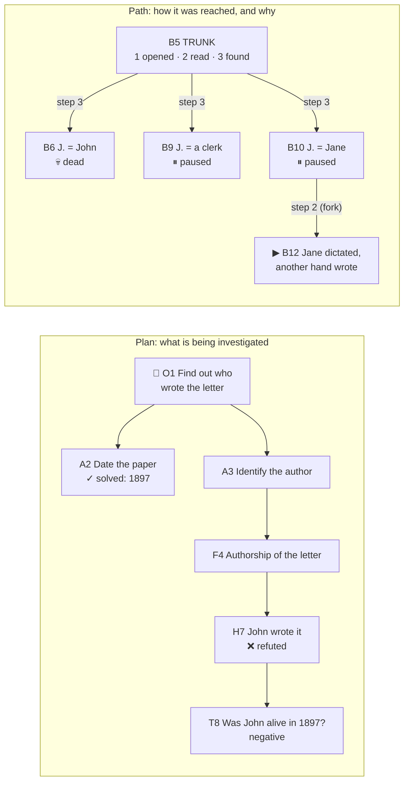
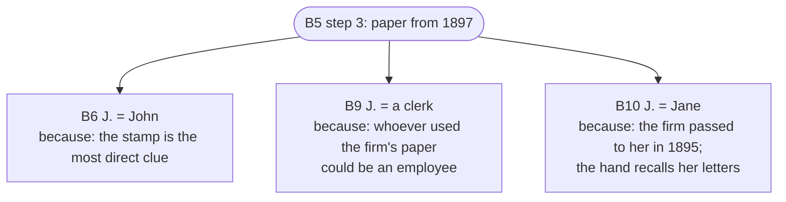
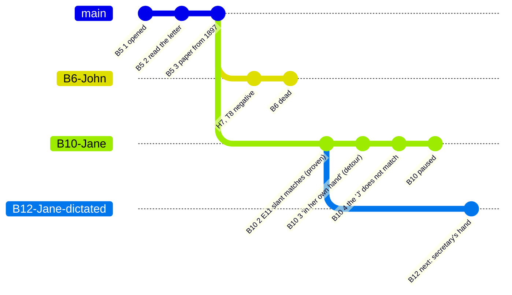

# A fictional case, from start to finish

[README](README.md) · [Data model](MODELO.md)

This document shows how holmes records a short investigation: the **plan** (what is wanted, what is tested) and
the **path** (how each thing was reached, and why). Every output below was produced by running the commands for
real; the script to reproduce it is at the end.

**The case:** an anonymous letter, signed only "J.", with a firm's stamp on the back. Who wrote it?

> [!NOTE]
> The CLI speaks Portuguese. The words it prints around your text mean: `abriu` opened · `nasce de` born from ·
> `porque` because · `leu` read · `achou` found · `pensou` thought · `registrou` recorded · `testou` tested ·
> `mudou` changed · `bifurcou` branched · `proximo` next · `passos` steps · `último` last · `do passo` from step ·
> states `ativo` active, `pausado` paused, `morto` dead, `resolvido` solved, `aberto` open.

## The two trees

holmes keeps two trees in the same database, and they answer different questions.



- The **plan** (objective, targets, fronts, hypotheses, tests) says what is open, what is solved and what each test
  covers. It is what the `mapa` summarizes.
- The **path** (branches and steps) says where each line of reasoning came from, what was done in it and why the
  direction changed. It is what `arvore`, `trilha` and `ficha` show.

The two touch: hypothesis H7 and test T8 were created **inside** branch B6, so they show up as steps of it, and the
refutation of H7 was recorded there with its reason.

## The story, step by step

### 1. The case and what is already solved

```bash
holmes.py init letter "Find out who wrote the anonymous letter signed J."
holmes.py novo alvo "Date the paper" --pai O1                     # A2
holmes.py novo alvo "Identify the author" --pai O1                # A3
holmes.py estado A2 resolvido "watermark compared with the maker's catalogue" \
    --solucao "paper from 1897 (Whatman 1897 watermark)"
holmes.py novo frente "Authorship of the letter" --pai A3         # F4
```

### 2. The trunk: what is established

Before any hypothesis, a trunk branch records only what is fact, with the source of each thing. Every line of
investigation will be born from one of its steps.

```bash
holmes.py ramo novo "TRUNK: what is established about the letter" --de O1 \
    --porque "Every twig needs the path that leads to it"                                        # B5
holmes.py passo leu "The letter: one sheet, signed only 'J.', a 'John & Co' stamp on the back, handwriting slanting left." \
    --porque "Primary source: the letter itself (photographed and catalogued)"
holmes.py passo achou "Paper from 1897 by its watermark (A2)." \
    --porque "Authenticated by the maker's catalogue: the earliest possible date of the text" --nos A2
```

`ramo novo` makes the branch **active**. Every step without `--ramo` goes to the active branch.

### 3. Three rival readings, as sibling branches

"J." admits three readings. They do not become a queue in which the newest corrects the previous one: each is a
branch born from the same point (step 3 of the trunk), inheriting everything established up to there.



### 4. The "John" line: a test that brings it down

```bash
holmes.py ramo novo "J. = John, owner of the firm on the stamp" --de B5 --passo 3 \
    --porque "The 'John & Co' stamp on the back is the most direct clue"                         # B6
holmes.py novo hipotese "John wrote the letter" --pai F4 --prob 0.5 \
    --refuta-se "John dead or away before 1897"                                                   # H7
holmes.py teste H7 "Was John alive in 1897?" --alcance "the town's civil register, 1890-1900" \
    --porque "if alive, still possible; if dead before 1897, it falls" --previsao "alive"         # T8
holmes.py resultado T8 negativo "John died in 1895, two years before the paper" \
    --sentido "the stamp belongs to the FIRM, which outlived John; not to the person" --n 1
holmes.py estado H7 refutada "T8: John died in 1895"
holmes.py passo pensou "The stamp proves where the sheet passed through (the firm), not who wrote it." \
    --porque "T8: the owner died before the paper existed"
holmes.py estado B6 morto "T8: John died in 1895, before the 1897 paper"
```

`novo`, `teste`, `resultado` and `estado` become steps of the active branch **by themselves**. Only reasoning
without a command (the `pensou`) has to be written, and it requires `--porque`. The branch dies here because the
hypothesis' **refutation criterion** was met (`--refuta-se`), not because a test gave zero.

The dead line's trail stays whole, with the reason:

```
$ holmes.py trilha B6
O1 [aberto] Find out who wrote the anonymous letter signed J.
  B5 [ativo] TRUNK: what is established about the letter
    1. abriu: nasce de O1: Find out who wrote the anonymous letter signed J.
       porque: Every twig needs the path that leads to it
    2. leu: The letter: one sheet, signed only 'J.', a 'John & Co' stamp on the back, handwriting slanting left.
       porque: Primary source: the letter itself (photographed and catalogued)
    3. achou: Paper from 1897 by its watermark (A2).
       porque: Authenticated by the maker's catalogue: the earliest possible date of the text
    B6 [morto] J. = John, owner of the firm on the stamp
      1. abriu: nasce de B5 (passo 3): TRUNK: what is established about the letter
         porque: The 'John & Co' stamp on the back is the most direct clue
      2. registrou: H7 John wrote the letter
      3. registrou: T8 Was John alive in 1897?
         porque: if alive, still possible; if dead before 1897, it falls
      4. testou: T8 X1 → negativo: Was John alive in 1897?
         porque: the stamp belongs to the FIRM, which outlived John; not to the person
      5. mudou: H7 viva → refutada
         porque: T8: John died in 1895
      6. pensou: The stamp proves where the sheet passed through (the firm), not who wrote it.
         porque: T8: the owner died before the paper existed
      7. mudou: B6 ativo → morto
         porque: T8: John died in 1895, before the 1897 paper
```

### 5. The "clerk" line: paused, not dead

```bash
holmes.py ramo novo "J. = a clerk at the firm" --de B5 --passo 3 --nao-usa \
    --porque "Rival reading: whoever used the firm's paper could be an employee"                 # B9
holmes.py estado B9 pausado "no list of employees; reopen if the attendance book turns up"
```

There is no way to test it now, and that is not a refutation. The branch pauses with what is missing written down,
and comes back into view whenever someone looks at the tree. `--nao-usa` opens the branch without making it active.

### 6. The "Jane" line: a fact proven without a source, a detour, and the way back

```bash
holmes.py ramo novo "J. = Jane, John's daughter" --de B5 --passo 3 \
    --porque "The firm passed to Jane in 1895; and the left-slanting hand recalls her letters"    # B10
holmes.py novo fato "Blind comparison by a third party: the slant matches 3 letters signed by Jane." \
    --natureza observacao --porque "Discriminating test written beforehand: same slant and same 'J'"   # E11
holmes.py confere E11 "a second examiner repeated the comparison blind and got the same result" \
    --por reproducao --prova "second examiner's report, 2 Nov"
holmes.py passo pensou "So Jane wrote the letter in her own hand." \
    --porque "The slant is rare and matches in all 3 letters"
holmes.py passo achou "But the letter's 'J' has a loop Jane never makes in the 3 letters." \
    --porque "Second half of the prediction: the 'J' should match, and it does not"
```

**A fact is a proven finding, and the proof need not be a source.** E11 has no document to quote: what makes it a
fact is that an independent examiner reproduced it. `confere --por` takes four kinds of proof: `fonte` (read in the
primary source), `medicao` (a measurement anyone can rerun, with `--prova "<command>"`), `teste` (a test with a
recorded result, `--prova T..`) and `reproducao` (reproduced independently). An inference such as step 3 ("so
she wrote it in her own hand") cannot be proven this way: `confere` refuses it, because what would prove it is a
new finding.

Step 3 was a leap: the slant does not prove "in her own hand". Step 4 shows the problem. The correction **does not
erase** step 3: you go back to the last step that still holds (step 2) and open another direction from there, like
a fork.



```bash
holmes.py ramo novo "Jane dictated; another hand wrote" --de B10 --passo 2 \
    --porque "Back to step 2: the slant holds; the detour was step 3 (concluding 'in her own hand'). The slant may come from the handwriting school Jane and her secretary both attended"   # B12
holmes.py estado B10 pausado "the 'J' does not match (step 4): 'in her own hand' has no basis; Jane as author continues in B12"
holmes.py passo proximo "Compare the letter's 'J' with the handwriting of Jane's secretary." \
    --porque "Separates 'Jane dictated' from 'a clerk': if the loop is the secretary's, the letter came from Jane's office"
```

The new branch's trail inherits **only** steps 1 and 2 from B10. The detour and the evidence that brought it down
stay in B10, visible, but outside the path going forward:

```
$ holmes.py trilha B12
O1 [aberto] Find out who wrote the anonymous letter signed J.
  B5 [ativo] TRUNK: what is established about the letter
    1. abriu: nasce de O1: Find out who wrote the anonymous letter signed J.
       porque: Every twig needs the path that leads to it
    2. leu: The letter: one sheet, signed only 'J.', a 'John & Co' stamp on the back, handwriting slanting left.
       porque: Primary source: the letter itself (photographed and catalogued)
    3. achou: Paper from 1897 by its watermark (A2).
       porque: Authenticated by the maker's catalogue: the earliest possible date of the text
    B10 [pausado] J. = Jane, John's daughter
      1. abriu: nasce de B5 (passo 3): TRUNK: what is established about the letter
         porque: The firm passed to Jane in 1895; and the left-slanting hand recalls her letters
      2. registrou: E11 Blind comparison by a third party: the slant matches 3 letters signed by Jane.
         porque: Discriminating test written beforehand: same slant and same 'J'
      B12 [ativo] Jane dictated; another hand wrote
        1. abriu: nasce de B10 (passo 2): J. = Jane, John's daughter
           porque: Back to step 2: the slant holds; the detour was step 3 (concluding 'in her own hand'). The slant may come from the handwriting school Jane and her secretary both attended
        2. proximo: Compare the letter's 'J' with the handwriting of Jane's secretary.
           porque: Separates 'Jane dictated' from 'a clerk': if the loop is the secretary's, the letter came from Jane's office
```

## Resuming later: what a new session sees

### The whole tree

```
$ holmes.py arvore
O1 [aberto] Find out who wrote the anonymous letter signed J.
  A2 [resolvido] Date the paper ✓ paper from 1897 (Whatman 1897 watermark)
  A3 [aberto] Identify the author
  B5 [ativo] TRUNK: what is established about the letter
      6 passos; último: bifurcou: → B10 J. = Jane, John's daughter
    B6 [morto] J. = John, owner of the firm on the stamp  (do passo 3)
        7 passos; último: mudou: B6 ativo → morto
    B9 [pausado] J. = a clerk at the firm  (do passo 3)
        2 passos; último: mudou: B9 ativo → pausado
    B10 [pausado] J. = Jane, John's daughter  (do passo 3)
        6 passos; último: mudou: B10 ativo → pausado
      ▶ B12 [ativo] Jane dictated; another hand wrote  (do passo 2)
          2 passos; último: proximo: Compare the letter's 'J' with the handwriting of Jane's secretary.
```

`(do passo N)` says which step each branch was born from; `▶` marks the active branch. The trunk's `bifurcou` steps
are automatic: whoever opens a branch leaves a record in the branch of origin that it was opened and why.

### The sheet: one page

```
$ holmes.py ficha
# FICHA — letter  (2026-11-21 19:52 UTC)
OBJETIVO O1: Find out who wrote the anonymous letter signed J.

IMEDIATO B12: Jane dictated; another hand wrote
  caminho: O1 Find out who wrote the anonymous letter  › B5 TRUNK: what is established about the let › B10 J. = Jane, John's daughter

ÚLTIMOS PASSOS (2 no ramo; `trilha` dá todos):
  1. abriu: nasce de B10 (passo 2): J. = Jane, John's daughter
     porque: Back to step 2: the slant holds; the detour was step 3 (concluding 'in her own hand'). The slant may come from the handwriting school Jane and her secretary both attended
  2. proximo: Compare the letter's 'J' with the handwriting of Jane's secretary.
     porque: Separates 'Jane dictated' from 'a clerk': if the loop is the secretary's, the letter came from Jane's office

PRÓXIMA EXPERIÊNCIA: Compare the letter's 'J' with the handwriting of Jane's secretary. — porque Separates 'Jane dictated' from 'a clerk': if the loop is the secretary's, the letter came from Jane's office

JÁ PERCORRIDO AQUI (não refazer sem motivo novo):
  B6 [morto] J. = John, owner of the firm on the stamp — T8: John died in 1895, before the 1897 paper

RESOLVIDO (tronco):
  A2 Date the paper — paper from 1897 (Whatman 1897 watermark)

OUTRAS LINHAS ABERTAS (3):
  B5 [ativo] TRUNK: what is established about the letter
  B9 [pausado] J. = a clerk at the firm
  B10 [pausado] J. = Jane, John's daughter
```

The sheet's sections: the immediate goal and the path to it, the latest steps, the **next experiment**, what was
**already walked here** (do not redo without a new reason), what is **solved**, and the **other open lines**.

### The map at session start

Every session start injects the `mapa`. Right after the overall reading comes the active branch with its last two
steps, so the agent knows where to continue without reading anything:

```
RAMO ATIVO B12: Jane dictated; another hand wrote  (2 ativos, 2 pausados; `ficha`, `trilha`, `arvore`)
  1. abriu: nasce de B10 (passo 2): J. = Jane, John's daughter
  2. proximo: Compare the letter's 'J' with the handwriting of Jane's secretary.
PRÓXIMO (`proximo`): rever a leitura de conjunto — 1 hipótese ou premissa refutada (H7)
```

### Asking the database

Steps are searchable, so a question in ordinary words finds the lines where the subject came up, and each fact
shows how it was proven:

```
$ holmes.py busca slant
E11 [fato:vigente observacao/agente/- provado:reproducao] Blind comparison by a third party: the slant matches 3 letters signed by Jane.
B10 [ramo:pausado] J. = Jane, John's daughter
B12 [ramo:ativo] Jane dictated; another hand wrote
```

A dead branch shows with `✗` in front, so nobody walks it again by accident.

## What the example illustrates

| Situation | What holmes does | Rule |
|---|---|---|
| A clue admits several readings | one sibling branch each, born from the same step | constitution 24 |
| A test meets the refutation criterion | hypothesis refuted, branch dead with the reason, trail kept | 7 and 26 |
| No way to test now | branch paused with what is missing, not discarded | 26 |
| A conclusion was a leap | fork from the last valid step; the detour stays visible in the branch of origin | 25 |
| A finding with no document behind it | a fact proven by reproduction (or measurement, or a test), not by a source | 11 |
| New session, no memory | `mapa` brings the active branch; `ficha` gives the rest on one page | 23 |
| "Have we tried this?" | `busca` finds the line by its steps, with its state | 9 |

## Reproduce

In an empty folder, with this repository in `$HOLMES`:

```bash
export HOLMES_RAIZ=$(mktemp -d)
h() { python3 -I "$HOLMES/holmes/holmes.py" "$@"; }
h init letter "Find out who wrote the anonymous letter signed J."
h novo alvo "Date the paper" --pai O1
h novo alvo "Identify the author" --pai O1
h estado A2 resolvido "watermark compared with the maker's catalogue" --solucao "paper from 1897 (Whatman 1897 watermark)"
h novo frente "Authorship of the letter" --pai A3
h ramo novo "TRUNK: what is established about the letter" --de O1 --porque "Every twig needs the path that leads to it"
h passo leu "The letter: one sheet, signed only 'J.', a 'John & Co' stamp on the back, handwriting slanting left." --porque "Primary source: the letter itself (photographed and catalogued)"
h passo achou "Paper from 1897 by its watermark (A2)." --porque "Authenticated by the maker's catalogue: the earliest possible date of the text" --nos A2
h ramo novo "J. = John, owner of the firm on the stamp" --de B5 --passo 3 --porque "The 'John & Co' stamp on the back is the most direct clue"
h novo hipotese "John wrote the letter" --pai F4 --prob 0.5 --refuta-se "John dead or away before 1897"
h teste H7 "Was John alive in 1897?" --alcance "the town's civil register, 1890-1900" --porque "if alive, still possible; if dead before 1897, it falls" --previsao "alive"
h resultado T8 negativo "John died in 1895, two years before the paper" --sentido "the stamp belongs to the FIRM, which outlived John; not to the person" --n 1
h estado H7 refutada "T8: John died in 1895"
h passo pensou "The stamp proves where the sheet passed through (the firm), not who wrote it." --porque "T8: the owner died before the paper existed"
h estado B6 morto "T8: John died in 1895, before the 1897 paper"
h ramo novo "J. = a clerk at the firm" --de B5 --passo 3 --nao-usa --porque "Rival reading: whoever used the firm's paper could be an employee"
h estado B9 pausado "no list of employees; reopen if the attendance book turns up"
h ramo novo "J. = Jane, John's daughter" --de B5 --passo 3 --porque "The firm passed to Jane in 1895; and the left-slanting hand recalls her letters"
h novo fato "Blind comparison by a third party: the slant matches 3 letters signed by Jane." --natureza observacao --porque "Discriminating test written beforehand: same slant and same 'J'"
h confere E11 "a second examiner repeated the comparison blind and got the same result" --por reproducao --prova "second examiner's report, 2 Nov"
h passo pensou "So Jane wrote the letter in her own hand." --porque "The slant is rare and matches in all 3 letters"
h passo achou "But the letter's 'J' has a loop Jane never makes in the 3 letters." --porque "Second half of the prediction: the 'J' should match, and it does not"
h ramo novo "Jane dictated; another hand wrote" --de B10 --passo 2 --porque "Back to step 2: the slant holds; the detour was step 3 (concluding 'in her own hand'). The slant may come from the handwriting school Jane and her secretary both attended"
h estado B10 pausado "the 'J' does not match (step 4): 'in her own hand' has no basis; Jane as author continues in B12"
h passo proximo "Compare the letter's 'J' with the handwriting of Jane's secretary." --porque "Separates 'Jane dictated' from 'a clerk': if the loop is the secretary's, the letter came from Jane's office"
h arvore; h trilha B12; h ficha
```
