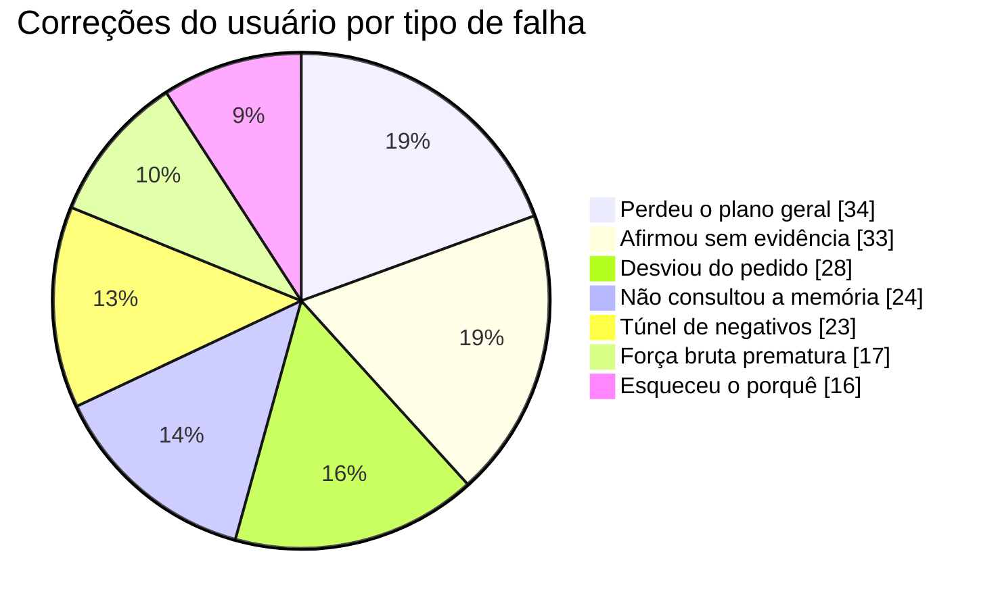

# Lições de campo: por que o holmes 2.0 é assim

Este documento é o diagnóstico que explica de onde vem cada peça do 2.0. A base é uma investigação real e
longa, conduzida com agentes de IA ao longo de várias semanas: 64 sessões, ~620 MB de transcrição. Cada
sessão foi condensada só no diálogo (falas do usuário, texto do agente e nome das ferramentas) e lida por
inteiro por 20 leitores independentes. Duas auditorias leram o código do harness e os bancos.

> [!NOTE]
> O caso em si não importa aqui. Os padrões de falha abaixo são do agente, não do assunto, e reaparecem em
> qualquer investigação longa.

## Resumo em cinco linhas

1. O agente quase nunca perdeu o plano por falta de informação. Perdeu porque havia informação demais, em
   lugares demais, e nenhuma âncora curta dizendo "o objetivo é este, estamos nesta frente, o próximo
   passo é este".
2. Na maior parte do tempo o trabalho foi fechar receitas negativas em túnel. Centenas de "0 acertos"
   seguidos. Quem puxava o passo atrás era sempre o usuário ("visão do todo", "estou perdido", "em que
   parte estamos?").
3. A maioria dos negativos não valia o que dizia. O instrumento que julgava os resultados foi achado cego
   ou incompleto pelo menos cinco vezes. 78% dos testes registrados não diziam qual instrumento os julgou.
4. O progresso real veio de leitura literal da fonte primária, de perguntas simples do usuário e de
   revisão externa conferida na fonte. Não veio de varredura.
5. A primeira versão do holmes tentou consertar isso acrescentando mais coisas: guias, painéis, regras,
   injeções, arestas automáticas. Cada acréscimo aumentou o volume que precisava ser lido e reduziu o que
   de fato chegava ao agente.

## Como a condução evoluiu

| Fase | O que aconteceu | Sinal do usuário |
|---|---|---|
| Antes de qualquer estrutura | Um caderno `.md` corrido por caso (8 mil linhas) e vários casos misturados. Objetivo contínuo (`/goal`) preso em laço por 4 a 17 h. "Premissas" escritas no caderno viraram fato por horas. | "mas vai desistir assim fácil?"; "estamos pulando etapas"; "status" perguntado 6 vezes ou mais |
| Nasce o holmes v1 | SQLite por caso, método em fases, subagentes, instruções enxugadas. Logo depois o banco ainda estava vazio: uma sessão remota seguia escrevendo em `.md`. | "enorme, pode atrapalhar mais que ajudar" (sobre os `.md`) |
| Defeitos em série | O instrumento falhou várias vezes seguidas. A busca por palavra falhou duas vezes, e daí nasceu um índice vetorial. Meta-trabalho: 14 guias, 7 digestos, milhares de artefatos catalogados, com ganho medido de 24 para 25 acertos em 36 buscas. | "muita informação, vários .md espalhados… falta uma única fonte de memória" |
| O banco cresce | A auto-consolidação gerava 53 a 61% das arestas. A visão do todo foi pedida 4 vezes numa noite. Medido: o painel de abertura era cortado de 465 KB para 14 KB, e o mod nem carregava no ambiente. | "você vai pulando de galho em galho deixando de fechar raciocínios" |
| Validade em xeque | O instrumento cobria 22 de 7.502 alvos. Negativos de semanas perderam validade. Sessões paralelas colidiram ids no mesmo banco. | "se der erro nunca vamos saber" |
| Inchaço | ~1.900 afirmações, e 555 de 713 testes sem instrumento. Uma lista de "famílias" de combinações foi de 11 para 319 numa única sessão de objetivo contínuo. Uma premissa falsa vinda do próprio banco sustentou ~15 testes em 11 h. | "estamos sempre tentando tudo de uma vez à toa… estou perdido"; "banco inchado demais… não conseguimos recuperar os acertos" |

## Os padrões de falha

Categorias que os leitores atribuíram às correções do usuário, somadas em todos os lotes:

O instrumento de julgamento aparece em 156 menções nos relatórios.

### 1. Túnel de negativos e perda do plano geral
- Num trecho foram ~40 seções seguidas de "0 acertos" depois de uma compactação. Noutro, ~145 negativos
  com 24 scripts rodados *depois* de o próprio agente notar a saturação. Noutro, 12 h fechando variações
  sobre partes já resolvidas, até o usuário perguntar se aquilo era essencial.
- O agente oscilava entre traduzir cada pista em operação mecânica e abandonar a narrativa. Faltava saber
  a que tese cada teste servia ("qual o propósito?").
- Não existia âncora: na auditoria, a abertura injetava 0 bytes de estado do caso. O painel comia o
  orçamento, e os 10 "fios" injetados eram frases soltas colhidas por regex (456 abertos, 41 fechados).

### 2. Não consultar antes e redescobrir
- Mais de 12 "já estava no dossiê" num único período. Um resultado foi refeito por 1 h, e ele já estava no
  banco e numa fonte antiga. O inventário foi "resgatado" 4 vezes. Uma fórmula foi reconstruída 3 vezes.
- "Não está no banco" e "nunca tentado" falsos, porque a consulta cortava linhas, falhava com frases ou só
  buscava num tipo de registro e não nos documentos.
- Havia seis comandos concorrentes para "o que o banco sabe", e as regras tinham de explicar quando cada
  um não bastava.

### 3. Negativo sem validade de instrumento
- Instrumento cego a formatos de resposta legítimos. Instrumento congelado numa cópia local desatualizada.
  22 alvos em vez de 7.502. Off-by-one em 5 geradores. Filtro que rejeitava justamente os dois casos reais
  conhecidos. Cada um invalidou de dezenas a bilhões de "zeros".
- O banco não distinguia escrito, executado e fechado, nem guardava versão ou data do instrumento.
  "Fechado/esgotado/exaustivo" aparecia sem alcance ("frases humanas testadas" eram ~30 frases).
- Controles plantados com o mesmo bug do código passaram verdes. Só controle com dado real, segunda
  implementação ou sabotagem por revisor pegou.

### 4. Fato, interpretação e terceiros misturados
- Interpretação de terceiro registrada como fala do autor. Comentário de terceiro citado como se fosse da
  fonte. Plano colado de outra IA (com um número inexistente) tomado como premissa.
- Premissas viraram fato pela escrita. Uma delas sustentou 15 experimentos. Afirmações retratadas
  continuaram sendo citadas porque a consulta não mostrava o status.

### 5. Compactação perde o fio
- Depois de compactar, o agente refez testes que ele mesmo fizera horas antes (milhões de operações),
  apresentou como "novo" um achado da mesma noite, negou uma frase que era dele, mudou de idioma e voltou
  a uma frente que o usuário já tinha deixado.
- Medição na própria sessão: o raciocínio (falas + texto do agente) é ~7% da janela. Comandos e saídas são
  ~75%. A compactação descartava justamente os 7%. O diário de raciocínio por sessão foi a melhor correção
  do v1.

### 6. Volume: documentos e injeções demais
- Nove `.md` se diziam "leia primeiro" ou "fonte de verdade". Para se orientar, o agente precisava de
  ~235 KB (65–70 mil tokens). O harness custava ~12 mil tokens antes da primeira linha útil e ~55–60 mil
  numa sessão de 50 prompts.
- As 12 regras do usuário estavam em 5 lugares, e uma delas aparecia repetida 15 vezes.
- 61% das ~18 mil arestas eram automáticas. As 52 hipóteses estavam todas "vivas" e 49 não tinham nenhuma
  aresta: as hipóteses de verdade estavam no texto livre.
- Injeção acima de 10 mil caracteres vira prévia de 2 KB, e hook de módulo pode ser barrado por plugin de
  segurança da organização. Parte do que se achava injetado nunca chegou ao agente.

### 7. Força bruta como refúgio
- O agente admitiu: varredura "rende resultado mensurável" e interpretação não. Mesmo com o usuário
  pedindo foco no sentido das pistas, voltava a varrer. Transformava a pista em string e combinação e
  declarava o espaço "exausto", e foi corrigido por isso ao menos 4 vezes.
- Os avanços vieram de ler o texto literal da fonte e de perguntar o que ele nomeia.

### 8. Laços de objetivo contínuo e ociosidade
- Um avaliador com critério inalcançável ("resolver tudo", "cobertura total") produziu ~12 respostas quase
  idênticas, ~50 negativos só "para manter movimento" e 17 h de receitas. Em outro período foram 12 h
  ociosas "aguardando decisão" sem oferecer opções.

### 9. Comunicação e o usuário como roteador
- Jargão interno e tabelas densas levaram a "não entendi nada". Um ✅ numa coluna foi lido como problema
  resolvido. O controle positivo também foi lido como achado.
- O usuário colou análises de outras IAs mais de 12 vezes, e essas colagens trouxeram achados reais. A
  revisão externa funcionava, mas dependia de transporte manual.

### 10. Concorrência
- Sessões e máquinas em paralelo no mesmo banco: ids intercalados e duplicados, scripts com o mesmo nome,
  `holmes.py` quebrado no meio da edição de outra sessão, cadernos colidindo.
- `pkill -f` matando o próprio shell, `ps` vazio por causa de um proxy, jobs que terminavam horas antes de
  o agente ver, estimativas de tempo erradas por fator 2.

### 11. Leitura mecânica no lugar de leitura de sentido
- Em 21 dos 23 relatórios o usuário cobra a mesma coisa: "tem certeza que essas palavras são literais ou
  remetem a uma mensagem subliminar?", "não trate o livro como puras palavras matemáticas, tem
  significado", "o material não foi feito por uma máquina, então as palavras têm significados", "estamos
  indo muito ao pé da letra", "não quero que você determine nulos, preciso que analise a saída".
- O padrão: a pista virava string e senha em milhares de combinações, o livro era varrido por
  palavra-chave e dado como esgotado, a saída era julgada só pelo p, e um 0 numa tradução literal matava a
  ideia inteira. O agente aplicava ceticismo estatístico a significado.
- Quando o usuário mandava ler pelo sentido e não descartar, saíram os achados textuais. O v1 chegou a
  codificar isso (dois julgamentos, "conceitual, não literal", skill de leitura narrativa), mas só depois
  de semanas e espalhado em regras longas.
- A versão inicial do 2.0 perdeu essas regras na generalização e manteve só as que puxam para o rigor.
  Corrigido: seção "Sentido" da constituição, skill `leitura`, agente `interprete`, `--sentido`, `leitura`
  no topo do mapa e pausa de leitura de conjunto.

## O que funcionou e foi mantido
- Controle positivo, nulo declarado e previsão escrita antes. Retratação curta e registrada.
- Conferir relatório de subagente na fonte (achou citações erradas 5 vezes, e 14 de 14 ids errados num
  relatório).
- Revisor cético e independente, e IA externa com briefing neutro, tratada como hipótese.
- Diário de raciocínio regenerado do transcript a cada turno.
- Portão "já foi feito?", quando existia e era rápido. Teste cirúrgico com fonte primária.
- Perguntas do usuário em linguagem simples. Elas viraram os melhores testes de modelo.

## Do diagnóstico à peça do 2.0

| Problema | Peça do 2.0 |
|---|---|
| Sem âncora de plano | `mapa`: objetivo → alvos (com dependências) → frentes ativas → hipóteses vivas → fronteira, decisões do usuário, fios, contradições, testes abertos, alertas. No máximo 3,5 KB, gerado, e é a única coisa que a abertura injeta. |
| Leitura mecânica | Constituição 5–8, skill `leitura`, agente `interprete`; `resultado --sentido`; `leitura` no topo do mapa, ligada à base; `teste` exige `--refuta-se`, e o negativo fecha a forma testada, não o conceito. |
| Túnel | Alerta automático no `mapa`, no `resultado` e no hook de prompt após N negativos seguidos sem hipótese nova (`HOLMES_TUNEL`, padrão 5). Regra 16 da constituição. |
| Frentes demais | Máximo de 5 frentes ativas e 7 hipóteses vivas por frente, checado pela CLI. |
| Redescoberta | Um comando de busca (`busca`/`ja`, BM25 sem acento, nós + fontes, uma linha por item com estado). O hook de prompt injeta até 6 linhas sem repetir na sessão. `teste` recusa receita idêntica já feita e mostra as parecidas. |
| Negativo sem validade | `teste` exige `--alcance`. `instrumento` registra o sha. Negativo sem instrumento aparece INDETERMINADO, e quando o instrumento muda os negativos antigos aparecem A REVALIDAR. |
| Fato × interpretação | `--origem` (autor, fonte, medido, usuario, agente, externo) e `--grau`. Externo entra C automaticamente. `fato` nasce `rascunho`, e o status aparece em toda linha de busca. |
| Compactação | Diário de raciocínio por sessão (hooks `fim`/`pre-compact`); a abertura pós-compactação injeta o mapa + a cauda do diário. O estado vive no banco, não no resumo. |
| Volume | Um banco, um `CASO.md` de 2 KB, `MAPA.md` gerado. Constituição de 22 regras sem histórico. Skill detetive curta, com referências sob demanda. Sem arestas automáticas: relação percebida é `conexao` candidata até ser confirmada. Título e resumo com limite de tamanho. |
| Injeção que não chega | Hooks de shell para tudo o que injeta, e um módulo só para `tool.call` (poda de saída), que comprovadamente chega. Cada injeção fica abaixo de 9 mil caracteres, com corte avisado. A carga foi verificada numa sessão real. |
| Força bruta como refúgio | Modos LEITURA / CIRURGIA / VARREDURA declarados; varredura só com hipótese ancorada em fonte e custo estimado. Palpite barato roda como `--exploratorio`, que vale pista, nunca cobertura. |
| Objetivo contínuo em laço | Regra 22: condição verificável e saída "bloqueado". |
| Comunicação | Regra 20: uma linha de veredito com rótulo (ACHADO, NEGATIVO no alcance, CONTROLE, INSTRUMENTO) antes do detalhe. O `resultado` lembra disso. |
| Concorrência | Ids por AUTOINCREMENT do SQLite em WAL (sem numeração à mão). O caso ativo é explícito (`usa`), nunca adivinhado pelo arquivo mais recente. |
| Jobs | `roda --pid --log`; `jobs` e o `mapa` mostram PID vivo ou MORTO. O hook nega `pkill -f`. |
| Registro esquecido | Hook `pos` avisa o agente quando um script do caso roda sem teste aberto, e o `fim` cobra registro uma vez por turno. |

## O que ficou de fora de propósito (e quando reconsiderar)
- **Busca vetorial como padrão.** No v1, BM25 por trecho teve recall@5 de 100% contra 2% do vetorial com o
  mesmo material. O corpus oferece o modo vetorial e o híbrido como opção (`embed`), regeneráveis e nunca
  injetados.
- **Curva de esquecimento, saliência, consolidação automática, painel web, colheita de fios por regex.**
  Medidos como inertes ou como ruído no v1.
- **Fases do método como portão obrigatório.** O usuário sentiu "cerimônia". O 2.0 obriga os controles
  (alcance, instrumento, origem) e deixa as fases como método na skill.
- **Migração de bancos antigos.** O 2.0 começa limpo. Material de outro sistema entra por `extrai` (contrato
  JSON) ou `fonte`; itens importados podem ser marcados `legado`, que os mantém fora dos alertas até alguém
  mexer neles.

## Limites desta análise
- Os resultados das ferramentas foram removidos antes da leitura, e muitas falas longas do agente estão
  truncadas. As medidas citadas vêm das falas, não da saída bruta.
- Alguns lotes de sessões não puderam ser lidos (barrados pelo filtro de segurança do modelo leitor). Os
  padrões acima aparecem em todos os lotes lidos. Não há sinal de que os outros mudariam o diagnóstico,
  mas eles não foram lidos.
