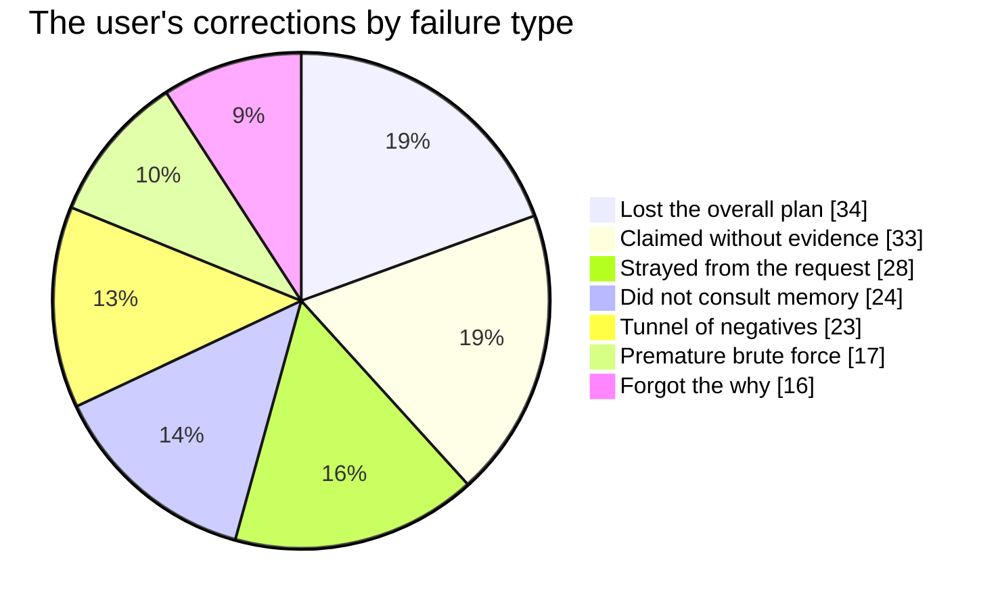

# Field lessons: why holmes 2.0 is the way it is

This document is the diagnosis behind every piece of 2.0. Its basis is a long, real investigation run with AI
agents over several weeks: 64 sessions, ~620 MB of transcript. Each session was condensed to the dialogue only
(the user's words, the agent's text and the tool names) and read in full by 20 independent readers. Two audits
read the harness code and the databases.

> [!NOTE]
> The case itself does not matter here. The failure patterns below belong to the agent, not the subject, and
> come back in any long investigation.

## Summary in five lines

1. The agent almost never lost the plan for lack of information. It lost it because there was too much
   information, in too many places, and no short anchor saying "the objective is this, we are on this front, the
   next step is this".
2. Most of the time the work was closing negative recipes in a tunnel. Hundreds of "0 hits" in a row. The one
   pulling the step back was always the user ("the whole picture", "I'm lost", "where are we?").
3. Most negatives were not worth what they claimed. The instrument judging the results was found blind or
   incomplete at least five times. 78% of the recorded tests did not say which instrument judged them.
4. Real progress came from literal reading of the primary source, from the user's simple questions and from
   external review checked against the source. It did not come from sweeps.
5. The first version of holmes tried to fix this by adding things: guides, dashboards, rules, injections,
   automatic edges. Each addition increased the volume that had to be read and reduced what actually reached
   the agent.

## How the conduct evolved

| Phase | What happened | The user's signal |
|---|---|---|
| Before any structure | One running `.md` notebook per case (8 thousand lines) and several cases mixed together. A continuous objective (`/goal`) stuck in a loop for 4 to 17 h. "Premises" written in the notebook became facts for hours. | "are you going to give up that easily?"; "we're skipping steps"; "status" asked 6 times or more |
| holmes v1 is born | SQLite per case, a phased method, subagents, trimmed instructions. Shortly after, the database was still empty: a remote session kept writing to `.md`. | "huge, it may get in the way more than help" (about the `.md` files) |
| Defects in series | The instrument failed several times in a row. Word search failed twice, and a vector index was born from that. Meta-work: 14 guides, 7 digests, thousands of catalogued artefacts, with a measured gain from 24 to 25 hits in 36 searches. | "a lot of information, many scattered .md… a single source of memory is missing" |
| The database grows | Auto-consolidation produced 53 to 61% of the edges. The whole picture was requested 4 times in one night. Measured: the opening dashboard was cut from 465 KB to 14 KB, and the mod did not even load in the environment. | "you keep jumping from branch to branch without closing your reasoning" |
| Validity in question | The instrument covered 22 of 7,502 targets. Weeks of negatives lost their validity. Parallel sessions collided ids in the same database. | "if it errors we'll never know" |
| Bloat | ~1,900 claims, and 555 of 713 tests without an instrument. A list of combination "families" went from 11 to 319 in a single continuous-objective session. A false premise coming from the database itself supported ~15 tests over 11 h. | "we're always trying everything at once for nothing… I'm lost"; "database too bloated… we can't recover the hits" |
| The path is lost | Interpretations stored as loose facts, 1,238 of 1,283 facts with no place in the tree; one conclusion (the film's numbers in the author's text) rediscovered three times in 17 days; four competing readings of the same clue recorded as a queue in which each "corrected" the previous one. | "we open branches but have no view of them… it should be a tree we can always go back to and fork" |

## The failure patterns

Categories the readers assigned to the user's corrections, added up over all batches:

The judging instrument appears in 156 mentions across the reports.

### 1. Tunnel of negatives and loss of the overall plan
- In one stretch there were ~40 consecutive sections of "0 hits" after a compaction. In another, ~145 negatives
  with 24 scripts run *after* the agent itself had noticed the saturation. In another, 12 h closing variations
  on already solved parts, until the user asked whether that was essential.
- The agent swung between turning every clue into a mechanical operation and abandoning the narrative. It
  lacked knowing which thesis each test served ("what is the purpose?").
- There was no anchor: in the audit, the opening injected 0 bytes of case state. The dashboard ate the budget,
  and the 10 injected "threads" were loose sentences harvested by regex (456 open, 41 closed).

### 2. Not consulting first, and rediscovering
- More than 12 "it was already in the dossier" in a single period. A result was redone for 1 h, and it was
  already in the database and in an old source. The inventory was "rescued" 4 times. A formula was rebuilt 3
  times.
- False "not in the database" and "never tried", because the query cut lines, failed on phrases or only searched
  one kind of record and not the documents.
- There were six competing commands for "what the database knows", and the rules had to explain when each one
  was not enough.

### 3. Negatives without instrument validity
- An instrument blind to legitimate answer formats. An instrument frozen in an outdated local copy. 22 targets
  instead of 7,502. Off-by-one in 5 generators. A filter that rejected precisely the two known real cases. Each
  one invalidated from dozens to billions of "zeros".
- The database did not distinguish written, run and closed, nor did it keep the instrument's version or date.
  "Closed/exhausted/exhaustive" appeared without a scope ("human phrases tested" were ~30 phrases).
- Planted controls with the same bug as the code went green. Only a control with real data, a second
  implementation or sabotage by a reviewer caught them.

### 4. Fact, interpretation and third parties mixed up
- A third party's interpretation recorded as the author's words. A third party's comment quoted as if it came
  from the source. A plan pasted from another AI (with a non-existent number) taken as a premise.
- Premises became facts by being written down. One of them supported 15 experiments. Retracted claims kept being
  quoted because the query did not show their status.
- "Fact" meant "checked against a source": a measurement anyone could rerun had no way of being recorded as
  proven, and an inference could become a "current fact" with one check.

### 5. Compaction loses the thread
- After compacting, the agent redid tests it had done hours before (millions of operations), presented a
  finding from the same night as "new", denied a sentence that was its own, switched language and went back to a
  front the user had already left.
- Measured in the session itself: the reasoning (the user's words + the agent's text) is ~7% of the window.
  Commands and outputs are ~75%. Compaction discarded precisely the 7%. The per-session reasoning diary was v1's
  best fix.

### 6. Volume: too many documents and injections
- Nine `.md` files claimed to be "read first" or "source of truth". To get oriented, the agent needed ~235 KB
  (65–70 thousand tokens). The harness cost ~12 thousand tokens before the first useful line and ~55–60 thousand
  in a 50-prompt session.
- The user's 12 rules lived in 5 places, and one of them appeared 15 times.
- 61% of the ~18 thousand edges were automatic. The 52 hypotheses were all "alive" and 49 had no edge at all: the
  real hypotheses lived in free text.
- An injection over 10 thousand characters becomes a 2 KB preview, and a module hook can be blocked by the
  organization's security plugin. Part of what was believed to be injected never reached the agent.

### 7. Brute force as a refuge
- The agent admitted it: a sweep "yields a measurable result" and interpretation does not. Even with the user
  asking to focus on the clues' meaning, it went back to sweeping. It turned the clue into strings and
  combinations and declared the space "exhausted", and was corrected for it at least 4 times.
- Progress came from reading the source's literal text and asking what it names.

### 8. Continuous-objective loops and idleness
- An evaluator with an unreachable criterion ("solve everything", "total coverage") produced ~12 almost
  identical answers, ~50 negatives just "to keep moving" and 17 h of recipes. In another period there were 12 h
  idle "awaiting a decision" without offering options.

### 9. Communication, and the user as a router
- Internal jargon and dense tables led to "I didn't understand anything". A ✅ in a column was read as a solved
  problem. The positive control was also read as a finding.
- The user pasted analyses from other AIs more than 12 times, and those pastes brought real findings. External
  review worked, but depended on manual transport.

### 10. Concurrency
- Sessions and machines running in parallel on the same database: interleaved and duplicated ids, scripts with
  the same name, `holmes.py` broken in the middle of another session's edit, colliding notebooks.
- `pkill -f` killing its own shell, empty `ps` because of a proxy, jobs finishing hours before the agent noticed,
  time estimates off by a factor of 2.

### 11. Mechanical reading instead of reading for meaning
- In 21 of the 23 reports the user asks for the same thing: "are you sure these words are literal or do they
  point to a subliminal message?", "don't treat the book as pure mathematical words, it has meaning", "the
  material wasn't made by a machine, so the words have meanings", "we're being far too literal", "I don't want
  you to determine nulls, I need you to analyse the output".
- The pattern: the clue became a string and a password in thousands of combinations, the book was swept by
  keyword and called exhausted, the output was judged only by p, and a 0 on a literal translation killed the
  whole idea. The agent applied statistical scepticism to meaning.
- When the user asked to read for meaning and not discard, the textual findings came out. v1 eventually encoded
  this (two judgments, "conceptual, not literal", a narrative-reading skill), but only after weeks and scattered
  across long rules.
- The initial version of 2.0 lost those rules in the generalization and kept only the ones that pull towards
  rigour. Fixed: the constitution's "Meaning" section, skill `leitura`, agent `interprete`, `--sentido`,
  `leitura` at the top of the map and the overall-reading pause.

### 12. The path of the reasoning was not recorded
- The database kept what was being investigated but not how each thing had been reached: inferences went in as
  loose facts with the why in prose inside the title, course corrections left no trace (the `substitui` edge was
  used 9 times and `refuta` once in 2,300 edges), and 8 of 9 working readings were replaced within two days.
- Competing readings of the same clue were stored as a succession, each one "correcting" the previous, so a
  newer interpretation could silently discard an older one that had never been refuted.
- Rebuilding why a line had been opened, or where it had stopped, required searching dozens of memories.

## What worked and was kept
- Positive control, declared null and prediction written beforehand. Short, recorded retraction.
- Checking a subagent's report against the source (it found wrong quotes 5 times, and 14 of 14 wrong ids in
  one report).
- A sceptical, independent reviewer, and an external AI with a neutral briefing, treated as a hypothesis.
- A reasoning diary regenerated from the transcript every turn.
- The "has this been done already?" gate, when it existed and was quick. A surgical test with a primary source.
- The user's plain-language questions. They became the best model tests.

## From the diagnosis to the 2.0 piece

| Problem | 2.0 piece |
|---|---|
| No anchor for the plan | `mapa`: objective → targets (with dependencies) → active fronts → live hypotheses → frontier, user decisions, threads, contradictions, open tests, alerts, active branch. At most 3.5 KB, generated, and the only thing the opening injects. |
| Mechanical reading | Constitution 5–8, skill `leitura`, agent `interprete`; `resultado --sentido`; `leitura` at the top of the map, tied to its basis; `teste` requires `--refuta-se`, and a negative closes the tested form, not the concept. |
| Tunnel | Automatic alert in the `mapa`, in `resultado` and in the prompt hook after N consecutive negatives without a new hypothesis (`HOLMES_TUNEL`, default 5). Rule 16 of the constitution. |
| Too many fronts | At most 5 active fronts and 7 live hypotheses per front, checked by the CLI. |
| Rediscovery | One search command (`busca`/`ja`, accent-insensitive BM25, nodes + sources + branch steps, one line per item with its state). The prompt hook injects up to 6 lines without repeating within the session. `teste` refuses an identical recipe already done and shows the similar ones. |
| Negative without validity | `teste` requires `--alcance`. `instrumento` records the sha. A negative without an instrument shows as INDETERMINADO, and when the instrument changes the old negatives show as A REVALIDAR. |
| Fact × interpretation | `--origem` (author, source, measured, user, agent, external) and `--grau`. External enters as C automatically. `fato` is born `rascunho`, and its status shows on every search line. |
| What makes a fact a fact | A fact is a proven finding: `confere --por fonte\|medicao\|teste\|reproducao`, with `--prova` for measurement, test and reproduction; an inference or interpretation is refused, and what proves it enters as a new fact. |
| Compaction | Per-session reasoning diary (hooks `fim`/`pre-compact`); the post-compaction opening injects the map + the tail of the diary. State lives in the database, not in the summary. |
| Volume | One database, a 2 KB `CASO.md`, a generated `MAPA.md`. A constitution of 26 rules without history. A short detective skill, with references on demand. No automatic edges: a perceived relation is a candidate `conexao` until confirmed. Title and summary with size limits. |
| Loss of the path | `ramo` + `passo`: every line born from a point with its why; immutable steps; fork from an earlier step; `trilha`, `arvore` and `ficha` rebuild the path. Measured in the real case before the piece: 1,238 of 1,283 facts with no place in the tree and the same conclusion rediscovered three times in 17 days. |
| Injection that does not arrive | Shell hooks for everything that injects, and a module only for `tool.call` (output trimming), which demonstrably arrives. Each injection stays under 9 thousand characters, with a warned cut. The load was verified in a real session. |
| Brute force as a refuge | Declared LEITURA / CIRURGIA / VARREDURA modes; a sweep only with a hypothesis anchored in a source and an estimated cost. A cheap hunch runs as `--exploratorio`, which counts as a lead, never as coverage. |
| Continuous objective in a loop | Rule 22: a verifiable condition and a "blocked" exit. |
| Communication | Rule 20: one verdict line with a label (ACHADO, NEGATIVO within scope, CONTROLE, INSTRUMENTO) before the detail. `resultado` reminds of it. |
| Concurrency | Ids by SQLite AUTOINCREMENT in WAL (no hand numbering). The active case is explicit (`usa`), never guessed from the most recent file. |
| Jobs | `roda --pid --log`; `jobs` and the `mapa` show the PID alive or DEAD. The hook denies `pkill -f`. |
| Forgotten record | The `pos` hook warns the agent when a case script runs without an open test, and `fim` asks for the record once per turn. |

## Left out on purpose (and when to reconsider)
- **Vector search as the default.** In v1, per-chunk BM25 reached recall@5 of 100% against 2% for vectors on the
  same material. The corpus offers vector and hybrid modes as options (`embed`), regenerable and never injected.
- **Forgetting curve, salience, automatic consolidation, web dashboard, thread harvesting by regex.** Measured
  as inert or as noise in v1.
- **Method phases as a mandatory gate.** The user felt it as "ceremony". 2.0 enforces the controls (scope,
  instrument, origin) and leaves the phases as method in the skill.
- **Migrating old databases.** 2.0 starts clean. Material from another system enters through `extrai` (JSON
  contract) or `fonte`; imported items can be marked `legado`, which keeps them out of the alerts until someone
  touches them.

## Limits of this analysis
- Tool results were removed before reading, and many of the agent's long turns are truncated. The measures cited
  come from the dialogue, not from raw output.
- Some session batches could not be read (blocked by the reader model's safety filter). The patterns above show
  up in every batch read. There is no sign the others would change the diagnosis, but they were not read.
