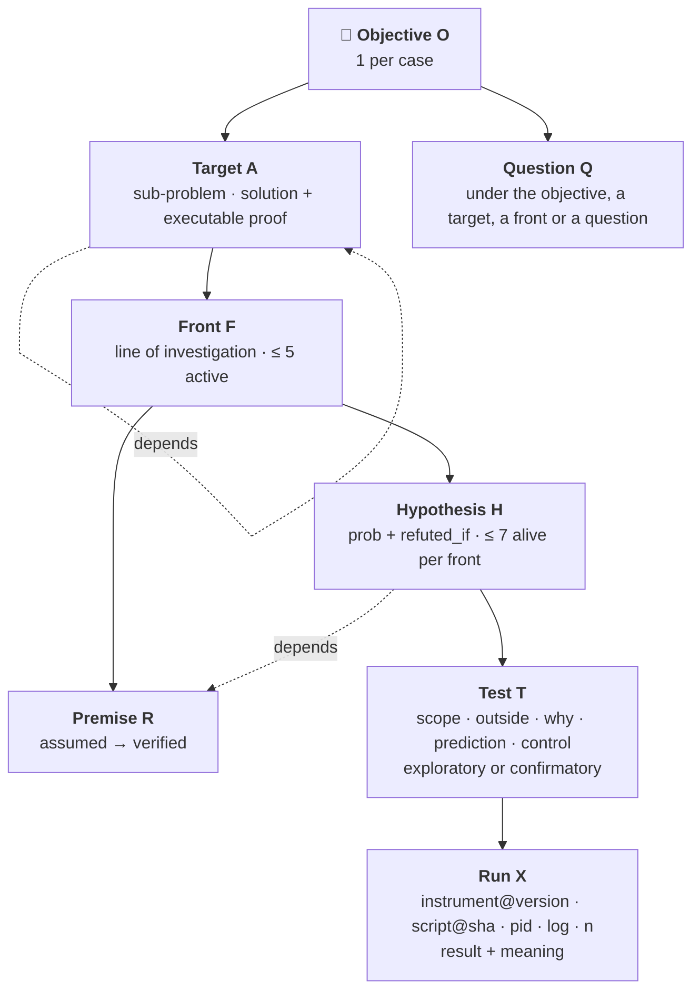
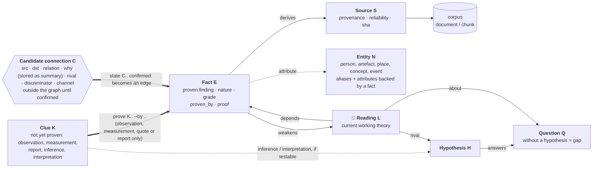
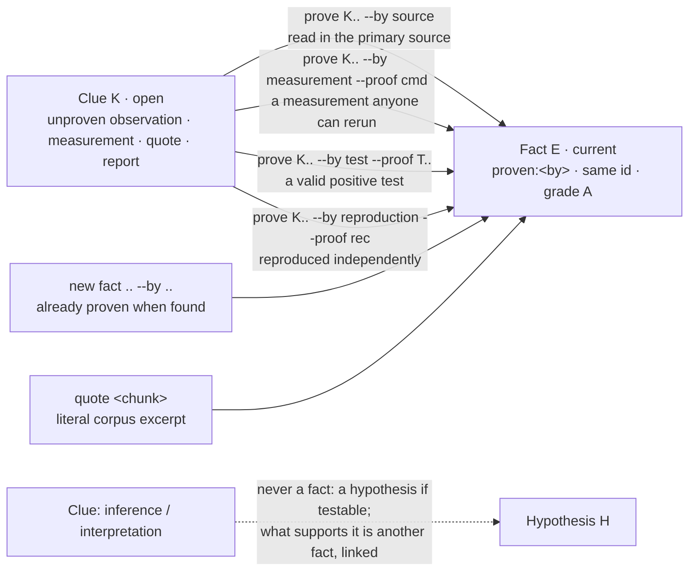
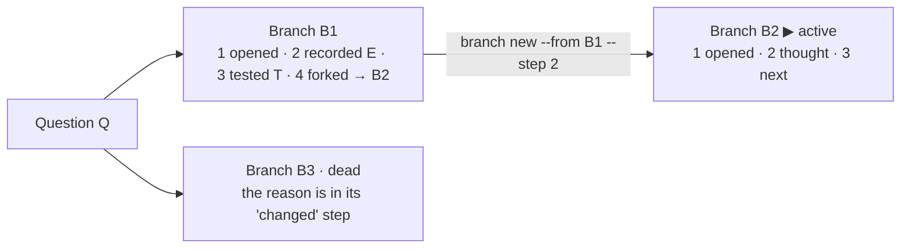
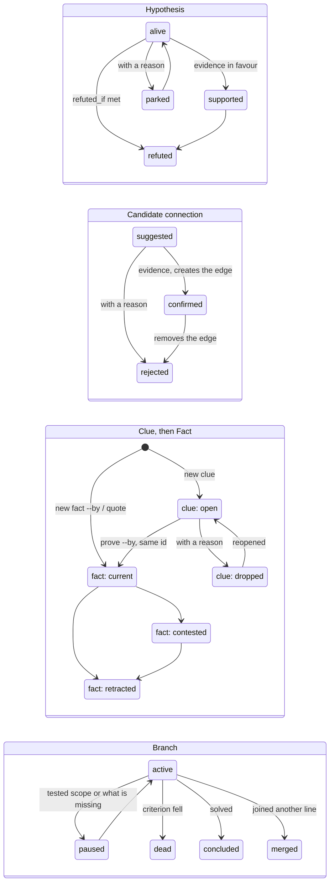
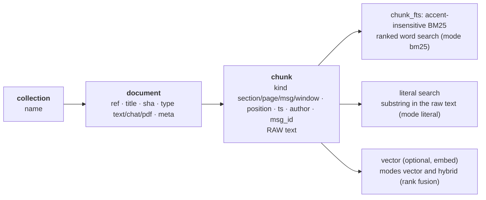

# holmes 2.0 data model

Two SQLite databases with different roles. Every type, state, column and command name below is the CLI's own
token, exactly as stored and typed.

| Database | Where | Holds | Grows? |
|---|---|---|---|
| **case.db** | `cases/<case>/case.db` | the *reasoning*: what is wanted, what is found, what was tested, what is known and where from | slowly; short items, with limits |
| **corpus.db** | `corpus/corpus.db` | the *material*: chats, documents, books, pages, in searchable chunks | a lot; never injected whole, only snippet lines returned by a query (the prompt hook can show up to 3) |

> [!TIP]
> The case points to the corpus (`source.document` → document, `quote <chunk>` → chunk), and the corpus knows
> nothing about the case. The material can be reindexed or moved to another search engine without touching the
> reasoning.

## case.db: the reasoning graph

The tree is the plan: each level answers to the one above.

Allowed parents (checked by `new`): a target under the objective or a target; a front under a target or the
objective; a hypothesis under a front; a premise under a front, a target or the objective; a test under a
hypothesis; a question under the objective, a target, a front or another question.

Next to the tree sit what is known, where it came from and what is still a question:

Also outside the tree: **user decision D** (`forbids` / `allows`), **thread P** (a pending item) and
**instrument I** (versions by sha + `verifier`). Every node has `legacy`: 1 = inherited from another system, kept
out of the map's alerts until touched (any command that changes the item: `edit`, `state`, `prob`, `result`...).

| Edges (always manual, or by confirming a C) | ACH |
|---|---|
| `supports` · `weakens` · `contradicts` · `refutes` · `depends` · `duplicates` · `supersedes` · `about` · `derives` · `answers` · `rival` | fact/clue × hypothesis matrix with `CC` / `C` / `N` / `I` / `II` (`ach E.. H.. CC`, `ach F..` shows a front's matrix) |

A few edges are written by the commands themselves, never inferred: `derives` from a fact or clue to its
`--source`, `supersedes` from a new reading to the old one, and the edges of a reading (`depends`, `weakens`,
`rival`, `about` with note `decisive` or `gap`).

### Facts and clues

A **fact** is a finding already proven, and it says how. Everything not yet proven is a **clue**. Both live in the
`fact` table (same columns); the node `type` says which one it is.

| Command | What it does |
|---|---|
| `new fact "<title>" --by source --source S.. \| --quote "<excerpt>" \| --location "<where>"` | a fact proven by reading the source; `--by source` must point somewhere (a note alone is not a locator); like every `new fact --by ..`, born at grade A unless `--grade` says otherwise |
| `new fact "<title>" --by measurement\|reproduction --proof "<command or record>"` | a fact proven by something anyone can rerun |
| `new fact "<title>" --by test --proof T..` | a fact proven by a test; refused unless the test's last result is a **valid positive** (no validity flag: instrument, control seen, not exploratory) |
| `new clue "<title>" [--nature ..]` | anything not yet proven: an observation or measurement without proof, a report, an inference, an interpretation |
| `quote <chunk> "<claim>"` | copies the corpus' literal text into a fact proven by source (creating the source if needed); an inference, interpretation or report about the excerpt is refused: it is a clue |
| `prove K.. --by source\|measurement\|test\|reproduction [--proof ..] [--source S..] [--location ..] "<note>"` | promotes an observation, measurement, quote or report clue (never an inference or interpretation) to a fact **with the same id**, at grade A (a proven report becomes a `quote` if proven by source, otherwise an `observation`), and records a `changed` step in the active branch ("K11 proven by reproduction: clue → fact"); on a fact, renews its proof |

Rules the CLI enforces:

- A fact only has nature `observation`, `measurement` or `quote`. `inference`, `interpretation` and `report` are
  clues; `prove` refuses an inference or interpretation (what supports it is another fact, linked with
  `supports`; if it explains something testable, it is a hypothesis).
- `prove` does not revive what fell (`retracted`, `contested`, `dropped`): reopen with `state` first.
- `--origin external` enters with grade C. Inside `extract` it never proves itself: an external JSON cannot
  declare itself proven, so an external observation is always a clue. Outside `extract`, the coordinator proves
  external material with `prove` after checking it, which raises it to grade A.
- A script is attached to a test at creation (`test .. --script <path>`) or later (`edit <T> --script <path>`).
- `proof` lists the facts proven by measurement (and targets and instruments) and runs them only with
  `--execute`.

### Branches and steps: the path of the reasoning

The tree above says **what** is being investigated. The **branch B** keeps **how each thing was reached**: a
line of reasoning born from a point (a question, a hypothesis, a target or a step of another branch) with the
why of its existence, accumulating **steps** in order, like commits. A step is not edited: a course correction
is a new step (`corrected`, `changed`) or a new branch born from an earlier step
(`branch new "<question>" --from B.. --step N --why ".."`), like a fork. A worked example: [EXAMPLE.md](EXAMPLE.md).

| Piece | What it keeps |
|---|---|
| `branch` (node B, `parent` = point of origin; table `branch`) | the line's question · state `active`/`paused`/`dead`/`merged`/`concluded` · `from_step` when born from a step |
| `step` (table) | `branch` · `type` · `text` · **`why`** · `nodes` produced · `at`. Manual (`step <type> "<text>" --why ".."`, `--why` required): `read`, `thought`, `tested`, `found`, `corrected`, `decided`, `next`. Automatic: `opened`, `forked`, `recorded`, `changed`, `tested` |
| active branch (`.holmes/branch-<case>`) | every `new`, `test`, `result`, `state` and `prove` becomes a step of it (`recorded`, `tested`, `changed`), and the node created carries `node.branch` |

Commands: `branch new "<question>" --from <id> --why ".." [--step N] [--no-use]` opens a line (and makes it
active unless `--no-use`; a fork also writes a `forked` step in the origin branch); `branch use B..` picks the
active one; `branch release` leaves none active; `branch` alone shows the active one. A branch's state changes with
`state B.. paused|dead|merged|concluded "<reason>"`, and the reason becomes the why of its `changed` step.

Queries: `tree [id]` (trunk + every branch, never a twig without the path to it), `trail [B..]` (from the root to
the branch, with each step and its why; from the ancestors, only the steps up to the fork point), `sheet` (one
page: IMMEDIATE goal, LATEST STEPS, NEXT EXPERIMENT, ALREADY EXPLORED HERE, SOLVED (trunk), OTHER OPEN LINES).
Steps are searchable: `search` finds a branch by what was done in it.

### Ontology: each investigation concept and where it lives

The conceptual model is rich; the storage, economical. Only **question**, **candidate connection**, **branch**
and **clue** got their own type, because no existing object represented them without distorting the meaning (a
question is not a hypothesis; a suggested relation cannot be an edge; a path is not a node of the plan; what is not
proven is not a fact). The rest is a type, role or relation of what already existed.

| Concept | Representation | Why so |
|---|---|---|
| Objective | `objective` (1 per case) | — |
| Investigative question | `question` Q | not every question already has a hypothesis; one without is a **gap** |
| Line of investigation (plan) | `front` F | it already grouped questions and hypotheses |
| Line of reasoning (path) | `branch` B + `step` | where it came from, what was done, why it turned |
| Source | `source` S (`provenance`, `reliability`, `sha`) | — |
| Artefact | `source` (the file) or `entity --class artefact` (the object in the world) | a file is a source; the safe is an entity |
| Observation | `--nature observation\|measurement\|quote`, with `location` and the method in the summary | it already separated nature from origin |
| Fact | `fact` E: a finding already proven, born `current` with `proven_by` (`source`, `measurement`, `test` or `reproduction`) | a fact is a finding, and says how it holds; the proof need not be a source |
| Clue | `clue` K: what is not yet proven (an observation or measurement without proof, a report, an inference, an interpretation); proven by `prove`, an observation, measurement, quote or report clue becomes a fact with the same id, at grade A (never an inference or interpretation) | an unproven claim is never a fact |
| Clue (role) | an observation linked `about` a question, hypothesis or front, with the why in the edge's note | the same observation can be a clue for one question and nothing for another |
| Evidence | **role**: a fact with an ACH cell or a `supports`/`weakens` edge to a hypothesis | its strength depends on the hypothesis assessed |
| Inference / interpretation | `clue --nature inference\|interpretation` linked `about` what was observed | it falls without bringing down the observation; it never becomes a fact (if testable, it becomes a hypothesis) |
| Premise | `premise` R (`assumed` → `verified`) | — |
| Hypothesis | `hypothesis` H; **exploratory** without `refuted_if`, **operational** with it | only the operational one gets a confirmatory test |
| Prediction | `test.prediction`, timestamped in `predicted_at` before the run | — |
| Test / run / result | `test` T / `run` X / `result` + `meaning` | — |
| Finding | a positive without a validity flag and verified (F6) | an authorized conclusion, not just an observed one |
| Gap | an open question without a hypothesis (`questions`, `next`) | — |
| Contradiction | `contradicts` edge | — |
| Event in the world | `entity --class event` + `attribute N.. when <date>`; `timeline` | the database's `event` table is auditing, not the world |
| Synthesis / working theory | `reading` L with basis, against, rivals, decisive question and gaps | history through `supersedes` edges |
| Candidate connection | `connection` C: `suggested` → `confirmed` (becomes an edge) or `rejected` (stays, so it is not rediscovered) | a suggestion is never knowledge |

Four views of the same database, by query: **plan** (`map`, `next`, `questions`), **knowledge** (`show`, `chain`,
`timeline`, `search`), **explanations** (`reading`, `ach`, `connections`, `chain` of a hypothesis) and **path**
(`tree`, `trail`, `sheet`).

### Discovering relations

`connections <id|"text">` is a query: it returns up to 8 candidates (`-n`) and records nothing; `connections`
alone lists the suggested ones still waiting for a decision. Channels, from strongest to weakest: **bridge** (the
text cites one name of an entity and the other item cites another name or alias of the same entity, the path to a
relation with no shared word), **number** (the same number or hex sequence), **graph** (a common neighbour),
**terms** (shared words of 4+ letters, without stop words) and corpus **material** (hybrid if there are vectors,
otherwise BM25). It excludes what is already linked and what was already rejected. The agent judges; the promising
one becomes a candidate with `connection <from> <to> <relation> "<why>" [--rival ..] [--discriminator ..]
[--reasons ..] [--channel ..]` (state `suggested`); only `state C.. confirmed "<evidence>"` creates the edge
(and leaving `confirmed` removes it). An abstract concept that links clues ("complementarity": two halves,
yin-yang) is recorded as an entity with aliases and starts linking whatever comes. Measurement on the synthetic
case: [holmes/eval/README.md](holmes/eval/README.md).

### Extraction contract (`extract <file.json>`)

JSON with the keys below, all optional (extracting a single observation is valid). Local ids (`o1`, `q1`, `h1`,
lowercase) become case ids; case ids (`E42`, `ext:42`) are reused. Without `--apply` it shows the plan; with it, it
records in one transaction (an error undoes the batch). `--only`/`--reject` pick items by local id. Text identical
to an existing item is not duplicated for observations, questions and hypotheses; interpretations and
discriminators are always created; connections are de-duplicated by (pair, relation). Any other top-level key is
refused.

| Key | Item | Becomes |
|---|---|---|
| `source` | `"S12"` | the observations' default source |
| `observations` | `id, text, nature?, location?, quote?, method?, limits?, chunk?, by?, proof?, source?, grade?, origin?, existing?` | `fact` if proven (`chunk` = literal corpus excerpt, proven by source; or `by` + `proof`, never when `origin` is `external`), otherwise `clue`; `existing` reuses a recorded fact/clue; nature `inference`/`interpretation` here is refused |
| `clues` | `obs, about?, why` | edge `obs about <Q/H/F>` (default: the objective) |
| `interpretations` | `id, about, text, alternatives?, confidence?, origin?` | `clue --nature interpretation` linked `about` |
| `questions` | `id, text, parent?, summary?, motivated_by?` | `question` (+ `derives` from the motives) |
| `hypotheses` | `id, text, parent, summary?, answers?, motivated_by?, premises?, rivals?, prob?, refuted_if?` | `hypothesis` + `answers`, `derives`, `depends`, `rival` |
| `connections` | `id?, from, to, relation, why, rival?, discriminator?, reasons?, channel?, origin?, state?` | `connection` **only suggested** (any other `state` is refused) |
| `discriminators` | `id?, between: [h1, h2], observation` | `thread` linked `about` the hypotheses |
| `impact` | `plan?, reading?` | shown, never applied by itself (synthesis is deliberate) |

### Why each part exists (lesson → field)

| v1 lesson | How the model answers |
|---|---|
| No anchor for the plan | The objective→target→front→hypothesis→test tree *is* the plan; `map` only walks it. |
| Attacked everything at once ("all the parts together") | `target` with `depends` between targets; the map shows which are UNBLOCKED. |
| Test written ≠ run ≠ closed | `test` is the recipe; `run` is each round. A test's result is that of its last valid run (`failed` does not count). Rerunning after fixing the instrument does not erase the previous one. |
| 78% of negatives without an instrument; the instrument changed and nobody knew | `run` records the instrument `version` (sha) and `script_sha`; an instrument changed on disk gets a new version when the run opens. Negative without an instrument = INDETERMINATE; old version = TO REVALIDATE; `control_ok = 0` = INVALID. |
| "Closed/exhaustive" without a scope | `--scope` mandatory, `--outside` optional; the default text of a negative is "0 in <scope>". |
| Forgot why the test was run | `--why` mandatory: "if positive it opens X; if negative it closes Y". |
| Pattern found after looking | `prediction` timestamped (`predicted_at`) before the first run; `show` says whether the prediction came BEFORE or after. |
| Planted control with the same bug | `control_type`: `real`, `planted`, `sabotage` or `none`. The "no real control" warning shows per test (`show`, the search line, the `test`/`result` output). |
| A third party's interpretation became the author's words | `fact.nature` (`observation`, `measurement`, `quote`, `inference`, `interpretation`, `report`) separate from `origin` (`author`, `source`, `measured`, `user`, `agent`, `external`) and from `grade` A/B/C. |
| Wrong quote, "remembered" number | `quote <chunk>` copies the corpus' literal text into the fact; `proven_at` + `proven_by` keep when and how it was proven (source, measurement, test, reproduction); unproven, it is a clue. |
| Premise became a fact | `premise` is its own type, born `assumed`; the map lists the unverified ones per front. |
| Refutation did not reach the dependants | `depends`/`derives` edges; `state` lists the dependants of what fell, the map warns, and `show` marks a fallen neighbour (FELL). |
| Word search missed synonyms ("key/lock" × "tumblers/lock") | `entity` with `aliases`: the search expands the term by the entity's aliases. |
| The same formula rebuilt 3 times; 0/1-based indexes swapped | the entity's `attribute` (`key` → `value`), each one pointing to the `fact` that backs it; history in the `event` table. |
| "Proven" that nobody could re-prove | `proof` (a command that exits 0) on fact, target and instrument (`verifier`); the `proof` command lists them and only runs them with `--execute` (they are shell coming from the database; the inherited ones only with `--legacy`). |
| Hypothesis "alive" forever, without weight | `hypothesis.prob` with history (each change is an event) and `refuted_if`; ACH shows which evidence distinguishes the rivals. |
| User orders forgotten or over-applied | `decision` with explicit `forbids` and `allows`; the map lists the current ones. |
| Threads harvested by regex (456 open) | `thread` only by command, with an optional parent; closing requires a reason. |
| Automatic edges = 61% of the graph | No automatic edges. Similarity is a query (`search`, `connections`), not data. |
| Ids colliding between sessions | SQLite AUTOINCREMENT in WAL; the prefix is display only and is checked on reading (an H12 that is a test raises an error). |
| Mechanical reading: clue tested as a string, book swept by term, output judged only by p | `reading` (the overall picture at the top of the map) and `run.meaning` in four states (substantive, `none: <why>`, `revisit: <what>`, pending), without forcing empty text. The OVERALL READING is requested by **event** (positive, connection confirmed, question answered or reformulated, hypothesis or premise refuted, hypothesis supported, fact retracted or contested, clue dropped or front discarded, clue or fact proven, contradiction recorded); the `HOLMES_READING` result count is only a reminder. |
| One 0 killed the whole idea | hypothesis = concept, test = one form of it. `test` refuses a hypothesis without `refuted_if` (except `--exploratory`); the concept only falls when that is met, but accumulated valid negatives lower the `prob`. |
| Clues with no apparent relation never met | `connections` (a query over five channels) + candidate `connection`, confirmed only with evidence. |
| A question without a hypothesis had nowhere to live | `question`; without a hypothesis it shows up as a gap in `questions` and `next`. |
| The working theory was a loose paragraph | `reading --supports --weakens --rival --question --gap --reason`; a basis that falls makes the reading a broken dependant. |
| The agent did not know what to do next | `next`: a recommendation explained by verifiable criteria (below). |
| Migrated debt drowned the new signal (122 alerts) | `node.legacy`: the inherited stays out of the alerts, on one count line; touching the item (any change) clears the mark. |
| Decisions became a dumping ground | `decision` is only what the user determined; the agent's choice of method is a clue of nature `inference`. |
| Huge text in the nodes | title ≤ 160, summary ≤ 800, quote ≤ 1000. The rest goes to the corpus or `notes/`. |
| The path was lost: conclusions rediscovered, corrections overwriting the why | `branch` + `step` (above): every line born from a point with a why, immutable steps, forks, `trail`/`tree`/`sheet`. |
| "Fact" meant "checked against a source", and inferences and reports were stored as facts | a fact is a finding already proven (`new fact --by ..`); what is not proven is a `clue`; `prove` turns a clue into a fact. |

### States

Stored values; the first one is the initial state. `state <id> <state> "<reason>"` changes them.

| Type | States | Change that requires a reason |
|---|---|---|
| `objective` | `open`, `achieved`, `abandoned` | `achieved`, `abandoned` |
| `target` | `open`, `solved`, `blocked` | `solved` (with `--solution`, optionally `--proof`), `blocked` |
| `front` | `active`, `parked`, `closed`, `discarded` | all but `active` |
| `hypothesis` | `alive`, `supported`, `refuted`, `parked` | `refuted`, `parked` |
| `premise` | `assumed`, `verified`, `refuted` | `verified`, `refuted` |
| `test` | `planned`, `running`, `done`, `cancelled` | `cancelled` (`running`/`done` come from the runs) |
| `fact` | `current`, `contested`, `retracted` | `contested`, `retracted` (a fact is born proven) |
| `clue` | `open`, `dropped` | `dropped` (proven, it becomes a `fact`) |
| `entity` | `active`, `merged` | `merged` |
| `decision` | `current`, `revoked` | `revoked` |
| `thread` | `open`, `closed`, `parked` | `closed`, `parked` |
| `source` | `catalogued`, `indexed` | — |
| `instrument` | `current`, `obsolete` | `obsolete` |
| `reading` | `current`, `superseded` | — (the new one replaces the previous and requires `--reason`) |
| `question` | `open`, `answered`, `reformulated`, `parked` | `answered`, `reformulated`, `parked` |
| `connection` | `suggested`, `confirmed`, `rejected` | `confirmed` (creates the edge), `rejected` |
| `branch` | `active`, `paused`, `dead`, `merged`, `concluded` | all but `active` (the reason becomes the why of the `changed` step) |

States that count as **fallen** (their dependants are warned): `refuted`, `retracted`, `contested`, `discarded`,
`dropped`, `revoked`, `abandoned`, `cancelled`, `rejected`, `dead`.

The cycles that weigh most on the reasoning:

### Validity of a result (computed, never typed)

> [!IMPORTANT]
> The validity flag is computed by the database at every query. Nobody writes "valid" by hand.

It separates four things: the run happened; the result was observed; the control passed (seen, not declared);
the conclusion is authorized. It applies to negatives and positives of the test's last valid run; the first
matching line is the flag.

| Run situation | How it shows |
|---|---|
| `control_ok = 0` (`--control-ok no`) | INVALID (control failed) |
| `--exploratory` test | exploratory (counts as a clue; neither closes nor confirms) |
| negative without a recorded instrument | INDETERMINATE (no instrument) |
| negative, and the instrument changed version afterwards | TO REVALIDATE (instrument changed) |
| `--script` given, but the file did not exist when running | unversioned script (file missing when run) |
| no control, or only planted | no real control |
| real control declared, but `--control-ok` not given | control not confirmed (--control-ok) |
| all good | no warning |

Only a positive with no flag proves a fact (`--by test`).

### Next step (`next`, and the map's NEXT line)

An explained recommendation, not a numerical ranking. Criteria in order, from what changes course most to what
changes it least, only over non-inherited items (the inherited does not steer):

1. a tunnel in a front → READING of that front, without testing;
2. the current reading lost its basis;
3. a relevant event since the reading (the same events that request the OVERALL READING, plus a hypothesis tied to
   the reading whose weight changed ≥ 0.2); a result TO REVALIDATE → `run` it again with the current instrument;
4. for the reading's decisive question and the open questions (at most two: the decisive question first, then the
   oldest open): no hypothesis → formulate one; only one → generate a
   rival; several without ACH evidence that distinguishes them → find the discriminator; with discrimination →
   test the leader (or give it a `--refuted-if`);
5. a suggested connection sitting still, first the one linking different fronts;
6. an open clue that something `depends` on or `derives` from → prove it or drop it;
7. a live hypothesis with a criterion and no test, only if none of the above.

With none of that: READING of the primary source or of the last result.

### Derived alerts the `map` shows

- **TUNNEL:** N consecutive negatives in a front since the last new hypothesis or the last non-negative result;
  runs with a failed control are not counted (`HOLMES_TUNNEL`, default 5). It counts the indeterminate ones (effort without progress) and reports separately
  how many were valid (instrument and control seen): only those support a conclusion.
- **Broken dependency:** a live item that `depends` on or `derives` from something fallen.
- **Open contradiction:** `contradicts` between two live items.
- **Orphan run:** a test 'running' with a dead PID.
- **Validity counts:** negatives INDETERMINATE, negatives TO REVALIDATE, results INVALID.
- **Open clues** waiting to be proven (`prove K.. --by ..`) or dropped (`state K.. dropped`).
- **Unverified premises** per front, and general ones under the objective or a target.
- **UNBLOCKED targets:** open targets that have dependencies, all of them solved, i.e. where to attack.
- **OVERALL READING:** requested by a relevant event since the current reading; a reminder after N results
  (`HOLMES_READING`, default 6).
- **OPEN QUESTIONS** (up to 3, with "gap: no hypothesis" when without one) and the count of candidate
  connections to assess.
- **ACTIVE BRANCH:** the line of reasoning in progress and its last two steps.
- **Inherited:** contradictions, dependencies and negatives of items with `legacy = 1` become one count line
  (detail in `health`).

## The candidate ledger

A test records a concept; a sweep tries concrete candidates. `holmes/ledger.py` keeps, per test, in
`cases/<case>/ledger/`: a Bloom filter in segments of 10 million candidates (~18 MB each, 0.1% false "tried", a
"not tried" is certain), a HyperLogLog of 16 KB (distinct candidates within ~1%) and the seed of the test's
sample. Writers merge on save under a lock (bits OR, registers max), so parallel sweeps of one test lose nothing.
`L.pick(c, fraction)` samples by a hash of (seed, candidate): the same seed picks the same candidates in any order.
`result` fills `n` from the distinct count when `--n` is absent; `show T..` prints it; `tried "<c>" --candidate`
lists the tests that probably tried `c`. What was never fed to a ledger is outside its answer.

## Custody and reopening

`health` rehashes every registered local source and lists the ones changed or missing since registration;
sources registered under a folder that does not exist on this machine are only counted. A
fallen item (refuted, retracted, dropped, discarded...) only comes back with a reason: the new information or
form that makes it worth testing again. `new` points out live items of the same kind whose 3-word sequences
mostly repeat the new one (Jaccard ≥ 0.5), suggesting `link .. duplicates ..`.

## corpus.db: the material

`add` skips a file whose size and modification time match what it stored, without reading it; otherwise it
rehashes in 1 MB blocks and reindexes only if the content changed.

Commands (`python3 -I holmes/corpus.py ..`): `add <collection> <file|folder> [--type auto|text|chat|pdf]`,
`search "<text>" [-c collection] [--author X] [-n 8] [--mode bm25|literal|vector|hybrid] [--where key=value]`,
`show <chunk>` (full raw text), `window <collection> <msg_id> [-k 5]` (the conversation around a message),
`collections`, `embed [-c collection] [--batch 32]`. `holmes.py source <file>` registers a source and indexes it
in the corpus under the case's name; `holmes.py search` also shows the top corpus chunks.

- **Chat** (Telegram Desktop JSON export or JSONL `{id, ts, author, text}`): one `msg` chunk per message plus
  `window` chunks of 8 messages overlapping by half, for context search; `window <collection> <msg_id>` returns the
  surrounding conversation.
- **Text** (md, txt, html, json, csv, xml, yaml, log...): `section` chunks of paragraphs grouped into ~1,200
  characters (html is stripped of tags).
- **PDF/book**: one `page` chunk per page (requires `pdftotext` or the `pypdf` package).
- **Vectors**: any Ollama-compatible server (`HOLMES_EMBED_URL`, `HOLMES_EMBED_MODEL`). Without it, search works
  with BM25 and literal only. In v1, BM25 alone already reached recall@5 of 100%.
- Text is stored raw. Nothing is flattened, because flattening line breaks hid a vertical pattern in v1.
