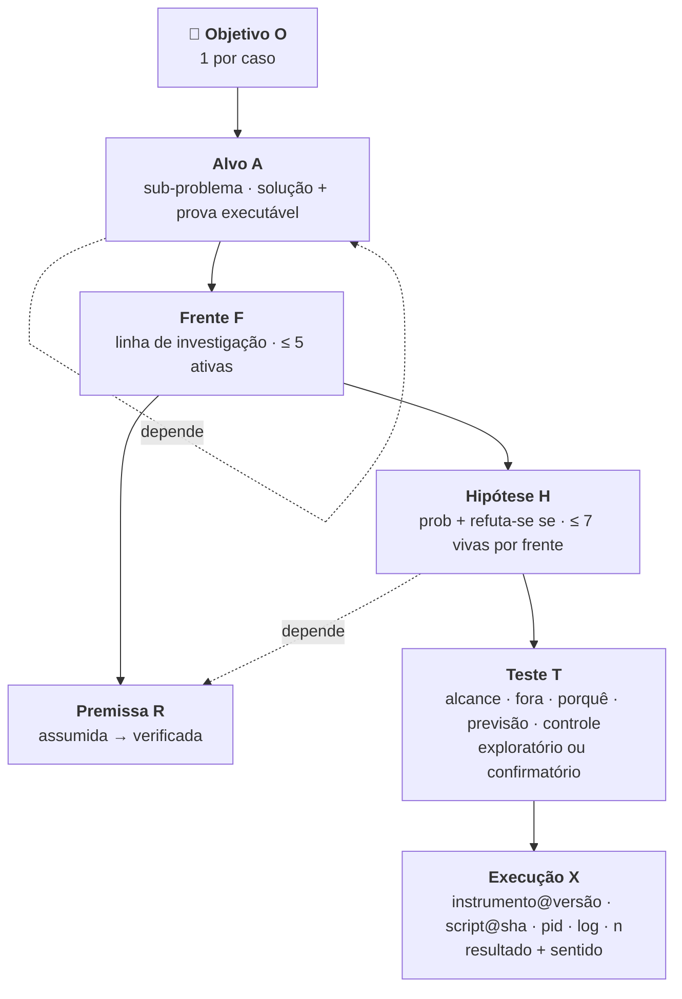
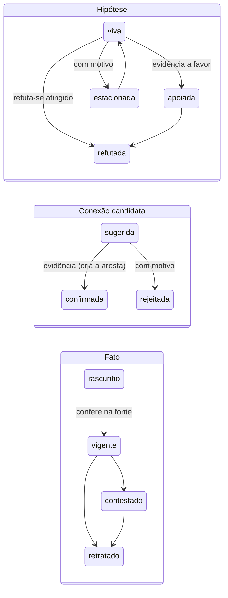
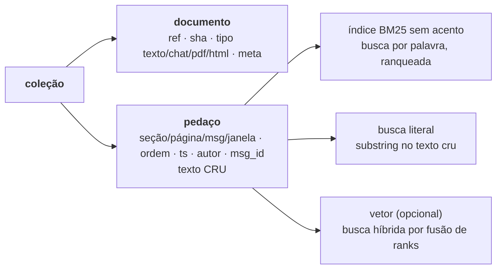

# Modelo de dados do holmes 2.0

Dois bancos SQLite com papéis diferentes:

| Banco | Onde | Guarda | Cresce? |
|---|---|---|---|
| **caso.db** | `casos/<caso>/caso.db` | o *raciocínio*: o que se quer, o que se acha, o que se testou, o que se sabe e de onde | devagar; itens curtos, com limite |
| **corpus.db** | `corpus/corpus.db` | o *material*: chats, documentos, livros, páginas, em pedaços pesquisáveis | muito; nunca é injetado, só consultado |

> [!TIP]
> O caso aponta para o corpus (fonte → documento, citação → pedaço), e o corpus não sabe nada do caso. O
> material pode ser reindexado ou trocado de motor de busca sem tocar no raciocínio.

## caso.db: o grafo do raciocínio

A árvore é o plano: cada nível responde ao de cima.

Ao lado da árvore ficam o que se sabe, de onde veio e o que ainda é pergunta:

Também ficam fora da árvore: **decisão do usuário D** (proíbe / permite), **fio P** (pendência) e
**instrumento I** (versões por sha + verificador). Todo nó tem `legado`: 1 = herdado de outro sistema,
fora dos alertas do mapa até ser mexido.

| Arestas (sempre manuais ou por confirmação de C) | ACH |
|---|---|
| sustenta · enfraquece · contradiz · refuta · depende · duplica · substitui · sobre · deriva · responde · rival | matriz fato × hipótese com CC / C / N / I / II |

### Ontologia: cada conceito da investigação e onde ele mora

O modelo conceitual é rico; o armazenamento, econômico. Só **questão** e **conexão candidata** ganharam tipo
próprio, porque nenhum objeto existente as representava sem deformar o sentido (uma pergunta não é hipótese; uma
relação sugerida não pode ser aresta). O resto é tipo, papel ou relação do que já existia.

| Conceito | Representação | Por que assim |
|---|---|---|
| Objetivo | `objetivo` (1 por caso) | — |
| Questão investigativa | `questao` Q | nem toda pergunta já tem hipótese; a que não tem é **lacuna** |
| Linha de investigação | `frente` F | já agrupava questões e hipóteses |
| Fonte | `fonte` S (procedência, confiabilidade, sha) | — |
| Artefato | `fonte` (o arquivo) ou `entidade --classe artefato` (o objeto do mundo) | um arquivo é fonte; o cofre é entidade |
| Observação | `fato --natureza observacao\|medicao\|citacao`, com `local` e método no resumo | já separava natureza de origem |
| Fato | `fato` vigente e conferido | estado diz se a sustentação vale |
| Pista | **papel**: observação ligada `sobre` uma questão, hipótese ou frente, com o porquê na nota da aresta | a mesma observação pode ser pista para uma questão e nada para outra |
| Evidência | **papel**: fato com célula ACH ou aresta `sustenta`/`enfraquece` para uma hipótese | força depende da hipótese avaliada |
| Inferência / interpretação | `fato --natureza inferencia\|interpretacao` ligado `sobre` o observado | cai sem derrubar a observação |
| Premissa | `premissa` R (assumida → verificada) | — |
| Hipótese | `hipotese` H; **exploratória** sem `refuta_se`, **operacional** com ele | só a operacional recebe teste confirmatório |
| Previsão | `teste.previsao` com hora anterior à execução | — |
| Teste / execução / resultado | `teste` T / `execucao` X / resultado + `sentido` | — |
| Achado | positivo sem selo de validade e verificado (F6) | conclusão autorizada, não só observada |
| Lacuna | questão aberta sem hipótese (`questoes`, `proximo`) | — |
| Contradição | aresta `contradiz` | — |
| Acontecimento do mundo | `entidade --classe evento` + `atributo quando`; `cronologia` | o `evento` do banco é auditoria, não o mundo |
| Síntese / teoria de trabalho | `leitura` L com base, contra, rivais, questão decisiva e lacunas | histórico pelas arestas `substitui` |
| Conexão candidata | `conexao` C: sugerida → confirmada (vira aresta) ou rejeitada (fica, para não ser redescoberta) | sugestão nunca é conhecimento |

Três visões do mesmo banco, por consulta: **plano** (`mapa`, `proximo`, `questoes`), **conhecimento** (`ver`,
`cadeia`, `cronologia`, `busca`) e **explicações** (`leitura`, `ach`, `conexoes`, `cadeia` de uma hipótese).

### Descoberta de relações

`conexoes <id|"texto">` é consulta: devolve até 8 candidatas e grava nada. Canais, do mais ao menos forte:
**ponte** (o texto cita um nome de uma entidade e o outro item cita outro nome ou alias da mesma entidade, o
caminho para relação sem palavra comum), **número** (mesmo número ou sequência hex), **grafo** (vizinho comum),
**termos** (palavras de 4+ letras em comum, sem palavras vazias) e **material** do corpus (híbrido se houver
vetores, senão BM25). Exclui o que já está ligado e o que já foi rejeitado. O agente julga; a promissora vira
`conexao` (sugerida); só `estado C.. confirmada "<evidência>"` cria a aresta. Conceito abstrato que liga pistas
("complementaridade": duas metades, yin-yang) é registrado como entidade com aliases e passa a ligar o que vier.
Medição no caso sintético: `holmes/aval/README.md`.

### Contrato de extração (`extrai <arquivo.json>`)

JSON com as chaves abaixo, todas opcionais (extrair uma observação só é válido). Ids locais (`o1`, `q1`, `h1`)
viram ids do caso; ids do caso (`E42`, `ext:42`) são reusados. Sem `--aplica` mostra o plano; com ele, grava
numa transação (um erro desfaz o lote). `--so`/`--rejeita` escolhem itens. Texto igual a um item existente não
é duplicado.

| Chave | Item | Vira |
|---|---|---|
| `fonte` | `"S12"` | fonte padrão das observações |
| `observacoes` | `id, texto, natureza?, local?, metodo?, limites?, pedaco?, grau?, origem?, existente?` | `fato` (com `pedaco`, citação literal copiada e conferida); interpretação aqui é recusada |
| `pistas` | `obs, sobre?, porque` | aresta `obs sobre <Q/H/F>` (padrão: o objetivo) |
| `interpretacoes` | `id, sobre, texto, alternativas?, confianca?` | `fato --natureza interpretacao` ligado `sobre` |
| `questoes` | `id, texto, pai?, motivada_por?` | `questao` (+ `deriva` dos motivos) |
| `hipoteses` | `id, texto, pai, responde?, motivada_por?, premissas?, rivais?, prob?, refuta_se?` | `hipotese` + `responde`, `deriva`, `depende`, `rival` |
| `conexoes` | `de, para, relacao, porque, rival?, discriminador?, motivos?` | `conexao` **só sugerida** (confirmada é recusada) |
| `discriminadores` | `entre: [h1, h2], observacao` | `fio` ligado `sobre` as hipóteses |
| `impacto` | `plano?, leitura?` | mostrado, nunca aplicado sozinho (a síntese é deliberada) |

### Por que cada parte existe (lição → campo)

| Lição do v1 | Como o modelo responde |
|---|---|
| Sem âncora do plano | A árvore objetivo→alvo→frente→hipótese→teste *é* o plano; `mapa` só a percorre. |
| Atacava tudo ao mesmo tempo ("todas as partes de uma vez") | `alvo` com `depende` entre alvos; o mapa mostra quais estão desbloqueados. |
| Teste escrito ≠ executado ≠ fechado | `teste` é a receita; `execucao` é cada rodada. O resultado do teste é o da última execução válida. Rodar de novo após consertar o instrumento não apaga a anterior. |
| 78% dos negativos sem instrumento; instrumento mudou e ninguém soube | `execucao` grava `instrumento@versão` (sha) e `script@sha`. Negativo sem instrumento = INDETERMINADO; versão antiga = A REVALIDAR; `controle_ok=0` = INVÁLIDO. |
| "Fechado/exaustivo" sem escopo | `alcance` obrigatório, `fora` opcional; o texto padrão do negativo é "0 em <alcance>". |
| Esqueceu o porquê do teste | `porque` obrigatório: "se positivo abre X; se negativo fecha Y". |
| Padrão achado depois de olhar | `previsao` com carimbo de hora anterior à primeira execução; o `ver` mostra se a previsão veio antes ou depois. |
| Controle plantado com o mesmo bug | `controle_tipo`: real, plantado, sabotagem ou nenhum. O mapa conta negativos sem controle real. |
| Interpretação de terceiro virou fala do autor | `fato.natureza` (observação, medição, citação, inferência, interpretação, relato) separada de `origem` (autor, fonte, medido, usuário, agente, externo) e de `grau` A/B/C. |
| Citação errada, número "lembrado" | `cita <pedaço>` copia o texto literal do corpus para o fato; `conferido` guarda quando foi checado na fonte; `rascunho` até conferir. |
| Premissa virou fato | `premissa` é tipo próprio, nasce `assumida`; o mapa lista as assumidas por frente. |
| Refutação não chegava aos dependentes | arestas `depende`/`sustenta`; o mapa e o `ver` alertam quando algo depende de item refutado, retratado ou contestado. |
| Contradições ignoradas (3 localizações do mesmo conceito) | aresta `contradiz` entre dois itens vivos aparece no mapa até um ser retratado ou a aresta ser desfeita. |
| Busca por palavra perdia sinônimos ("chave/fechadura" × "tumblers/lock") | `entidade` com `aliases`: a busca expande o termo pelos aliases da entidade. |
| Mesma fórmula reconstruída 3 vezes; índices 0/1-base trocados | `atributo` da entidade (chave → valor), cada um apontando o fato que o sustenta; histórico no evento. |
| "Provado" que ninguém conseguia re-provar | `prova` (comando que sai 0) em fato, alvo e instrumento (`verificador`); `prova` lista os comandos e só os executa com `--executa` (são shell vindo do banco; os herdados, só com `--legado`). |
| Hipótese "viva" para sempre, sem peso | `hipotese.prob` com histórico (cada mudança é evento) e `refuta_se`; ACH mostra qual evidência distingue as rivais. |
| Ordens do usuário esquecidas ou aplicadas demais | `decisao` com `proibe` e `permite` explícitos; o mapa lista as vigentes. |
| Fios colhidos por regex (456 abertos) | `fio` só por comando, com pai opcional; fechar exige motivo. |
| Arestas automáticas = 61% do grafo | Nenhuma aresta automática. Similaridade é consulta (`busca`), não dado. |
| Ids colidindo entre sessões | AUTOINCREMENT do SQLite em WAL; o prefixo é só exibição e é conferido na leitura (H12 que é teste dá erro). |
| Leitura mecânica: pista testada como string, livro varrido por termo, saída julgada só por p | `leitura` (quadro de conjunto no topo do mapa) e `execucao.sentido` em quatro estados (substantivo, nenhum, revisar, pendente), sem obrigar texto vazio. A leitura de conjunto é pedida por **evento** (positivo, conexão confirmada, questão respondida, hipótese refutada ou apoiada, fato retratado); a contagem de `HOLMES_LEITURA` resultados é só lembrete. |
| Um 0 matava a ideia inteira | hipótese = conceito, teste = uma forma dele. `teste` recusa hipótese sem `refuta_se` (exceto `--exploratorio`); o conceito só cai quando ele é atingido, mas negativos válidos acumulados baixam a `prob`. |
| Pistas sem relação aparente nunca se encontravam | `conexoes` (consulta por cinco canais) + `conexao` candidata, confirmada só com evidência. |
| Pergunta sem hipótese não tinha onde morar | `questao`; sem hipótese ela aparece como lacuna em `questoes` e `proximo`. |
| A teoria de trabalho era um parágrafo solto | `leitura --sustenta --enfraquece --rival --questao --lacuna --motivo`; base que cai torna a leitura dependente quebrada. |
| O agente não sabia o que fazer em seguida | `proximo`: recomendação explicada por critérios verificáveis (abaixo). |
| Dívida migrada afogava o sinal novo (122 alertas) | `no.legado`: herdado fica fora dos alertas, numa linha de contagem; `toca` (qualquer mudança) zera a marca. |
| Decisões viraram depósito | `decisao` é só o que o usuário determinou; escolha de método do agente é `fato` de natureza inferência. |
| Texto gigante nos nós | título ≤ 160, resumo ≤ 800, citação ≤ 1000. O resto fica no corpus ou em `notas/`. |

### Estados

| Tipo | Estados (o 1º é o inicial) | Mudança que exige motivo |
|---|---|---|
| objetivo | aberto, atingido, abandonado | atingido, abandonado |
| alvo | aberto, resolvido, bloqueado | resolvido (com `--solucao`), bloqueado |
| frente | ativa, estacionada, fechada, descartada | todas menos ativa |
| hipótese | viva, apoiada, refutada, estacionada | refutada, estacionada |
| premissa | assumida, verificada, refutada | verificada, refutada |
| teste | planejado, rodando, feito, cancelado | cancelado (rodando/feito vêm das execuções) |
| fato | rascunho, vigente, contestado, retratado | contestado, retratado |
| entidade | ativa, fundida | fundida |
| decisão | vigente, revogada | revogada |
| fio | aberto, fechado, estacionado | fechado, estacionado |
| fonte | catalogada, indexada | — |
| instrumento | vigente, obsoleto | obsoleto |
| leitura | vigente, substituida | — (a nova substitui a anterior e exige `--motivo`) |
| questão | aberta, respondida, reformulada, estacionada | respondida, reformulada, estacionada |
| conexão | sugerida, confirmada, rejeitada | confirmada (cria a aresta), rejeitada |

Os três ciclos que mais pesam no raciocínio:

### Validade de um resultado (calculada, nunca digitada)

> [!IMPORTANT]
> O selo de validade é calculado pelo banco a cada consulta. Ninguém escreve "válido" à mão.

Separa quatro coisas: a execução aconteceu; o resultado foi observado; o controle passou (visto, não declarado);
a conclusão está autorizada. Vale para negativo e positivo; a primeira linha que bater é o selo.

| Situação da execução | Como aparece |
|---|---|
| `controle_ok = 0` | INVÁLIDO (o controle falhou) |
| teste `--exploratorio` | exploratório: pista, não fecha nem confirma |
| negativo sem instrumento registrado | INDETERMINADO |
| negativo, e o instrumento mudou de versão depois | A REVALIDAR |
| `--script` dado, mas o arquivo não existia ao rodar | script não versionado |
| sem controle, ou só plantado | sem controle real |
| controle real declarado, mas `--controle-ok` não informado | controle não confirmado |
| tudo certo | sem aviso |

### Próximo passo (`proximo`, e as 2 primeiras linhas no mapa)

Recomendação explicada, não ranking numérico. Critérios na ordem, do que mais muda o rumo ao que menos muda, só
sobre itens do 2.0 (o legado não dirige): (1) túnel numa frente → LEITURA; (2) a leitura vigente perdeu base; (3)
evento relevante desde a leitura (inclui contradição registrada e hipótese ligada à leitura que mudou
≥ 0,2 de peso); resultado A REVALIDAR → rodar de novo com o instrumento atual; (4) para a questão decisiva da leitura e as questões abertas: sem hipótese →
formular; uma só → gerar rival; várias sem evidência que as distinga na ACH → achar o discriminador; com
discriminação → teste da líder (ou dar `--refuta-se`); (5) conexão sugerida parada, primeiro a que liga frentes
diferentes; (6) fato em rascunho que sustenta algo → conferir; (7) hipótese viva com critério e sem teste. Sem
nada disso: ler melhor a fonte primária.

### Alertas derivados que o `mapa` mostra
- **Túnel:** N negativos seguidos numa frente desde a última hipótese nova ou o último positivo. Conta os
  indeterminados (esforço sem avanço) e informa à parte quantos foram válidos (instrumento e controle vistos):
  só esses sustentam conclusão.
- **Dependência quebrada:** item vivo que depende de algo refutado, retratado ou contestado.
- **Contradição aberta:** `contradiz` entre dois itens vivos.
- **Execução órfã:** "rodando" com PID morto.
- **Premissas assumidas** por frente, e **fatos em rascunho** à espera de conferência.
- **Alvos desbloqueados:** abertos cujas dependências estão resolvidas, ou seja, onde atacar.
- **Leitura de conjunto:** pedida por evento relevante desde a leitura vigente; lembrete após N resultados.
- **Questões abertas** (até 3, com "lacuna" quando sem hipótese) e a contagem de **conexões candidatas** paradas.
- **Herdado:** contradições, dependências e negativos de itens com `legado=1` viram uma linha de contagem.

## corpus.db: o material

- **Chat** (export JSON do Telegram Desktop ou JSONL `{id, ts, autor, texto}`): um pedaço por mensagem
  mais janelas de 8 mensagens para busca por contexto; `janela <msg>` devolve a conversa ao redor.
- **Texto** (md, txt, html, json, csv): parágrafos agrupados em ~1.200 caracteres.
- **PDF/livro**: uma página por pedaço (precisa do `pdftotext`).
- **Vetores**: qualquer servidor compatível com Ollama (`HOLMES_EMBED_URL`, `HOLMES_EMBED_MODELO`).
  Sem ele, a busca funciona só com BM25 e literal. No v1, o BM25 sozinho já teve recall@5 de 100%.
- O texto é guardado cru. Nada é achatado, porque achatar quebras de linha escondeu um padrão vertical
  no v1.
