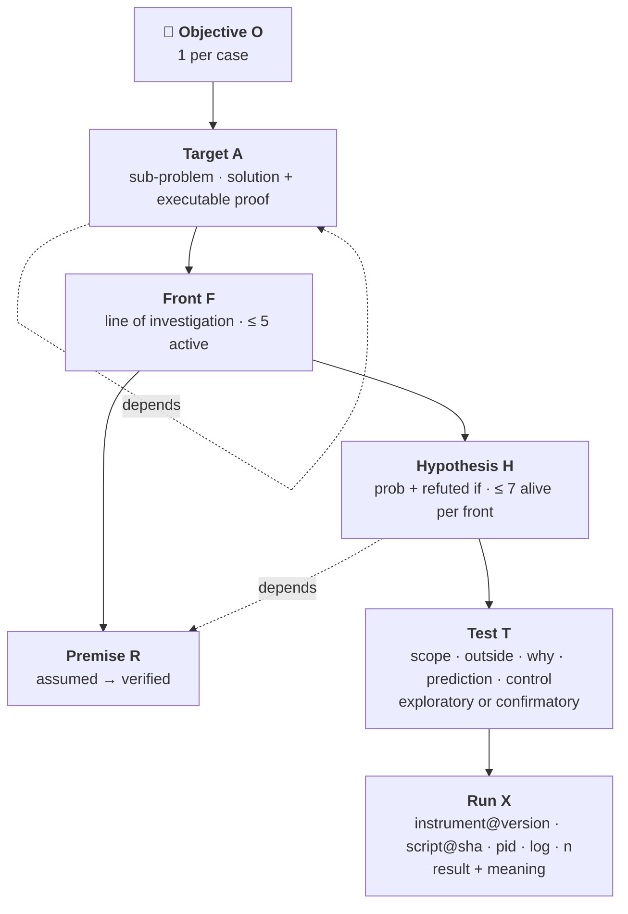
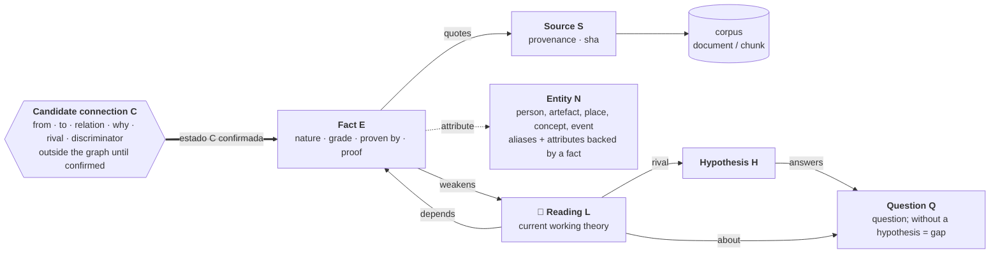
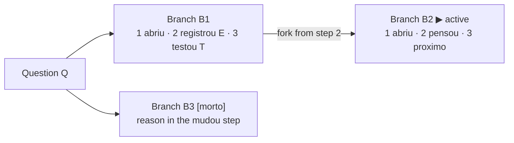
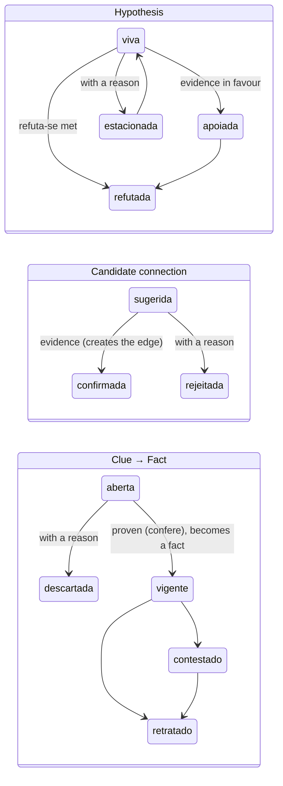
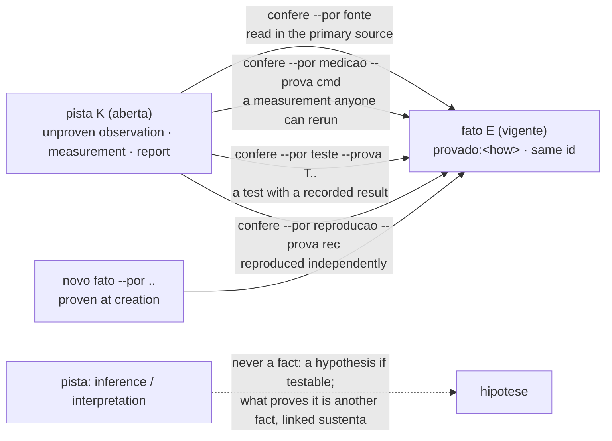
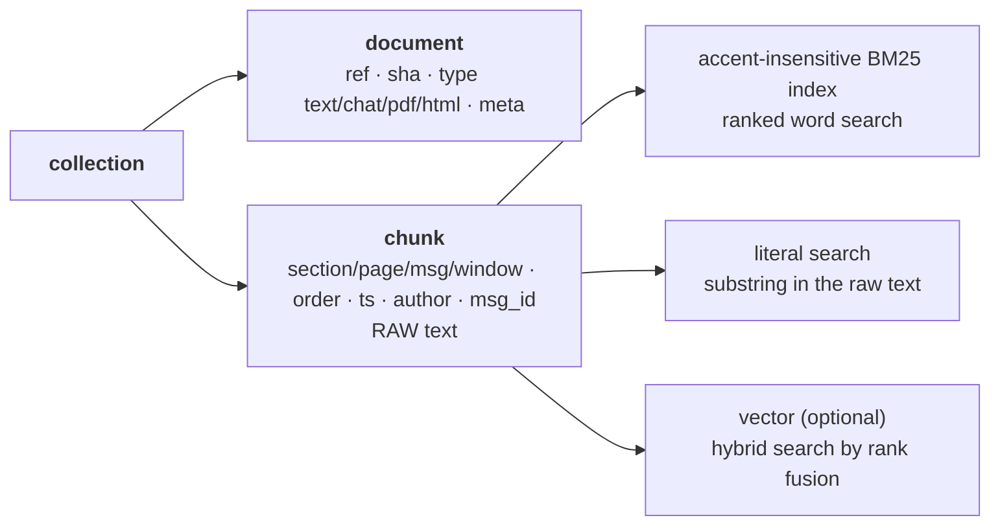

# holmes 2.0 data model

Two SQLite databases with different roles. Type, state and command names are the CLI's own tokens, in
Portuguese (`fato` = fact, `ramo` = branch, `passo` = step...).

| Database | Where | Holds | Grows? |
|---|---|---|---|
| **caso.db** | `casos/<case>/caso.db` | the *reasoning*: what is wanted, what is found, what was tested, what is known and where from | slowly; short items, with limits |
| **corpus.db** | `corpus/corpus.db` | the *material*: chats, documents, books, pages, in searchable chunks | a lot; never injected, only queried |

> [!TIP]
> The case points to the corpus (source → document, quote → chunk), and the corpus knows nothing about the case.
> The material can be reindexed or moved to another search engine without touching the reasoning.

## caso.db: the reasoning graph

The tree is the plan: each level answers to the one above.

Next to the tree sit what is known, where it came from and what is still a question:

Also outside the tree: **user decision D** (forbids / allows), **thread P** (a pending item) and **instrument I**
(versions by sha + verifier). Every node has `legado`: 1 = inherited from another system, kept out of the map's
alerts until touched.

| Edges (always manual or by confirming a C) | ACH |
|---|---|
| sustenta · enfraquece · contradiz · refuta · depende · duplica · substitui · sobre · deriva · responde · rival | fact × hypothesis matrix with CC / C / N / I / II |

### Branches and steps: the path of the reasoning

The tree above says **what** is being investigated. The **branch B** keeps **how each thing was reached**: a
line of reasoning born from a point (a question, a hypothesis, a target or a step of another branch) with the
why of its existence, accumulating **steps** in order, like commits. A step is not edited: a course correction
is a new step (`corrigiu`, `mudou`) or a new branch born from an earlier step (`ramo novo .. --de B.. --passo N`),
like a fork. A worked example: [EXEMPLO.md](EXEMPLO.md).

| Piece | What it keeps |
|---|---|
| `ramo` (node B, `pai` = point of origin) | the line's question · state ativo/pausado/morto/fundido/concluido · `de_passo` when born from a step |
| `passo` (table) | branch · type · text · **why** · nodes produced · when. Manual: leu, pensou, testou, achou, corrigiu, decidiu, proximo (require `--porque`). Automatic: abriu, bifurcou, registrou, mudou, testou |
| active branch (`.holmes/ramo-<case>`) | every `novo`, `teste`, `resultado` and `estado` becomes a step of it, and the node created carries `no.ramo` |

Queries: `arvore [id]` (trunk + every branch, never a twig without the path to it), `trilha [B..]` (from the root
to the branch, with each step and its why; from the ancestors, only the steps up to the fork point), `ficha` (one
page: immediate goal, latest steps, next experiment, what was already walked there, what is solved, other open
lines). Steps are searchable: `busca` finds a branch by what was done in it.

### Ontology: each investigation concept and where it lives

The conceptual model is rich; the storage, economical. Only **question**, **candidate connection**,
**branch** and **clue** got their own type, because no existing object represented them without distorting the meaning (a
question is not a hypothesis; a suggested relation cannot be an edge; a path is not a node of the plan; what is not
proven is not a fact). The
rest is a type, role or relation of what already existed.

| Concept | Representation | Why so |
|---|---|---|
| Objective | `objetivo` (1 per case) | — |
| Investigative question | `questao` Q | not every question already has a hypothesis; one without is a **gap** |
| Line of investigation (plan) | `frente` F | it already grouped questions and hypotheses |
| Line of reasoning (path) | `ramo` B + `passo` | where it came from, what was done, why it turned |
| Source | `fonte` S (provenance, reliability, sha) | — |
| Artefact | `fonte` (the file) or `entidade --classe artefato` (the object in the world) | a file is a source; the safe is an entity |
| Observation | `fato --natureza observacao\|medicao\|citacao`, with `local` and method in the summary | it already separated nature from origin |
| Fact | `fato` E: a finding already proven, born `vigente` with `conferido_por` (source, measurement, test or reproduction) | a fact is a finding, and says how it holds; the proof need not be a source |
| Clue | `pista` K: what is not yet proven (an observation or measurement without proof, a report, an inference, an interpretation); proven by `confere`, an observation or report clue becomes a fact with the same id | an unproven claim is never a fact |
| Clue (role) | an observation linked `sobre` a question, hypothesis or front, with the why in the edge's note | the same observation can be a clue for one question and nothing for another |
| Evidence | **role**: a fact with an ACH cell or a `sustenta`/`enfraquece` edge to a hypothesis | its strength depends on the hypothesis assessed |
| Inference / interpretation | `pista --natureza inferencia\|interpretacao` linked `sobre` what was observed | it falls without bringing down the observation; it never becomes a fact (if testable, it becomes a hypothesis) |
| Premise | `premissa` R (assumed → verified) | — |
| Hypothesis | `hipotese` H; **exploratory** without `refuta_se`, **operational** with it | only the operational one gets a confirmatory test |
| Prediction | `teste.previsao` timestamped before the run | — |
| Test / run / result | `teste` T / `execucao` X / result + `sentido` | — |
| Finding | a positive without a validity flag and verified (F6) | an authorized conclusion, not just an observed one |
| Gap | an open question without a hypothesis (`questoes`, `proximo`) | — |
| Contradiction | `contradiz` edge | — |
| Event in the world | `entidade --classe evento` + `atributo quando`; `cronologia` | the database's `evento` table is auditing, not the world |
| Synthesis / working theory | `leitura` L with basis, against, rivals, decisive question and gaps | history through `substitui` edges |
| Candidate connection | `conexao` C: suggested → confirmed (becomes an edge) or rejected (stays, so it is not rediscovered) | a suggestion is never knowledge |

Four views of the same database, by query: **plan** (`mapa`, `proximo`, `questoes`), **knowledge** (`ver`,
`cadeia`, `cronologia`, `busca`), **explanations** (`leitura`, `ach`, `conexoes`, `cadeia` of a hypothesis) and
**path** (`arvore`, `trilha`, `ficha`).

### Discovering relations

`conexoes <id|"text">` is a query: it returns up to 8 candidates and records nothing. Channels, from strongest to
weakest: **bridge** (the text cites one name of an entity and the other item cites another name or alias of the
same entity, the path to a relation with no shared word), **number** (the same number or hex sequence),
**graph** (a common neighbour), **terms** (shared words of 4+ letters, without stop words) and corpus
**material** (hybrid if there are vectors, otherwise BM25). It excludes what is already linked and what was
already rejected. The agent judges; the promising one becomes a `conexao` (suggested); only
`estado C.. confirmada "<evidence>"` creates the edge. An abstract concept that links clues ("complementarity":
two halves, yin-yang) is recorded as an entity with aliases and starts linking whatever comes. Measurement on
the synthetic case: `holmes/aval/README.md`.

### Extraction contract (`extrai <file.json>`)

JSON with the keys below, all optional (extracting a single observation is valid). Local ids (`o1`, `q1`, `h1`)
become case ids; case ids (`E42`, `ext:42`) are reused. Without `--aplica` it shows the plan; with it, it records
in one transaction (an error undoes the batch). `--so`/`--rejeita` pick items. Text identical to an existing item
is not duplicated.

| Key | Item | Becomes |
|---|---|---|
| `fonte` | `"S12"` | the observations' default source |
| `observacoes` | `id, texto, natureza?, local?, metodo?, limites?, pedaco?, por?, prova?, grau?, origem?, existente?` | `fato` if proven (`pedaco` = literal quote, proven by source; or `por` + `prova`), otherwise `pista`; an interpretation here is refused |
| `pistas` | `obs, sobre?, porque` | edge `obs sobre <Q/H/F>` (default: the objective) |
| `interpretacoes` | `id, sobre, texto, alternativas?, confianca?` | `pista --natureza interpretacao` linked `sobre` |
| `questoes` | `id, texto, pai?, motivada_por?` | `questao` (+ `deriva` from the motives) |
| `hipoteses` | `id, texto, pai, responde?, motivada_por?, premissas?, rivais?, prob?, refuta_se?` | `hipotese` + `responde`, `deriva`, `depende`, `rival` |
| `conexoes` | `de, para, relacao, porque, rival?, discriminador?, motivos?` | `conexao` **only suggested** (confirmed is refused) |
| `discriminadores` | `entre: [h1, h2], observacao` | `fio` linked `sobre` the hypotheses |
| `impacto` | `plano?, leitura?` | shown, never applied by itself (synthesis is deliberate) |

### Why each part exists (lesson → field)

| v1 lesson | How the model answers |
|---|---|
| No anchor for the plan | The objective→target→front→hypothesis→test tree *is* the plan; `mapa` only walks it. |
| Attacked everything at once ("all the parts together") | `alvo` with `depende` between targets; the map shows which are unblocked. |
| Test written ≠ run ≠ closed | `teste` is the recipe; `execucao` is each round. A test's result is that of its last valid run. Rerunning after fixing the instrument does not erase the previous one. |
| 78% of negatives without an instrument; the instrument changed and nobody knew | `execucao` records `instrument@version` (sha) and `script@sha`. Negative without an instrument = INDETERMINADO; old version = A REVALIDAR; `controle_ok=0` = INVÁLIDO. |
| "Closed/exhaustive" without a scope | `alcance` mandatory, `fora` optional; the default text of a negative is "0 in <scope>". |
| Forgot why the test was run | `porque` mandatory: "if positive it opens X; if negative it closes Y". |
| Pattern found after looking | `previsao` timestamped before the first run; `ver` shows whether the prediction came before or after. |
| Planted control with the same bug | `controle_tipo`: real, planted, sabotage or none. The map counts negatives without a real control. |
| A third party's interpretation became the author's words | `fato.natureza` (observation, measurement, quote, inference, interpretation, report) separate from `origem` (author, source, measured, user, agent, external) and from `grau` A/B/C. |
| Wrong quote, "remembered" number | `cita <chunk>` copies the corpus' literal text into the fact; `conferido` + `conferido_por` keep when and how it was proven (source, measurement, test, reproduction); `rascunho` until proven. |
| Premise became a fact | `premissa` is its own type, born `assumida`; the map lists the assumed ones per front. |
| Refutation did not reach the dependants | `depende`/`sustenta` edges; the map and `ver` warn when something depends on a refuted, retracted or contested item. |
| Word search missed synonyms ("key/lock" × "tumblers/lock") | `entidade` with `aliases`: the search expands the term by the entity's aliases. |
| The same formula rebuilt 3 times; 0/1-based indexes swapped | the entity's `atributo` (key → value), each one pointing to the fact that backs it; history in the event table. |
| "Proven" that nobody could re-prove | `prova` (a command that exits 0) on fact, target and instrument (`verificador`); `prova` lists the commands and only runs them with `--executa` (they are shell coming from the database; the inherited ones only with `--legado`). |
| Hypothesis "alive" forever, without weight | `hipotese.prob` with history (each change is an event) and `refuta_se`; ACH shows which evidence distinguishes the rivals. |
| User orders forgotten or over-applied | `decisao` with explicit `proibe` and `permite`; the map lists the current ones. |
| Threads harvested by regex (456 open) | `fio` only by command, with an optional parent; closing requires a reason. |
| Automatic edges = 61% of the graph | No automatic edges. Similarity is a query (`busca`), not data. |
| Ids colliding between sessions | SQLite AUTOINCREMENT in WAL; the prefix is display only and is checked on reading (an H12 that is a test raises an error). |
| Mechanical reading: clue tested as a string, book swept by term, output judged only by p | `leitura` (the overall picture at the top of the map) and `execucao.sentido` in four states (substantive, none, revisit, pending), without forcing empty text. The overall reading is requested by **event** (positive, connection confirmed, question answered, hypothesis refuted or supported, fact retracted); the `HOLMES_LEITURA` result count is only a reminder. |
| One 0 killed the whole idea | hypothesis = concept, test = one form of it. `teste` refuses a hypothesis without `refuta_se` (except `--exploratorio`); the concept only falls when that is met, but accumulated valid negatives lower the `prob`. |
| Clues with no apparent relation never met | `conexoes` (a query over five channels) + candidate `conexao`, confirmed only with evidence. |
| A question without a hypothesis had nowhere to live | `questao`; without a hypothesis it shows up as a gap in `questoes` and `proximo`. |
| The working theory was a loose paragraph | `leitura --sustenta --enfraquece --rival --questao --lacuna --motivo`; a basis that falls makes the reading a broken dependant. |
| The agent did not know what to do next | `proximo`: a recommendation explained by verifiable criteria (below). |
| Migrated debt drowned the new signal (122 alerts) | `no.legado`: the inherited stays out of the alerts, on one count line; `toca` (any change) clears the mark. |
| Decisions became a dumping ground | `decisao` is only what the user determined; the agent's choice of method is a `fato` of nature inference. |
| Huge text in the nodes | title ≤ 160, summary ≤ 800, quote ≤ 1000. The rest goes to the corpus or `notas/`. |
| The path was lost: conclusions rediscovered, corrections overwriting the why | `ramo` + `passo` (above): every line born from a point with a why, immutable steps, forks, `trilha`/`arvore`/`ficha`. |
| "Fact" meant "checked against a source", and inferences and reports were stored as facts | a fact is a finding already proven (`novo fato --por ..`); what is not proven is a `pista`; `confere` proves a clue into a fact; `reorganiza` brings an old database to this model |

### States

| Type | States (the 1st is the initial one) | Change that requires a reason |
|---|---|---|
| objetivo | aberto, atingido, abandonado | atingido, abandonado |
| alvo | aberto, resolvido, bloqueado | resolvido (with `--solucao`), bloqueado |
| frente | ativa, estacionada, fechada, descartada | all but ativa |
| hipotese | viva, apoiada, refutada, estacionada | refutada, estacionada |
| premissa | assumida, verificada, refutada | verificada, refutada |
| teste | planejado, rodando, feito, cancelado | cancelado (rodando/feito come from the runs) |
| fato | vigente, contestado, retratado | contestado, retratado (a fact is born proven) |
| pista | aberta, descartada | descartada (proven, it becomes a `fato`) |
| entidade | ativa, fundida | fundida |
| decisao | vigente, revogada | revogada |
| fio | aberto, fechado, estacionado | fechado, estacionado |
| fonte | catalogada, indexada | — |
| instrumento | vigente, obsoleto | obsoleto |
| leitura | vigente, substituida | — (the new one replaces the previous and requires `--motivo`) |
| questao | aberta, respondida, reformulada, estacionada | respondida, reformulada, estacionada |
| conexao | sugerida, confirmada, rejeitada | confirmada (creates the edge), rejeitada |
| ramo | ativo, pausado, morto, fundido, concluido | all but ativo (the reason becomes the why of the `mudou` step) |

The cycles that weigh most on the reasoning:

**Fact or clue.** A fact is a finding already proven, and says how. Everything not yet proven is a clue:

`cita <chunk>` comes out as a fact proven by source (an interpretation of the excerpt is refused: it is a clue). `--por fonte` must point to the source (`--fonte`, `--citacao` or `--local`, also accepted by `confere`; a note alone is not a locator). A test proves only with a valid positive result. `confere` does not revive what fell (`retratado`, `contestado`, `descartada`): reopen with `estado` first. In `extrai`, an observation becomes a fact only if proven
(`pedaco`, or `por` + `prova` when not external); otherwise it is a clue. External material never proves itself. An old database (inferences and reports stored as facts)
is brought to this model by `reorganiza --aplica`, which turns every unproven fact into a clue with the same id.

### Validity of a result (computed, never typed)

> [!IMPORTANT]
> The validity flag is computed by the database at every query. Nobody writes "valid" by hand.

It separates four things: the run happened; the result was observed; the control passed (seen, not declared);
the conclusion is authorized. It applies to negatives and positives; the first matching line is the flag.

| Run situation | How it shows |
|---|---|
| `controle_ok = 0` | INVÁLIDO (the control failed) |
| `--exploratorio` test | exploratory: a lead, neither closes nor confirms |
| negative without a recorded instrument | INDETERMINADO |
| negative, and the instrument changed version afterwards | A REVALIDAR |
| `--script` given, but the file did not exist when running | unversioned script |
| no control, or only planted | no real control |
| real control declared, but `--controle-ok` not given | control not confirmed |
| all good | no warning |

### Next step (`proximo`, and the map's first 2 lines)

An explained recommendation, not a numerical ranking. Criteria in order, from what changes course most to what
changes it least, only over 2.0 items (the inherited does not steer): (1) a tunnel in a front → LEITURA; (2) the
current reading lost its basis; (3) a relevant event since the reading (includes a recorded contradiction and a
hypothesis linked to the reading whose weight changed ≥ 0.2); a result A REVALIDAR → rerun with the current
instrument; (4) for the reading's decisive question and the open questions: no hypothesis → formulate one; only
one → generate a rival; several without ACH evidence that distinguishes them → find the discriminator; with
discrimination → test the leader (or give it a `--refuta-se`); (5) a stalled suggested connection, first the one
linking different fronts; (6) an open clue that something depends on → prove it or drop it; (7) a live hypothesis with a
criterion and no test. With none of that: read the primary source better.

### Derived alerts the `mapa` shows
- **Tunnel:** N consecutive negatives in a front since the last new hypothesis or the last positive. It counts the
  indeterminate ones (effort without progress) and reports separately how many were valid (instrument and
  control seen): only those support a conclusion.
- **Broken dependency:** a live item that depends on something refuted, retracted or contested.
- **Open contradiction:** `contradiz` between two live items.
- **Orphan run:** "rodando" with a dead PID.
- **Assumed premises** per front, and **open clues** waiting to be proven or dropped.
- **Unblocked targets:** open ones whose dependencies are resolved, i.e. where to attack.
- **Overall reading:** requested by a relevant event since the current reading; a reminder after N results.
- **Open questions** (up to 3, with "gap" when without a hypothesis) and the count of stalled **candidate
  connections**.
- **Active branch:** the line of reasoning in progress and its last two steps.
- **Inherited:** contradictions, dependencies and negatives of items with `legado=1` become one count line.

## corpus.db: the material

- **Chat** (Telegram Desktop JSON export or JSONL `{id, ts, autor, texto}`): one chunk per message plus windows of
  8 messages for context search; `janela <msg>` returns the surrounding conversation.
- **Text** (md, txt, html, json, csv): paragraphs grouped into ~1,200 characters.
- **PDF/book**: one page per chunk (requires `pdftotext`).
- **Vectors**: any Ollama-compatible server (`HOLMES_EMBED_URL`, `HOLMES_EMBED_MODELO`). Without it, search works
  with BM25 and literal only. In v1, BM25 alone already reached recall@5 of 100%.
- Text is stored raw. Nothing is flattened, because flattening line breaks hid a vertical pattern in v1.
