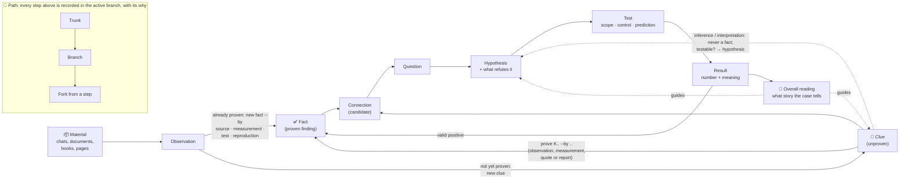
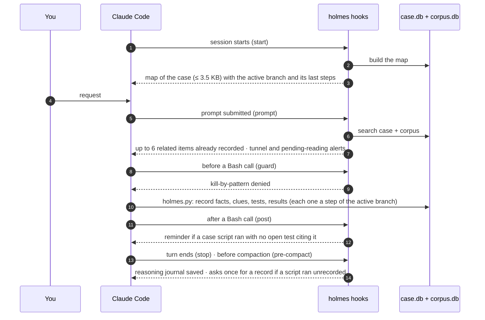

# 🔎 holmes 2.0

**English** · [Português](README.pt-BR.md)


**A kit that lets Claude Code run long investigations without losing the thread, fooling itself, or
repeating work.**

It fits any investigation where evidence arrives in fragments, several explanations compete, and jumping to
a conclusion is costly:

| | |
|---|---|
| 🧩 **Riddles and puzzles** | layered clues, ciphers, hints with double meanings |
| 🔎 **Audits and data forensics** | spreadsheets, logs, transactions, whatever doesn't add up |
| 📚 **Research** | literature, historical sources, fact-checking, "who said what, and where" |
| 🐛 **Hard debugging** | intermittent failures, many possible causes, expensive tests |
| 🕵️ **Inquiries** | timelines, entities, contradictions between accounts |

> [!NOTE]
> Everything is in English: documentation, rules, skills, agents, the CLI, its states and its output labels.
> A Portuguese README is in [README.pt-BR.md](README.pt-BR.md).

## The problem it solves

An AI agent in a long investigation fails in the same ways every time:

- 🧭 it **forgets the plan** after a few hours;
- 🔁 it **re-tests** what it already tested;
- 🕳️ it treats **"I didn't find it" as "it doesn't exist"**;
- 🎯 it finds a **pattern it drew around the data** itself;
- 📜 it reads a clue **literally** when it meant something else.

holmes was designed around these failures, observed across 64 real sessions of an investigation that lasted
several weeks ([LESSONS.md](LESSONS.md)).

## How it works



- **The plan is a query, not a document.** All reasoning lives in one SQLite database per case:
  objective, fronts, hypotheses with refutation criteria, tests, results, facts with origin and grade, user
  decisions, open threads. Every session opens with a `map` of at most 3.5 KB generated from the database,
  including the active branch. Everything else is pulled by id when needed, so the case fits in the context
  window however big it grows.
- **Facts are proven, clues are not.** A fact is a finding already proven by a source, a measurement, a test or
  a reproduction (`new fact --by ..`). Anything not yet proven is a clue (`new clue`). A clue of observation or
  report becomes a fact with `prove`; an inference never does: it stays a clue or becomes a hypothesis.
- **The path is a tree.** Each line of reasoning is a *branch* born from a point (a question, a hypothesis,
  a step of another branch) that accumulates *steps* with their why, like commits. You can go back to a step
  and take another direction (a fork) without erasing anything; `trail` rebuilds the path from the root to
  any branch, `tree` shows every line and where it was born, and `sheet` says on one page where we are and
  why. Annotated example: [EXAMPLE.md](EXAMPLE.md).
- **Material lives in a searchable corpus.** Chats, documents, books and pages are split into chunks and
  indexed (BM25, literal, vector or hybrid). The agent searches and quotes the literal passage instead of
  opening huge files.
- **Rigor where it matters.** Every hypothesis states what would refute it. Every test declares what it
  covers and what it doesn't. A negative without a registered instrument counts as INDETERMINATE, and
  nothing is ever "exhausted", only "0 in &lt;scope&gt;". Claims from third parties or other AIs enter at
  low grade until checked against the primary source.
- **Reading for meaning, not just mechanics.** A clue is read in layers (literal, figurative, allusion,
  function, subliminal, absence) before it becomes an operation. When something changes the picture, the
  map asks for an *overall reading*: what story the case seems to tell and where we are in it.
- **A team of specialized agents**, each with a narrow role: archivist, researcher, analyst, interpreter,
  engineer, reviewer, blind verifier and skeptic (devil's advocate).

### Hooks keep the agent on the method



> [!TIP]
> Everything runs on the Python standard library and SQLite. No server, no external service, no
> `pip install`.

## Getting started

```bash
git clone https://github.com/jhonymiler/holmes.git my-investigation && cd my-investigation
python3 -I holmes/test_holmes.py                                  # self-check
python3 -I holmes/holmes.py init my-case "One sentence with a verifiable objective"
```

`init` creates `cases/my-case/` (with `case.db`, `CASE.md`, `sources/`, `outputs/`, `notes/`, `scripts/`) and
makes it the active case. Fill in `cases/my-case/CASE.md` and the "This machine's environment" section of
`CLAUDE.md`, then open Claude Code at the root. The first time, Claude Code asks you to trust the folder so the
hooks can load.

A first session usually looks like this (the ids are the ones a fresh case gives):

```bash
H() { python3 -I holmes/holmes.py "$@"; }
H map                                                             # where we are (the start hook injects it too)
H source cases/my-case/sources/report.txt                         # S2: register the source and index it
H new front "Who signed the report" --parent O1                   # F3
H branch new "Who signed it?" --from F3 --why "the signature is the first open question"    # B4, now active
H new clue "The signature looks like the director's" --nature observation                  # K5: not proven yet
H prove K5 "matches the signature on the 2019 contract" --by source --location "contract, p. 3"    # K5 → E5
H step thought "if the director signed, the date is wrong" --why "the director was away that week"
H tried "signature"                                               # already tested?
H sheet                                                           # one page: where we are and why
```

> [!IMPORTANT]
> **Getting updates.** Keep this repository as a remote and run `git pull origin main`. Case data lives in
> `cases/` and `corpus/`, which don't exist here, so updates never touch your investigation. Make framework
> changes in separate commits from case changes, so they can be sent back upstream.

## Parts

```
CLAUDE.md                        project instructions template (machine facts go only here)
MODEL.md                         data model, with diagrams
EXAMPLE.md                       a fictional case from start to finish, with real command output
LESSONS.md                       why each rule exists
.claude/settings.json            holmes hooks (work in the CLI, VS Code and the app)
.claude/rules/constitution.md    27 rules for every session
.claude/skills/detective/        the method (SKILL.md + references/ on demand)
.claude/skills/reading/          reading for meaning: layers, test output, overall reading
.claude/skills/check-report/     check a subagent/AI report against the primary source
.claude/skills/holmes/           optional mod: only trims long Bash output
.claude/agents/                  analyst, archivist, engineer, interpreter, researcher, reviewer, skeptic, verifier
holmes/holmes.py                 reasoning database (case.db) and CLI
holmes/corpus.py                 material database (corpus.db): chats, documents, books; BM25, literal, vector
holmes/hooks.py                  what the hooks run
holmes/ledger.py                 candidate ledger: which exact candidates a sweep tried (Bloom filter + HyperLogLog)
holmes/test_holmes.py            hermetic tests
holmes/eval/                     synthetic case with answer key (watchmaker.json) and evaluator (evaluate.py)
cases/<case>/                    case.db · CASE.md (≤ 2 KB, by hand) · MAP.md (generated) · sources/ outputs/ notes/ scripts/
corpus/corpus.db                 created on the first `source` / `corpus.py add`
.holmes/                         local state: active case, active branch, per-session journal (written by hooks)
```

Optional: `numpy` speeds up vector search; `pdftotext` indexes PDFs.

## The two databases

| | `cases/<case>/case.db` (reasoning) | `corpus/corpus.db` (material) |
|---|---|---|
| Holds | objective, targets, fronts, questions, hypotheses, premises, tests, runs, facts, clues, entities, decisions, threads, sources, instruments, readings, candidate connections, branches and steps | chats, documents, books and pages in chunks, with the raw text |
| Size | small: title ≤ 160, summary ≤ 800 | large; never injected |
| Query | `map`, `show`, `search`, `tried`, `dossier`, `ach`, `health` | `corpus.py search` (bm25, literal, vector, hybrid), `window`, `show` |
| Link | `source` registers the file and indexes it; `quote <chunk>` copies the literal passage into a fact | — |

Full data model, with diagrams: [MODEL.md](MODEL.md). A fictional case from start to finish, with flowcharts and
the real output of each command: [EXAMPLE.md](EXAMPLE.md).

## Reference

<details>
<summary><b>Case commands</b> — <code>python3 -I holmes/holmes.py …</code></summary>

| For | Command |
|---|---|
| case | `init <case> "<objective>"` · `use <case>` (switch) · `cases` (list) |
| path | `sheet` (one page) · `tree [id]` · `trail [B..]` · `branch new "<question>" --from <id> [--step N] --why ".." [--no-use]` · `branch use B..` · `branch release` · `step <read\|thought\|tested\|found\|corrected\|decided\|next> ".." --why ".."` |
| orientation | `map [--all]` · `next` (what next, and why) · `show <id>` · `chain <id>` (what it rests on) · `questions` · `timeline` · `search "<txt>" [--literal]` · `tried "<txt>" [--literal]` (already tested? also flags terms listed as OUTSIDE) · `tried "<candidate>" --candidate` (the ledger) · `dossier "<terms>" [--hops 2]` (the chain around a theme: items found by content, their links, the steps that cite them) · `health` |
| overall reading | `reading "<picture>" [--supports E,..] [--weakens ..] [--rival H,..] [--question Q] [--gap Q,..] [--reason ".."]` · `reading --keep "<why>"` (the events do not change it: answers the request) · `reading` (show current) |
| create | `new <type> "<title>" --parent ..` (types: target, front, question, hypothesis, premise, fact (needs `--by`), clue, entity, decision, thread) |
| extract | `extract <contract.json> [--apply] [--only ..] [--reject ..]` (observation, clue, interpretation, question, hypothesis, connection; contract in MODEL.md) |
| relate | `connections <id\|"text">` (candidates; query) · `connection <from> <to> <relation> "<why>" [--rival ..] [--discriminator ..]` · `state C.. confirmed\|rejected "<reason>"` |
| hypotheses | `prob <H> 0.4 "<reason>"` · `ach <E> <H> CC\|C\|N\|I\|II` · `ach <F>` (matrix) |
| test | `test <H> "<t>" --scope .. --why .. [--outside ..] [--control ..] [--control-type real\|planted\|sabotage\|none] [--exploratory]` · `run <T> --pid --log` · `result <T> positive\|negative\|inconclusive\|failed "<note>" [--control-ok yes\|no] [--meaning ".."]` · `jobs` |
| sources | `source <file\|folder\|url>` · `quote <chunk> "<claim>"` · `prove K.. "<note>" --by source\|measurement\|test\|reproduction [--proof ..] [--source S..] [--location ..]` (turns a clue into a fact; the proof need not be a source) |
| change | `state <id> <state> "<reason>"` · `edit <id> [--title ..] [--summary ..] [--refuted-if ..]` · `link`/`unlink <from> <type> <to>` · `attribute <N> <key> <value>` |
| instruments | `instrument <path> "<name>" --verifier "<cmd>"` · `proof` (list) · `proof --execute [--legacy]` |

States for `state`, by type: hypothesis `alive · supported · refuted · parked`; test `planned · running · done ·
cancelled`; fact `current · contested · retracted`; clue `open · dropped`; connection `suggested · confirmed ·
rejected`; branch `active · paused · dead · merged · concluded`; objective `open · achieved · abandoned`; target
`open · solved · blocked`; front `active · parked · closed · discarded`; premise `assumed · verified · refuted`;
question `open · answered · reformulated · parked`; thread `open · closed · parked`; decision `current · revoked`;
entity `active · merged`; source `catalogued · indexed`; instrument `current · obsolete`; reading
`current · superseded`.

</details>

<details>
<summary><b>Corpus commands</b> — <code>python3 -I holmes/corpus.py …</code></summary>

| For | Command |
|---|---|
| add | `add <collection> <file\|folder> [--type auto\|text\|chat\|pdf]` (Telegram Desktop chat export, JSONL messages, md/txt/html/json, PDF) |
| search | `search "<txt>" [-c collection] [--author ..] [--mode bm25\|literal\|vector\|hybrid] [--where key=value]` |
| read | `show <chunk>` · `window <collection> <msg_id> [-k 5]` (conversation around a message) |
| manage | `collections` · `embed [-c collection] [--batch N]` (needs `HOLMES_EMBED_URL`, Ollama-compatible, and `HOLMES_EMBED_MODEL`) |

</details>

<details>
<summary><b>Hooks</b> — what runs on each event</summary>

| Event | `hooks.py` argument | Does | Injects |
|---|---|---|---|
| SessionStart | `start` | map of the active case with the active branch; after compaction or resume, also the tail of the journal | ≈ 6 KB (hard cap 9,000 characters) |
| UserPromptSubmit | `prompt` | up to 6 lines from the case and corpus about the request, without repeats in the session; tunnel and pending-reading alerts | ≤ 1.5 KB |
| PreToolUse (Bash) | `guard` | denies `pkill -f` (it matches its own shell) | reason to the agent |
| PostToolUse (Bash) | `post` | a case script ran with no open test citing it → reminder | 1 line |
| Stop | `stop` | rewrites the journal; asks once for a record if a case script ran without calling `holmes.py` | 1 line |
| PreCompact | `pre-compact` | rewrites the journal | 0 |
| tool.call (Bash, optional mod) | — | trims output above 4,000 characters (full copy in `/tmp/holmes-outputs/`) | reduces |

The mod `.claude/skills/holmes/` is optional and only trims long Bash output; it duplicates no hook. With
`claude -p` it only loads with `--plugin-dir .claude/skills/holmes`.

</details>

<details>
<summary><b>Environment variables</b></summary>

| Variable | Default | Purpose |
|---|---|---|
| `HOLMES_ROOT` · `HOLMES_CASES` · `HOLMES_CASE` · `HOLMES_CORPUS` | project paths | where things live (`HOLMES_CASE` forces the case) |
| `HOLMES_TUNNEL` | 5 | negatives in a row before the tunnel alert |
| `HOLMES_READING` | 6 | results before the overall-reading reminder |
| `HOLMES_MAX_JOURNAL` | 120000 | journal size (characters) |
| `HOLMES_OUTPUT_LIMIT` | 4000 | Bash output trimming (0 disables) |
| `HOLMES_EMBED_URL` · `HOLMES_EMBED_MODEL` | — | embedding server for vector search |

</details>

## Verified

- ✅ `holmes/test_holmes.py`: 14 hermetic tests, covering:
  - the tree and its limits, and targets;
  - runs and validity (control seen, versioned script, exploratory mode) and the tunnel alert;
  - facts, sources, citation, entities and aliases;
  - transitive dependencies, contradictions, ACH (analysis of competing hypotheses) and `health`;
  - the overall reading tied to its basis, `--meaning`, and legacy items kept out of alerts;
  - the corpus in all four search modes;
  - the hooks;
  - the path extraction → clue → candidate connection → question → hypothesis → plan;
  - branches forked from a step, steps, `trail`, `tree` and `sheet`;
  - rereading on a contradiction or a central hypothesis, instrument revalidation, and resume after
    compaction;
  - search by stem and literal text, `dossier`, legacy ids pointing to the mapped node, `reading --keep`;
  - the candidate ledger (exact candidates, distinct count, seeded sample), source custody in `health`,
    reopening only with a reason, near duplicates at creation, the Stop hook against asking leave;
  - the synthetic case with a known answer.
- ✅ `holmes/eval/evaluate.py recall`: relation discovery measured against an answer key (numbers and limits in
  `holmes/eval/README.md`).
- ✅ Stop hook on an 80 MB transcript: 4.6 s → 0.25 s by reading only the tail, with an identical journal.
- ✅ `claude plugin validate` and `claude plugin test .claude/skills/holmes` (trimming): pass.
- ✅ Real session with `--plugin-dir`: without reading any file, the agent answered with the case, the
  hypothesis with its probability, and the user's decision.

> [!WARNING]
> Not yet done: an evaluation with a real model end to end. The protocol is in `holmes/eval/README.md`.

## License

[MIT](LICENSE) © 2026 Jhony Miler
