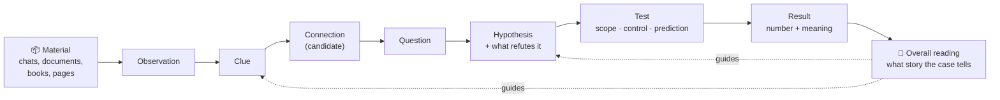
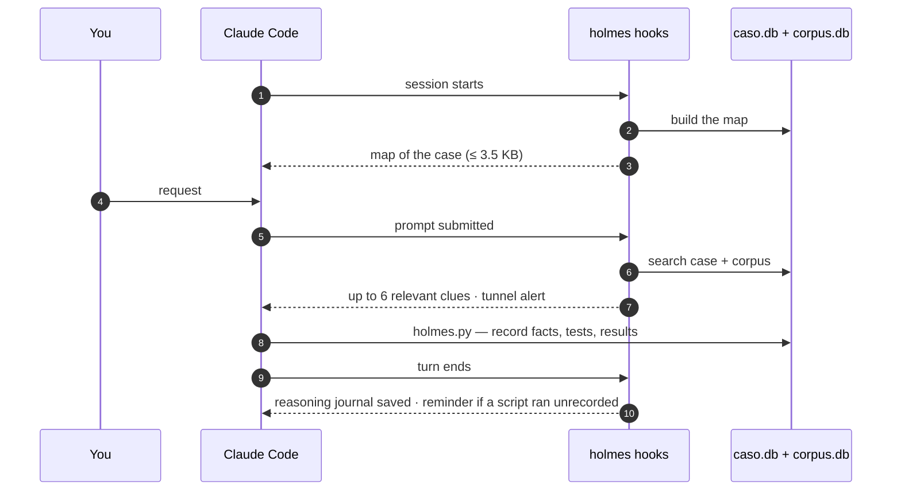

# 🔎 holmes 2.0

**English** · [Português](README.pt-BR.md)


**A kit that lets Claude Code run long investigations without losing the thread, fooling itself, or
repeating work.**

It fits any investigation where evidence arrives in fragments, several explanations compete, and jumping to
a conclusion is costly:

| | |
|---|---|
| 🧩 **Riddles and puzzles** | layered clues, ciphers, hints with double meanings |
| 🔎 **Audits and data forensics** | spreadsheets, logs, transactions, whatever doesn't add up |
| 📚 **Research** | literature, historical sources, fact-checking, "who said what, and where" |
| 🐛 **Hard debugging** | intermittent failures, many possible causes, expensive tests |
| 🕵️ **Inquiries** | timelines, entities, contradictions between accounts |

> [!NOTE]
> The method, rules, skills, agents and CLI are written in Portuguese (commands such as `mapa`, `hipotese`,
> `teste`). Claude reads them fine and works with you in English.

## The problem it solves

An AI agent in a long investigation fails in the same ways every time:

- 🧭 it **forgets the plan** after a few hours;
- 🔁 it **re-tests** what it already tested;
- 🕳️ it treats **"I didn't find it" as "it doesn't exist"**;
- 🎯 it finds a **pattern it drew around the data** itself;
- 📜 it reads a clue **literally** when it meant something else.

holmes was designed around these failures, observed across 64 real sessions of an investigation that lasted
several weeks ([LICOES.md](LICOES.md), in Portuguese).

## How it works



- **The plan is a query, not a document.** All reasoning lives in one SQLite database per case:
  objective, fronts, hypotheses with refutation criteria, tests, results, facts with origin and grade, user
  decisions, open threads. Every session opens with a `mapa` (map) of at most 3.5 KB generated from the
  database. Everything else is pulled by id when needed, so the case fits in the context window however big
  it grows.
- **Material lives in a searchable corpus.** Chats, documents, books and pages are split into chunks and
  indexed (BM25, literal, vector or hybrid). The agent searches and quotes the literal passage instead of
  opening huge files.
- **Rigor where it matters.** Every hypothesis states what would refute it. Every test declares what it
  covers and what it doesn't. A negative without a registered instrument counts as "indeterminate", and
  nothing is ever "exhausted", only "0 in &lt;scope&gt;". Claims from third parties or other AIs enter at
  low grade until checked against the primary source.
- **Reading for meaning, not just mechanics.** A clue is read in layers (literal, figurative, allusion,
  function, subliminal, absence) before it becomes an operation. When something changes the picture, the
  map asks for an *overall reading*: what story the case seems to tell and where we are in it.
- **A team of specialized agents**, each with a narrow role: archivist, researcher, analyst, interpreter,
  engineer, reviewer, blind verifier and devil's advocate.

### Hooks keep the agent on the method



> [!TIP]
> Everything runs on the Python standard library and SQLite. No server, no external service, no
> `pip install`.

## Quick start

```bash
git clone https://github.com/jhonymiler/holmes.git my-investigation && cd my-investigation
python3 -I holmes/test_holmes.py                                  # self-check
python3 -I holmes/holmes.py init my-case "One sentence with a verifiable objective"
```

Fill in `casos/my-case/CASO.md` and the "Ambiente" (environment) section of `CLAUDE.md`, then open Claude
Code at the root. The first time, Claude Code asks you to trust the folder so the hooks can load.

> [!IMPORTANT]
> **Getting updates.** Keep this repository as a remote and run `git pull origin main`. Case data lives in
> `casos/` and `corpus/`, which don't exist here, so updates never touch your investigation. Make framework
> changes in separate commits from case changes, so they can be sent back upstream.

## Parts

```
CLAUDE.md                        project instructions template (machine facts go only here)
.claude/settings.json            holmes hooks (work in the CLI, VS Code and the app)
.claude/rules/constituicao.md    22 rules for every session
.claude/skills/detetive/         the method (SKILL.md + references/ on demand)
.claude/skills/leitura/          reading for meaning: layers, test output, overall reading
.claude/skills/conferir-relatorio/  check a subagent/AI report against the primary source
.claude/skills/holmes/           optional mod: only trims long Bash output
.claude/agents/                  arquivista, pesquisador, analista, interprete, engenheiro, revisor, verificador, ceticismo
holmes/holmes.py                 reasoning database (caso.db) and CLI
holmes/corpus.py                 material database (corpus.db): chats, documents, books; BM25, literal, vector
holmes/hooks.py                  what the hooks run
holmes/test_holmes.py            hermetic tests
holmes/aval/                     synthetic case with answer key (relojoeiro.json) and evaluator (aval.py)
casos/<case>/                    CASO.md (≤ 2 KB, by hand) · MAPA.md (generated) · fontes/ scripts/ saidas/ notas/
corpus/corpus.db                 created on the first `fonte` / `corpus.py add`
```

Optional: `numpy` speeds up vector search; `pdftotext` indexes PDFs.

## The two databases

| | `casos/<case>/caso.db` (reasoning) | `corpus/corpus.db` (material) |
|---|---|---|
| Holds | objective, targets, fronts, questions, hypotheses, assumptions, tests, runs, facts, entities, decisions, threads, sources, instruments, readings, candidate connections | chats, documents, books and pages in chunks, with the raw text |
| Size | small: title ≤ 160, summary ≤ 800 | large; never injected |
| Query | `mapa`, `ver`, `busca`, `ja`, `ach`, `saude` | `corpus.py busca` (bm25, literal, vector, hybrid), `janela`, `ver` |
| Link | `fonte` registers the file and indexes it; `cita <chunk>` copies the literal passage into a fact | — |

Full data model, with diagrams: [MODELO.md](MODELO.md).

## Reference

<details>
<summary><b>Case commands</b> — <code>python3 -I holmes/holmes.py …</code></summary>

| For | Command |
|---|---|
| case | `init <case> "<objective>"` · `usa <case>` (switch) · `casos` (list) |
| path | `ficha` (one page) · `arvore [id]` · `trilha [B..]` · `ramo novo "<question>" --de <id> [--passo N] --porque ".."` · `ramo usa B..` · `passo <leu\|pensou\|testou\|achou\|corrigiu\|decidiu\|proximo> ".." --porque ".."` |
| orientation | `mapa [--tudo]` · `proximo` (what next, and why) · `ver <id>` · `cadeia <id>` (what it rests on) · `questoes` · `cronologia` · `busca "<txt>"` · `ja "<txt>"` (already tested?) · `saude` (health) |
| overall reading | `leitura "<picture>" [--sustenta E,..] [--enfraquece] [--rival H,..] [--questao Q] [--lacuna Q,..] [--motivo]` · `leitura` (show current) |
| create | `novo <type> "<title>" --pai ..` (types: alvo, frente, questao, hipotese, premissa, fato, entidade, decisao, fio) |
| extract | `extrai <contract.json> [--aplica] [--so ..] [--rejeita ..]` (observation, clue, interpretation, question, hypothesis, connection; contract in MODELO.md) |
| relate | `conexoes <id\|"text">` (candidates; query) · `conexao <from> <to> <relation> "<why>" [--rival] [--discriminador]` · `estado C.. confirmada\|rejeitada "<reason>"` |
| hypotheses | `prob <H> 0.4 "<reason>"` · `ach <E> <H> CC\|C\|N\|I\|II` · `ach <F>` (matrix) |
| test | `teste <H> "<t>" --alcance .. --porque .. [--exploratorio]` · `roda <T> --pid --log` · `resultado <T> <res> "<note>" [--sentido ".."]` · `jobs` |
| sources | `fonte <file\|folder\|url>` · `cita <chunk> "<claim>"` · `confere <E> "<where>"` |
| change | `estado <id> <state> "<reason>"` · `edita <id> [--refuta-se]` · `liga`/`desliga <from> <type> <to>` · `atributo <N> <key> <value>` |
| prove | `instrumento <path> "<name>" --verificador "<cmd>"` · `prova` (list) · `prova --executa [--legado]` |

</details>

<details>
<summary><b>Corpus commands</b> — <code>python3 -I holmes/corpus.py …</code></summary>

| For | Command |
|---|---|
| add | `add <collection> <file\|folder>` (Telegram Desktop chat export, JSONL messages, md/txt/html/json, PDF) |
| search | `busca "<txt>" [-c collection] [--autor] [--modo bm25\|literal\|vetor\|hibrido]` |
| read | `ver <chunk>` · `janela <collection> <msg_id> [-k 5]` (conversation around a message) |
| manage | `colecoes` · `embed` (needs `HOLMES_EMBED_URL`, Ollama-compatible, and `HOLMES_EMBED_MODELO`) |

</details>

<details>
<summary><b>Hooks</b> — what runs on each event</summary>

| Event | Does | Injects |
|---|---|---|
| SessionStart | map of the active case; after compaction or resume, also the tail of the journal | ≤ 6 KB |
| UserPromptSubmit | up to 6 lines from the case and corpus about the request, without repeats in the session; tunnel and pending-reading alerts | ≤ 1.5 KB |
| PreToolUse (Bash) | blocks `pkill -f` | reason to the agent |
| PostToolUse (Bash) | a case script ran with no open test citing it → reminder | 1 line |
| tool.call (Bash, optional mod) | trims output above 4,000 characters (full copy in `/tmp/holmes-saidas/`) | reduces |
| Stop | rewrites the journal; asks once for recording if a case script ran without calling `holmes.py` | 1 line |
| PreCompact | rewrites the journal | 0 |

The mod `.claude/skills/holmes/` is optional and only trims long Bash output; it duplicates no hook. With
`claude -p` it only loads with `--plugin-dir .claude/skills/holmes`.

</details>

<details>
<summary><b>Environment variables</b></summary>

| Variable | Default | Purpose |
|---|---|---|
| `HOLMES_RAIZ` · `HOLMES_CASOS` · `HOLMES_CASO` · `HOLMES_CORPUS` | project paths | where things live |
| `HOLMES_TUNEL` | 5 | negatives in a row before the tunnel alert |
| `HOLMES_LEITURA` | 6 | results before the overall-reading reminder |
| `HOLMES_MAX_DIARIO` | 120000 | journal size (characters) |
| `HOLMES_LIMITE_SAIDA` | 4000 | Bash output trimming (0 disables) |
| `HOLMES_EMBED_URL` · `HOLMES_EMBED_MODELO` | — | embedding server for vector search |

</details>

## Verified

- ✅ `holmes/test_holmes.py`: 12 tests. They cover the tree and limits, runs and validity (control seen,
  versioned script, exploratory), tunnel, versioned instrument, corpus in all four modes, citation, aliases,
  transitive dependencies, contradictions, ACH (analysis of competing hypotheses), hooks, reading tied to
  its basis, `--sentido`, legacy items kept out of alerts, the path extraction → candidate connection →
  edge → reading, branches forked from a step, path, tree and one-page sheet, and the synthetic case.
- ✅ `holmes/aval/aval.py recuperacao`: relation discovery measured against an answer key (numbers and
  limits in `holmes/aval/README.md`).
- ✅ Stop hook on an 80 MB transcript: 4.6 s → 0.25 s by reading only the tail, with an identical journal.
- ✅ `claude plugin validate` and `claude plugin test .claude/skills/holmes` (trimming): pass.
- ✅ Real session with `--plugin-dir`: without reading any file, the agent answered with the case, the
  hypothesis with its probability, and the user's decision.

> [!WARNING]
> Not yet done: an evaluation with a real model end to end. The protocol is in `holmes/aval/README.md`.

## License

[MIT](LICENSE) © 2026 Jhony Miler
