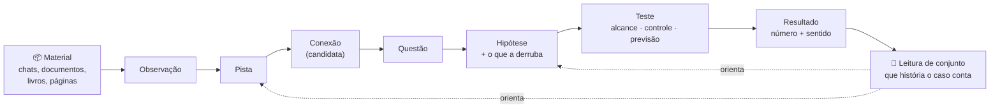
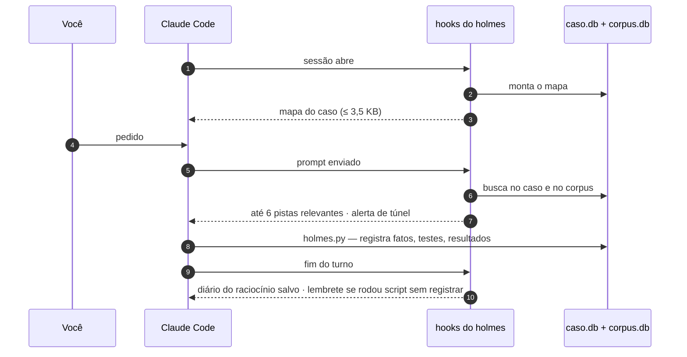

# 🔎 holmes 2.0

[English](README.md) · **Português**


**Um kit para o Claude Code conduzir investigações longas sem perder o fio, sem se enganar e sem repetir
trabalho.**

Serve para qualquer investigação em que a evidência chega em pedaços, há várias explicações possíveis e
concluir cedo demais custa caro:

| | |
|---|---|
| 🧩 **Enigmas e puzzles** | charadas em camadas, cifras, pistas com duplo sentido |
| 🔎 **Auditoria e perícia de dados** | planilhas, logs, transações, o que não fecha |
| 📚 **Pesquisa** | literatura, fontes históricas, checagem de fatos, "quem disse o quê e onde" |
| 🐛 **Depuração difícil** | falha intermitente, várias causas possíveis, testes caros |
| 🕵️ **Apuração** | linha do tempo, entidades, contradições entre relatos |

## O problema que ele resolve

Um agente de IA numa investigação longa erra sempre do mesmo jeito:

- 🧭 **esquece o plano** depois de umas horas;
- 🔁 **testa de novo** o que já tinha testado;
- 🕳️ trata **"não achei" como "não existe"**;
- 🎯 encontra um **padrão que ele mesmo desenhou** em volta dos dados;
- 📜 lê uma pista **ao pé da letra** quando ela queria dizer outra coisa.

O holmes foi desenhado a partir dessas falhas, observadas em 64 sessões reais de uma investigação de várias
semanas ([LICOES.md](LICOES.md), em inglês, como toda a documentação além deste README).

## Como ele funciona



- **O plano é uma consulta, não um documento.** Todo o raciocínio vive num banco SQLite por caso:
  objetivo, frentes, hipóteses com critério de refutação, testes, resultados, fatos com origem e grau,
  decisões do usuário, pendências. Cada sessão abre com um `mapa` de até 3,5 KB, gerado do banco. O resto
  é puxado por id quando preciso, e o caso cabe na janela de contexto por maior que fique.
- **O percurso é uma árvore.** Cada linha de raciocínio é um *ramo* que nasce de um ponto (uma questão, uma
  hipótese, um passo de outro ramo) e acumula *passos* com o porquê, como commits. Dá para voltar a um passo
  e abrir outra direção (um fork) sem apagar nada; `trilha` refaz o caminho da raiz até qualquer ramo, e
  `ficha` diz numa página onde estamos e por quê. Exemplo comentado (em inglês) em [EXEMPLO.md](EXEMPLO.md).
- **O material fica num corpus pesquisável.** Chats, documentos, livros e páginas são cortados em pedaços e
  indexados (BM25, literal, vetorial ou híbrido). O agente busca e cita o trecho literal em vez de abrir
  arquivos enormes.
- **Rigor onde importa.** Toda hipótese diz o que a derrubaria. Todo teste declara o que cobre e o que não
  cobre. Um negativo sem instrumento registrado vale "indeterminado", e nunca se escreve "esgotado", só
  "0 em &lt;alcance&gt;". Afirmação de terceiro ou de outra IA entra com grau baixo até ser conferida na
  fonte.
- **Leitura de sentido, não só mecânica.** Uma pista se lê em camadas (literal, figurada, alusão, função,
  subliminar, ausência) antes de virar operação. Quando algo muda o quadro, o mapa pede uma *leitura de
  conjunto*: que história o caso parece contar e onde estamos nela.
- **Um time de agentes especializados**, cada um com papel limitado: arquivista, pesquisador, analista,
  intérprete, engenheiro, revisor, verificador cego e advogado do diabo.

### Hooks mantêm o agente no método



> [!TIP]
> Tudo roda com a biblioteca padrão do Python e SQLite. Sem servidor, sem serviço externo, sem
> `pip install`.

## Começar

```bash
git clone https://github.com/jhonymiler/holmes.git minha-investigacao && cd minha-investigacao
python3 -I holmes/test_holmes.py                                  # autoteste
python3 -I holmes/holmes.py init meu-caso "Uma frase com o objetivo verificável"
```

Preencha `casos/meu-caso/CASO.md` e a seção "Ambiente" do `CLAUDE.md`, e abra o Claude Code na raiz. Na
primeira vez o Claude Code pede confiança na pasta para carregar os hooks.

> [!IMPORTANT]
> **Receber atualizações.** Mantenha este repositório como remote e rode `git pull origin main`. Os dados do
> caso ficam em `casos/` e `corpus/`, que não existem aqui, então a atualização não esbarra na sua
> investigação. Faça mudanças no framework em commits separados das mudanças do caso, para poder mandá-las
> de volta.

## Peças

```
CLAUDE.md                        modelo de instruções do projeto (fatos de máquina ficam só aqui)
.claude/settings.json            os hooks do holmes (valem no CLI, no VS Code e no app)
.claude/rules/constituicao.md    26 regras de toda sessão
.claude/skills/detetive/         o método (SKILL.md + references/ sob demanda)
.claude/skills/leitura/          leitura de sentido: camadas, saída de teste, leitura de conjunto
.claude/skills/conferir-relatorio/  confere relatório de subagente ou IA na fonte primária
.claude/skills/holmes/           mod opcional: só a poda de saídas longas do Bash
.claude/agents/                  arquivista, pesquisador, analista, interprete, engenheiro, revisor, verificador, ceticismo
holmes/holmes.py                 banco do raciocínio (caso.db) e CLI
holmes/corpus.py                 banco do material (corpus.db): chat, documentos, livros; BM25, literal, vetorial
holmes/hooks.py                  o que os hooks executam
holmes/test_holmes.py            testes herméticos
holmes/aval/                     caso sintético com gabarito (relojoeiro.json) e avaliador (aval.py)
casos/<caso>/                    CASO.md (≤ 2 KB, à mão) · MAPA.md (gerado) · fontes/ scripts/ saidas/ notas/
corpus/corpus.db                 criado no primeiro `fonte`/`corpus.py add`
```

Opcionais: `numpy` acelera a busca vetorial; `pdftotext` indexa PDF.

## Os dois bancos

| | `casos/<caso>/caso.db` (raciocínio) | `corpus/corpus.db` (material) |
|---|---|---|
| Guarda | objetivo, alvos, frentes, questões, hipóteses, premissas, testes, execuções, fatos, entidades, decisões, fios, fontes, instrumentos, leituras, conexões candidatas | chats, documentos, livros e páginas em pedaços, com o texto cru |
| Tamanho | pequeno: título ≤ 160, resumo ≤ 800 | grande; nunca injetado |
| Consulta | `mapa`, `ver`, `busca`, `ja`, `ach`, `saude` | `corpus.py busca` (bm25, literal, vetor, híbrido), `janela`, `ver` |
| Ligação | `fonte` registra o arquivo e o indexa no corpus; `cita <pedaço>` copia o trecho literal para um fato | — |

Modelo de dados completo, com diagramas: [MODELO.md](MODELO.md). Um caso fictício do começo ao fim, com fluxogramas e as saídas reais de cada comando: [EXEMPLO.md](EXEMPLO.md).

## Referência

<details>
<summary><b>Comandos do caso</b> — <code>python3 -I holmes/holmes.py …</code></summary>

| Para | Comando |
|---|---|
| caso | `init <caso> "<objetivo>"` · `usa <caso>` · `casos` |
| percurso | `ficha` (uma página) · `arvore [id]` · `trilha [B..]` · `ramo novo "<pergunta>" --de <id> [--passo N] --porque ".."` · `ramo usa B..` · `passo <leu\|pensou\|testou\|achou\|corrigiu\|decidiu\|proximo> ".." --porque ".."` |
| orientar-se | `mapa [--tudo]` · `proximo` · `ver <id>` · `cadeia <id>` · `questoes` · `cronologia` · `busca "<txt>"` · `ja "<txt>"` (já testado?) · `saude` |
| ler o todo | `leitura "<quadro>" [--sustenta E,..] [--enfraquece] [--rival H,..] [--questao Q] [--lacuna Q,..] [--motivo]` · `leitura` (mostra a atual) |
| criar | `novo <tipo> "<título>" --pai ..` (tipos: alvo, frente, questao, hipotese, premissa, fato (exige `--por`), pista, entidade, decisao, fio) |
| extrair | `extrai <contrato.json> [--aplica] [--so ..] [--rejeita ..]` (observação, pista, interpretação, questão, hipótese, conexão; contrato em MODELO.md) |
| relacionar | `conexoes <id\|"texto">` (candidatas; consulta) · `conexao <de> <para> <relação> "<por quê>" [--rival] [--discriminador]` · `estado C.. confirmada\|rejeitada "<motivo>"` |
| hipóteses | `prob <H> 0.4 "<motivo>"` · `ach <E> <H> CC\|C\|N\|I\|II` · `ach <F>` (matriz) |
| testar | `teste <H> "<t>" --alcance .. --porque .. [--exploratorio]` · `roda <T> --pid --log` · `resultado <T> <res> "<nota>" [--sentido ".."]` · `jobs` |
| fontes | `fonte <arquivo\|pasta\|url>` · `cita <pedaço> "<afirmação>"` · `confere K.. "<nota>" --por fonte\|medicao\|teste\|reproducao [--prova ..]` (prova uma pista e ela vira fato; a prova não precisa ser fonte) · `reorganiza [--aplica]` (banco antigo → só fatos provados, pistas, passos religados) |
| mudar | `estado <id> <estado> "<motivo>"` · `edita <id> [--refuta-se]` · `liga`/`desliga <de> <tipo> <para>` · `atributo <N> <chave> <valor>` |
| provar | `instrumento <caminho> "<nome>" --verificador "<cmd>"` · `prova` (lista) · `prova --executa [--legado]` |

</details>

<details>
<summary><b>Comandos do corpus</b> — <code>python3 -I holmes/corpus.py …</code></summary>

| Para | Comando |
|---|---|
| adicionar | `add <coleção> <arquivo\|pasta>` (chat do Telegram Desktop, JSONL de mensagens, md/txt/html/json, PDF) |
| buscar | `busca "<txt>" [-c coleção] [--autor] [--modo bm25\|literal\|vetor\|hibrido]` |
| ler | `ver <pedaço>` · `janela <coleção> <msg_id> [-k 5]` (conversa ao redor de uma mensagem) |
| gerir | `colecoes` · `embed` (precisa de `HOLMES_EMBED_URL`, compatível com Ollama, e `HOLMES_EMBED_MODELO`) |

</details>

<details>
<summary><b>Hooks</b> — o que roda em cada evento</summary>

| Evento | Faz | Injeta |
|---|---|---|
| SessionStart | mapa do caso ativo; após compactar ou retomar, também a cauda do diário | ≤ 6 KB |
| UserPromptSubmit | até 6 linhas do caso e do corpus sobre o pedido, sem repetir na sessão; alertas de túnel e de leitura pendente | ≤ 1,5 KB |
| PreToolUse (Bash) | nega `pkill -f` | motivo ao agente |
| PostToolUse (Bash) | script do caso rodou sem teste aberto que o cite → lembrete | 1 linha |
| tool.call (Bash, mod opcional) | poda saída acima de 4.000 caracteres (inteira em `/tmp/holmes-saidas/`) | reduz |
| Stop | regrava o diário; cobra registro uma vez se rodou script do caso sem chamar `holmes.py` | 1 linha |
| PreCompact | regrava o diário | 0 |

O mod `.claude/skills/holmes/` é opcional e só poda saídas longas do Bash; ele não repete nenhum hook. Em
`claude -p` ele só carrega com `--plugin-dir .claude/skills/holmes`.

</details>

<details>
<summary><b>Variáveis de ambiente</b></summary>

| Variável | Padrão | Para quê |
|---|---|---|
| `HOLMES_RAIZ` · `HOLMES_CASOS` · `HOLMES_CASO` · `HOLMES_CORPUS` | caminhos do projeto | onde ficam as coisas |
| `HOLMES_TUNEL` | 5 | negativos seguidos antes do alerta de túnel |
| `HOLMES_LEITURA` | 6 | resultados antes do lembrete de leitura de conjunto |
| `HOLMES_MAX_DIARIO` | 120000 | tamanho do diário (caracteres) |
| `HOLMES_LIMITE_SAIDA` | 4000 | poda de saída do Bash (0 desliga) |
| `HOLMES_EMBED_URL` · `HOLMES_EMBED_MODELO` | — | servidor de embeddings para a busca vetorial |

</details>

## Verificado

- ✅ `holmes/test_holmes.py`: 13 testes. Cobrem árvore e limites, execuções e validade (controle visto,
  script versionado, exploratório), túnel, instrumento versionado, corpus nos quatro modos, citação,
  aliases, dependências transitivas, contradições, ACH, hooks, leitura ligada à base, `--sentido`, legado
  fora dos alertas, o percurso extração → conexão candidata → aresta → leitura, ramos com fork de um passo, trilha, árvore e ficha, fato só provado e pista promovida por prova, reorganização de banco antigo, e o caso sintético.
- ✅ `holmes/aval/aval.py recuperacao`: descoberta de relações medida contra gabarito (números e limites em
  `holmes/aval/README.md`).
- ✅ Hook Stop num transcript de 80 MB: 4,6 s → 0,25 s lendo só a cauda, com diário idêntico.
- ✅ `claude plugin validate` e `claude plugin test .claude/skills/holmes` (poda): passam.
- ✅ Sessão real com `--plugin-dir`: sem ler nenhum arquivo, o agente respondeu o caso, a hipótese com a
  probabilidade e a decisão do usuário.

> [!WARNING]
> Ainda não feito: avaliação de ponta a ponta com um modelo real. O protocolo está em `holmes/aval/README.md`.

## Licença

[MIT](LICENSE) © 2026 Jhony Miler
