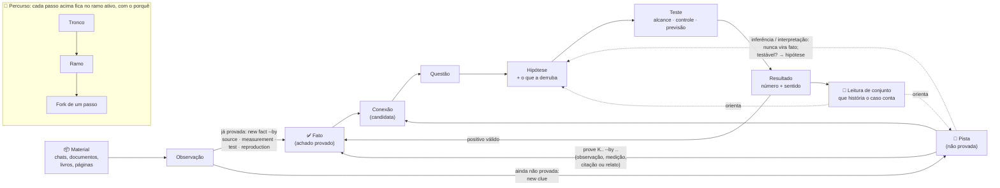
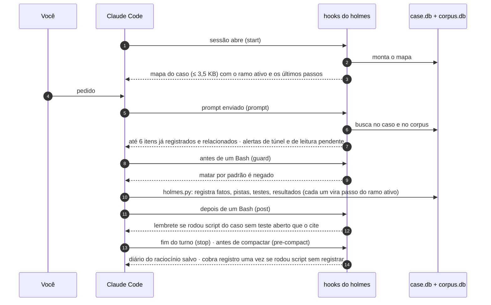

# 🔎 holmes 2.0

[English](README.md) · **Português**


**Um kit para o Claude Code conduzir investigações longas sem perder o fio, sem se enganar e sem repetir
trabalho.**

Serve para qualquer investigação em que a evidência chega em pedaços, há várias explicações possíveis e
concluir cedo demais custa caro:

| | |
|---|---|
| 🧩 **Enigmas e puzzles** | charadas em camadas, cifras, pistas com duplo sentido |
| 🔎 **Auditoria e perícia de dados** | planilhas, logs, transações, o que não fecha |
| 📚 **Pesquisa** | literatura, fontes históricas, checagem de fatos, "quem disse o quê e onde" |
| 🐛 **Depuração difícil** | falha intermitente, várias causas possíveis, testes caros |
| 🕵️ **Apuração** | linha do tempo, entidades, contradições entre relatos |

> [!NOTE]
> Este README é o único documento em português. Todo o resto está em inglês: documentação, regras, skills,
> agentes e a própria CLI, com seus estados e rótulos de saída.

## O problema que ele resolve

Um agente de IA numa investigação longa erra sempre do mesmo jeito:

- 🧭 **esquece o plano** depois de umas horas;
- 🔁 **testa de novo** o que já tinha testado;
- 🕳️ trata **"não achei" como "não existe"**;
- 🎯 encontra um **padrão que ele mesmo desenhou** em volta dos dados;
- 📜 lê uma pista **ao pé da letra** quando ela queria dizer outra coisa.

O holmes foi desenhado a partir dessas falhas, observadas em 64 sessões reais de uma investigação de várias
semanas ([LESSONS.md](LESSONS.md)).

## Como ele funciona



- **O plano é uma consulta, não um documento.** Todo o raciocínio vive num banco SQLite por caso:
  objetivo, frentes, hipóteses com critério de refutação, testes, resultados, fatos com origem e grau,
  decisões do usuário, pendências. Cada sessão abre com um `map` de até 3,5 KB, gerado do banco, que inclui o
  ramo ativo. O resto é puxado por id quando preciso, e o caso cabe na janela de contexto por maior que fique.
- **Fato é provado, pista não.** Fato é um achado já provado por fonte, medição, teste ou reprodução
  (`new fact --by ..`). O que ainda não foi provado é pista (`new clue`). Uma pista de observação ou de relato
  vira fato com `prove`; uma inferência nunca vira: continua pista ou vira hipótese.
- **O percurso é uma árvore.** Cada linha de raciocínio é um *ramo* que nasce de um ponto (uma questão, uma
  hipótese, um passo de outro ramo) e acumula *passos* com o porquê, como commits. Dá para voltar a um passo
  e abrir outra direção (um fork) sem apagar nada; `trail` refaz o caminho da raiz até qualquer ramo, `tree`
  mostra todas as linhas e onde cada uma nasceu, e `sheet` diz numa página onde estamos e por quê. Exemplo
  comentado (em inglês) em [EXAMPLE.md](EXAMPLE.md).
- **O material fica num corpus pesquisável.** Chats, documentos, livros e páginas são cortados em pedaços e
  indexados (BM25, literal, vetorial ou híbrido). O agente busca e cita o trecho literal em vez de abrir
  arquivos enormes.
- **Rigor onde importa.** Toda hipótese diz o que a derrubaria. Todo teste declara o que cobre e o que não
  cobre. Um negativo sem instrumento registrado vale INDETERMINATE (indeterminado), e nunca se escreve
  "esgotado", só "0 em &lt;alcance&gt;". Afirmação de terceiro ou de outra IA entra com grau baixo até ser
  conferida na fonte.
- **Leitura de sentido, não só mecânica.** Uma pista se lê em camadas (literal, figurada, alusão, função,
  subliminar, ausência) antes de virar operação. Quando algo muda o quadro, o mapa pede uma *leitura de
  conjunto*: que história o caso parece contar e onde estamos nela.
- **Um time de agentes especializados**, cada um com papel limitado: arquivista, pesquisador, analista,
  intérprete, engenheiro, revisor, verificador cego e cético (advogado do diabo).

### Hooks mantêm o agente no método



> [!TIP]
> Tudo roda com a biblioteca padrão do Python e SQLite. Sem servidor, sem serviço externo, sem
> `pip install`.

## Começar

```bash
git clone https://github.com/jhonymiler/holmes.git minha-investigacao && cd minha-investigacao
python3 -I holmes/test_holmes.py                                  # autoteste
python3 -I holmes/holmes.py init meu-caso "Uma frase com o objetivo verificável"
```

O `init` cria `cases/meu-caso/` (com `case.db`, `CASE.md`, `sources/`, `outputs/`, `notes/`, `scripts/`) e o
torna o caso ativo. Preencha `cases/meu-caso/CASE.md` e a seção "This machine's environment" do `CLAUDE.md`, e
abra o Claude Code na raiz. Na primeira vez o Claude Code pede confiança na pasta para carregar os hooks.

Uma primeira sessão costuma ser assim (os ids são os que um caso novo dá):

```bash
H() { python3 -I holmes/holmes.py "$@"; }
H map                                                             # onde estamos (o hook start também injeta)
H source cases/meu-caso/sources/relatorio.txt                     # S2: registra a fonte e a indexa
H new front "Quem assinou o relatório" --parent O1                # F3
H branch new "Quem assinou?" --from F3 --why "a assinatura é a primeira questão aberta"    # B4, agora ativo
H new clue "A assinatura parece a do diretor" --nature observation                       # K5: ainda não provada
H prove K5 "bate com a assinatura do contrato de 2019" --by source --location "contrato, p. 3"    # K5 → E5
H step thought "se o diretor assinou, a data está errada" --why "o diretor estava fora naquela semana"
H tried "assinatura"                                              # já testado?
H sheet                                                           # uma página: onde estamos e por quê
```

> [!IMPORTANT]
> **Receber atualizações.** Mantenha este repositório como remote e rode `git pull origin main`. Os dados do
> caso ficam em `cases/` e `corpus/`, que não existem aqui, então a atualização não esbarra na sua
> investigação. Faça mudanças no framework em commits separados das mudanças do caso, para poder mandá-las
> de volta.

## Peças

```
CLAUDE.md                        modelo de instruções do projeto (fatos de máquina ficam só aqui)
MODEL.md                         modelo de dados, com diagramas
EXAMPLE.md                       um caso fictício do começo ao fim, com as saídas reais dos comandos
LESSONS.md                       por que cada regra existe
.claude/settings.json            os hooks do holmes (valem no CLI, no VS Code e no app)
.claude/rules/constitution.md    26 regras de toda sessão
.claude/skills/detective/        o método (SKILL.md + references/ sob demanda)
.claude/skills/reading/          leitura de sentido: camadas, saída de teste, leitura de conjunto
.claude/skills/check-report/     confere relatório de subagente ou IA na fonte primária
.claude/skills/holmes/           mod opcional: só a poda de saídas longas do Bash
.claude/agents/                  analyst, archivist, engineer, interpreter, researcher, reviewer, skeptic, verifier
holmes/holmes.py                 banco do raciocínio (case.db) e CLI
holmes/corpus.py                 banco do material (corpus.db): chat, documentos, livros; BM25, literal, vetorial
holmes/hooks.py                  o que os hooks executam
holmes/test_holmes.py            testes herméticos
holmes/eval/                     caso sintético com gabarito (watchmaker.json) e avaliador (evaluate.py)
cases/<caso>/                    case.db · CASE.md (≤ 2 KB, à mão) · MAP.md (gerado) · sources/ outputs/ notes/ scripts/
corpus/corpus.db                 criado no primeiro `source` / `corpus.py add`
.holmes/                         estado local: caso ativo, ramo ativo, diário por sessão (escrito pelos hooks)
```

Opcionais: `numpy` acelera a busca vetorial; `pdftotext` indexa PDF.

## Os dois bancos

| | `cases/<caso>/case.db` (raciocínio) | `corpus/corpus.db` (material) |
|---|---|---|
| Guarda | objetivo, alvos, frentes, questões, hipóteses, premissas, testes, execuções, fatos, pistas, entidades, decisões, fios, fontes, instrumentos, leituras, conexões candidatas, ramos e passos | chats, documentos, livros e páginas em pedaços, com o texto cru |
| Tamanho | pequeno: título ≤ 160, resumo ≤ 800 | grande; nunca injetado |
| Consulta | `map`, `show`, `search`, `tried`, `dossier`, `ach`, `health` | `corpus.py search` (bm25, literal, vector, hybrid), `window`, `show` |
| Ligação | `source` registra o arquivo e o indexa no corpus; `quote <pedaço>` copia o trecho literal para um fato | — |

Modelo de dados completo, com diagramas: [MODEL.md](MODEL.md). Um caso fictício do começo ao fim, com fluxogramas
e as saídas reais de cada comando: [EXAMPLE.md](EXAMPLE.md).

## Referência

<details>
<summary><b>Comandos do caso</b> — <code>python3 -I holmes/holmes.py …</code></summary>

| Para | Comando |
|---|---|
| caso | `init <caso> "<objetivo>"` · `use <caso>` (trocar) · `cases` (listar) |
| percurso | `sheet` (uma página) · `tree [id]` · `trail [B..]` · `branch new "<pergunta>" --from <id> [--step N] --why ".." [--no-use]` · `branch use B..` · `branch release` · `step <read\|thought\|tested\|found\|corrected\|decided\|next> ".." --why ".."` |
| orientar-se | `map [--all]` · `next` (o que fazer e por quê) · `show <id>` · `chain <id>` (no que se apoia) · `questions` · `timeline` · `search "<txt>" [--literal]` · `tried "<txt>" [--literal]` (já testado? também avisa termos listados como OUTSIDE) · `dossier "<termos>" [--hops 2]` (o encadeamento de um tema: itens achados pelo conteúdo, suas ligações e os passos que os citam) · `health` |
| ler o todo | `reading "<quadro>" [--supports E,..] [--weakens ..] [--rival H,..] [--question Q] [--gap Q,..] [--reason ".."]` · `reading --keep "<por quê>"` (os eventos não mudam a leitura: responde ao pedido) · `reading` (mostra a atual) |
| criar | `new <tipo> "<título>" --parent ..` (tipos: target, front, question, hypothesis, premise, fact (exige `--by`), clue, entity, decision, thread) |
| extrair | `extract <contrato.json> [--apply] [--only ..] [--reject ..]` (observação, pista, interpretação, questão, hipótese, conexão; contrato em MODEL.md) |
| relacionar | `connections <id\|"texto">` (candidatas; consulta) · `connection <de> <para> <relação> "<por quê>" [--rival ..] [--discriminator ..]` · `state C.. confirmed\|rejected "<motivo>"` |
| hipóteses | `prob <H> 0.4 "<motivo>"` · `ach <E> <H> CC\|C\|N\|I\|II` · `ach <F>` (matriz) |
| testar | `test <H> "<t>" --scope .. --why .. [--outside ..] [--control ..] [--control-type real\|planted\|sabotage\|none] [--exploratory]` · `run <T> --pid --log` · `result <T> positive\|negative\|inconclusive\|failed "<nota>" [--control-ok yes\|no] [--meaning ".."]` · `jobs` |
| fontes | `source <arquivo\|pasta\|url>` · `quote <pedaço> "<afirmação>"` · `prove K.. "<nota>" --by source\|measurement\|test\|reproduction [--proof ..] [--source S..] [--location ..]` (prova uma pista e ela vira fato; a prova não precisa ser fonte) |
| mudar | `state <id> <estado> "<motivo>"` · `edit <id> [--title ..] [--summary ..] [--refuted-if ..]` · `link`/`unlink <de> <tipo> <para>` · `attribute <N> <chave> <valor>` |
| instrumentos | `instrument <caminho> "<nome>" --verifier "<cmd>"` · `proof` (lista) · `proof --execute [--legacy]` |

Estados para `state`, por tipo: hypothesis `alive · supported · refuted · parked`; test `planned · running · done ·
cancelled`; fact `current · contested · retracted`; clue `open · dropped`; connection `suggested · confirmed ·
rejected`; branch `active · paused · dead · merged · concluded`; objective `open · achieved · abandoned`; target
`open · solved · blocked`; front `active · parked · closed · discarded`; premise `assumed · verified · refuted`;
question `open · answered · reformulated · parked`; thread `open · closed · parked`; decision `current · revoked`;
entity `active · merged`; source `catalogued · indexed`; instrument `current · obsolete`; reading
`current · superseded`.

</details>

<details>
<summary><b>Comandos do corpus</b> — <code>python3 -I holmes/corpus.py …</code></summary>

| Para | Comando |
|---|---|
| adicionar | `add <coleção> <arquivo\|pasta> [--type auto\|text\|chat\|pdf]` (chat do Telegram Desktop, JSONL de mensagens, md/txt/html/json, PDF) |
| buscar | `search "<txt>" [-c coleção] [--author ..] [--mode bm25\|literal\|vector\|hybrid] [--where chave=valor]` |
| ler | `show <pedaço>` · `window <coleção> <msg_id> [-k 5]` (conversa ao redor de uma mensagem) |
| gerir | `collections` · `embed [-c coleção] [--batch N]` (precisa de `HOLMES_EMBED_URL`, compatível com Ollama, e `HOLMES_EMBED_MODEL`) |

</details>

<details>
<summary><b>Hooks</b> — o que roda em cada evento</summary>

| Evento | Argumento do `hooks.py` | Faz | Injeta |
|---|---|---|---|
| SessionStart | `start` | mapa do caso ativo com o ramo ativo; após compactar ou retomar, também a cauda do diário | ≈ 6 KB (teto rígido de 9.000 caracteres) |
| UserPromptSubmit | `prompt` | até 6 linhas do caso e do corpus sobre o pedido, sem repetir na sessão; alertas de túnel e de leitura pendente | ≤ 1,5 KB |
| PreToolUse (Bash) | `guard` | nega `pkill -f` (ele casa com o próprio shell) | motivo ao agente |
| PostToolUse (Bash) | `post` | script do caso rodou sem teste aberto que o cite → lembrete | 1 linha |
| Stop | `stop` | regrava o diário; cobra registro uma vez se rodou script do caso sem chamar `holmes.py` | 1 linha |
| PreCompact | `pre-compact` | regrava o diário | 0 |
| tool.call (Bash, mod opcional) | — | poda saída acima de 4.000 caracteres (inteira em `/tmp/holmes-outputs/`) | reduz |

O mod `.claude/skills/holmes/` é opcional e só poda saídas longas do Bash; ele não repete nenhum hook. Em
`claude -p` ele só carrega com `--plugin-dir .claude/skills/holmes`.

</details>

<details>
<summary><b>Variáveis de ambiente</b></summary>

| Variável | Padrão | Para quê |
|---|---|---|
| `HOLMES_ROOT` · `HOLMES_CASES` · `HOLMES_CASE` · `HOLMES_CORPUS` | caminhos do projeto | onde ficam as coisas (`HOLMES_CASE` força o caso) |
| `HOLMES_TUNNEL` | 5 | negativos seguidos antes do alerta de túnel |
| `HOLMES_READING` | 6 | resultados antes do lembrete de leitura de conjunto |
| `HOLMES_MAX_JOURNAL` | 120000 | tamanho do diário (caracteres) |
| `HOLMES_OUTPUT_LIMIT` | 4000 | poda de saída do Bash (0 desliga) |
| `HOLMES_EMBED_URL` · `HOLMES_EMBED_MODEL` | — | servidor de embeddings para a busca vetorial |

</details>

## Verificado

- ✅ `holmes/test_holmes.py`: 12 testes herméticos, que cobrem:
  - a árvore e seus limites, e os alvos;
  - execuções e validade (controle visto, script versionado, modo exploratório) e o alerta de túnel;
  - fatos, fontes, citação, entidades e apelidos;
  - dependências transitivas, contradições, ACH (análise de hipóteses concorrentes) e `health`;
  - a leitura de conjunto ligada à base, `--meaning`, e itens legados fora dos alertas;
  - o corpus nos quatro modos de busca;
  - os hooks;
  - o percurso extração → pista → conexão candidata → questão → hipótese → plano;
  - ramos com fork de um passo, passos, `trail`, `tree` e `sheet`;
  - releitura diante de contradição ou de hipótese central, revalidação de instrumento e retomada após
    compactar;
  - o caso sintético com resposta conhecida.
- ✅ `holmes/eval/evaluate.py recall`: descoberta de relações medida contra gabarito (números e limites em
  `holmes/eval/README.md`).
- ✅ Hook Stop num transcript de 80 MB: 4,6 s → 0,25 s lendo só a cauda, com diário idêntico.
- ✅ `claude plugin validate` e `claude plugin test .claude/skills/holmes` (poda): passam.
- ✅ Sessão real com `--plugin-dir`: sem ler nenhum arquivo, o agente respondeu o caso, a hipótese com a
  probabilidade e a decisão do usuário.

> [!WARNING]
> Ainda não feito: avaliação de ponta a ponta com um modelo real. O protocolo está em `holmes/eval/README.md`.

## Licença

[MIT](LICENSE) © 2026 Jhony Miler
